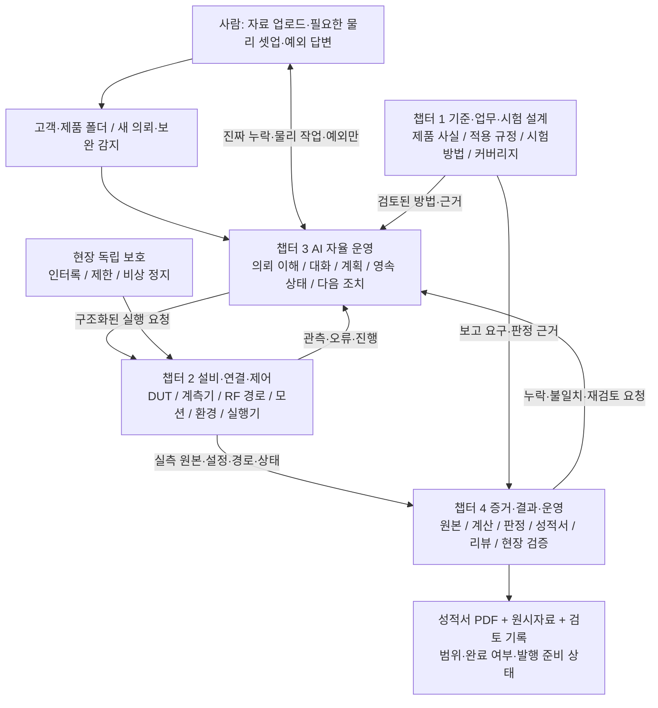
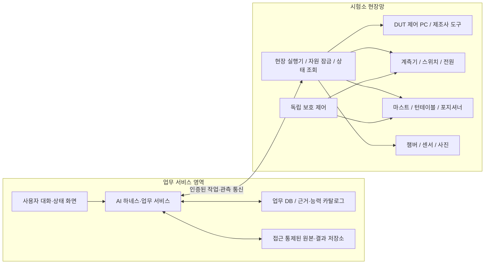
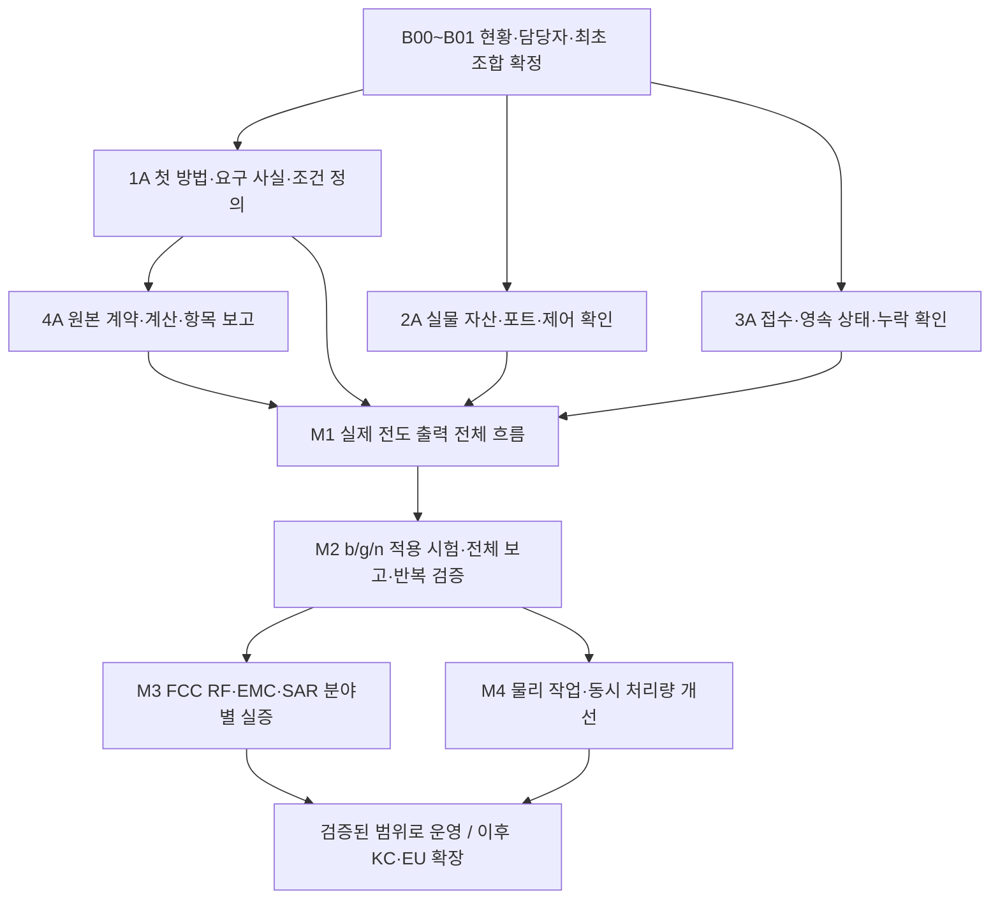

# 0. 전체 구성과 구축 순서

[시작 안내](../../AUTOLAB-BUILD-GUIDE.md) · [작업 양식](05-workbook.md)

## 목적과 성공 모습

고객·제품 자료가 지정 폴더에 들어오면 AI가 새 의뢰인지 보완인지 파악한다. 제품과 의뢰 목적을 읽고 필요한 시험·자료·장비·연결을 정리한다. 이미 위임된 범위에서는 진행하고, 누락 정보나 물리 작업이 필요한 때만 사람에게 요청한다. 실제 DUT와 장비를 제어해 측정하고, 원본에 연결된 성적서와 검토 결과를 남긴다.

첫 구축 분야는 **FCC RF·EMC·SAR**이며, 최초 전체 흐름 검증은 **스마트폰 2.4 GHz Wi-Fi b/g/n / §15.247**이다. 첫 실제 구현 단위는 전도 출력 한 항목이다. 이 항목의 성적서는 단일 항목 보고이며 전체 FCC 시험 완료를 뜻하지 않는다. b/g/n 완료도 스마트폰의 셀룰러·Bluetooth·다른 Wi-Fi·SAR 등 모든 FCC 의무 완료를 뜻하지 않는다.

사람의 역할은 고객·제품 자료 제공, 필요한 물리 연결·교체·배치, 지원 범위 밖의 예외 처리다. 방법 최초 검증과 설비 개발에는 시험 전문가가 참여한다. 일상 운전에서 정상 건마다 전문가가 조건을 골라 주는 구조를 완료 목표로 삼지 않는다. 공식 발행은 기관의 권한·절차에 연결하며 인증기관의 결정과 구분한다.

## 큰 그림: 네 챕터의 연결

| 챕터 | 담당하는 질문 | 핵심 산출물 | 대표 책임 역할 |
|---|---|---|---|
| 1 | 무엇을 왜 어떤 방법으로 시험하는가? | 사실·규칙·시험방법·적용성/조건 행렬 | 시험기술 담당 |
| 2 | 어떤 실제 장비·경로·자세에서 어떻게 측정하는가? | 자산/포트 지도·셋업·어댑터·현장 검증 | 설비·제어 담당 |
| 3 | AI가 어떻게 스스로 일을 이어 가고 사람과 협업하는가? | 접수·대화·작업 큐·실행 계약·복구 | AI/백엔드 담당 |
| 4 | 결과를 믿을 수 있고 재현·보고·운영할 수 있는가? | 원본 묶음·계산·보고·검토·인수 증거 | 데이터·품질 담당 |

한 직원이 여러 역할을 맡아도 된다. 다만 방법 작성자가 만든 예제만으로 방법을 검증하거나, AI 자기 평가만으로 측정 정확성을 인정하지 않는다. 역할표는 [작업 양식](05-workbook.md)에 실명으로 채운다.

## 실제 배치 구조

초기에는 기존 Python/SQLite 기반을 재사용하고 역할별 모듈로 분리한다. 서버 수, 메시지 큐·DB 제품은 개발총괄이 실제 동시성·배포 요구로 결정한다. GUI 전용 제조사 도구는 해당 OS의 현장 PC에서 실행한다. 클라우드 채팅 세션을 상시 운전 서비스로 간주하지 않는다. AI 연결이 끊겨도 현장 장비 상태와 중단 원인이 남아야 한다.

## 직원이 지켜야 할 데이터 연결

`의뢰 → 제품 사실 → 적용 근거 → 계획/방법 → 실제 시료/셋업 → 실행 → 원본 → 계산/판정 → 보고서`

모든 화살표는 ID와 버전으로 연결한다. “비슷한 파일명”이나 AI의 대화 기억만으로 연결하지 않는다. 계획 변경 시 이미 얻은 결과를 자동 재사용하지 않고 영향 여부를 평가한다. 공유 장비는 실제 자산 ID 단위로 예약하고 실행 중 잠근다.

## 구축 전략과 범위

가능한 접근은 전 장비를 먼저 연동하는 방식, 기존 제조사 시험 SW를 통째로 중심에 두는 방식, 한 실제 업무 흐름을 먼저 완성하는 방식이다. 이 문서는 기존 합의대로 **업무 한 흐름 우선**을 채택한다. 전 장비 선행 연동은 최초 결과를 늦추고, 제조사 SW 단독 구성은 접수·근거·다양한 설비 연결을 추가로 해결해야 한다. 기존 SW와 공개 드라이버는 해당 흐름의 구성품으로 우선 재사용한다.

| 구분 | 포함할 것 | 뒤 단계로 넘길 것 |
|---|---|---|
| M1 첫 실제 흐름 | 실제 스마트폰 한 조합, 전도 출력, 접수·누락·셋업·RF 확인·원본·항목 PDF·리뷰 | 전체 장비 지원, 자동 배선·시료 운반 |
| M2 b/g/n 범위 | 적용 시험 전체, 방사/해당 AC 셋업, 조건·커버리지, 전체 범위 보고 | 다른 무선 기능, SAR 실증의 완료 선언 |
| M3 FCC 분야 확장 | 우선 제품군의 RF·EMC·SAR 방법·장비·데이터를 각각 실증 | KC/EU 판본의 단순 복사 적용 |
| M4 물리·처리량 확장 | 반복 수작업 우선 자동화, RF 경로·자세·적재/이동 최적화, 복수 시험건 | 모든 제품을 동일 지그에 맞춘다는 가정 |

M4의 일부인 RF 스위치·마스트·포지셔너는 M2에 필요하면 먼저 넣는다. M4는 자동 시료 이송까지 확장하는 묶음이며 기존 장치 활용을 뒤로 미루라는 의미가 아니다.

## 개발 순서: 챕터를 가로질러 작은 실증을 만든다

| 게이트 | 통과 근거 | 결정 책임 |
|---|---|---|
| G0 시작 준비 | 실제 담당자·범위·기준 조합·자료/현장 미확정 목록 | 개발총괄 + 시험기술/현장 담당 |
| G1 첫 흐름 | 독립 기준과 비교한 실제 전도 출력, 원본 추적 PDF, 중단·재개 증거 | 시험기술 + 품질 담당 |
| G2 b/g/n | 적용 행 전체의 완료/비적용 근거, 방사/AC 포함 해당 셋업, 정상 건 기술 개입 측정 | 시험기술 + 품질 담당 |
| G3 운영 투입 | 지원 조합·허용차·운전량을 사전 확정한 현장 인수, 장애·복원·인계 | 운영 책임자 |
| G4 확장 | 새 분야/장비/규격별 차이 검토와 별도 검증 | 해당 분야 책임자 |

G3는 M1의 제한 운영과 M2/M3의 넓은 운영에서 각각 적용한다. 표의 순서는 문서 번호이며, 넓은 범위가 준비되기 전 제한 범위를 운영할 수 있다. “운영 가능”에는 항상 지원 범위와 버전을 붙인다.

## 현재 자산과 미확정 사항

로컬 기준 커밋에는 장비 대장 6,470행, 제조사·모델 기록 2,867개, 오프라인 공통 코어와 보고 초안, 장비 공개 제어자료 조사가 있다. 대장 행 수는 가동 설비 수가 아니다. 조사표의 공개 코드·매뉴얼은 후보이며 실제 옵션·FW·포트·라이선스·연결 시험을 대신하지 않는다. 다른 PC의 개발 진척은 B00에서 별도로 대조한다.

미확정 사항은 최초 DUT/도구 버전, 시험 사이트·자산·교정, 연결 경로, 현장 운전 시간, 기술 담당자, 검증 허용차·반복량이다. [현장 확인 양식](05-workbook.md)을 담당 직원이 채운다. 이 값 없이 총비용·주수·무인화율을 확정하지 않는다. 작업별 개발 공수, 현장 검증 공수, 자료/구매 대기를 나누어 추정한다.

## 참고 자료의 사용

규정은 [FCC §15.247](https://www.ecfr.gov/current/title-47/chapter-I/subchapter-A/part-15/subpart-C/section-15.247), 측정 상한 등은 [§15.33](https://www.ecfr.gov/current/title-47/chapter-I/subchapter-A/part-15/subpart-A/section-15.33)와 적용 방법의 검토로 확정한다. 장치 설계 참고는 [Keysight RF 스위칭 자료](https://www.keysight.com/us/en/assets/3119-1087/technical-overviews/5990-4952.pdf), [ETS-Lindgren 다축 포지셔너](https://www.ets-lindgren.com/product/2304-precision-multi-axis-positioner-maps/), [SPEAG SAR 시스템](https://speag.swiss/products/dasy8/m-sar-apd)이다. 제품 소개는 구매 규격·적합성 증거가 아니며 이 문서의 설계 제안과 구분한다. 원문 판본과 적용 여부는 챕터 1에서 등록한다.
