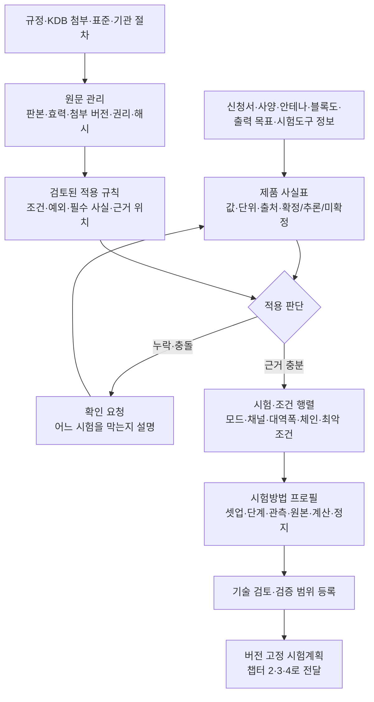

# 1. 기준·업무·시험 설계

[전체 구성](00-overview.md) · 다음: [설비·제어](02-hardware-and-control.md)

## 1.1 목적

AI가 제품 자료에서 시험 항목을 판단할 수 있도록 **제품 사실, 규정 적용 조건, 실행 가능한 시험방법, 필요한 증거**를 연결한다. 단순 문서 검색만으로 시험조건을 확정하지 않는다. 신규 직원은 이 챕터를 완료하면 “이 제품에 왜 이 항목이 필요한지, 어떤 정보가 없어서 아직 실행할 수 없는지”를 설명할 수 있어야 한다.

책임자는 시험기술 담당이다. 수집1·2·3이 RF·EMC·SAR 원문을, 수집7이 DUT 자료를, 수집8이 데이터·보고 자료를 제공한다. 수집 담당의 확보 완료와 시험기술 담당의 적용성 검토 완료는 별도 상태다.

## 1.2 상세 구조

## 1.3 입력 자료와 담당자

| 자료 | 필요한 내용 | 제공/검토 |
|---|---|---|
| 고객·의뢰 | 고객/신청자/제조자 구분, 모델, 시험 목적, 시장, 요청 범위 | 접수 담당 → 시험기술 |
| 제품·RF | HW/FW, 무선 기능, 모드·채널·대역폭, 안테나/체인, 이득, 최대 출력/튜닝 범위, 전원·사용 형태 | 제조사 자료 → 시험기술 |
| DUT 제어 | 시험 FW, 도구·라이선스·OS, 모드 명령, 송신 정지/복구, 응답·실제 RF 확인 방식 | 수집7/현장 → 제어 담당 |
| 규정·방법 | CFR, 최신 관련 KDB 원문/첨부·판본, 적용 표준, 변경·전환 조건 | 수집1~3 → 분야 전문가 |
| 기준 자료 | 교정·보정·사이트 검증, 기존 원시 데이터·성적서, 독립 측정 절차 | 현장·품질 → 시험기술 |

기존 시험성적서는 신규 양식을 강제하는 입력이 아니라 독립 비교 자료다. 권리 제한 표준·고객 자료·제조사 비공개 도구는 허용된 저장소에서 관리한다. 공개 Git에는 공유 가능한 메타데이터·스키마·예제만 올린다.

## 1.4 요구사항

| ID | 요구사항 | 검증 방법 |
|---|---|---|
| R1-01 | 사실마다 문서·페이지/표·자료 버전·단위·확정 상태를 연결 | 추출값 표본에서 원문 역추적 |
| R1-02 | 제품 종류와 신청 시장을 구분하고, 참고 FCC 보고서를 신청 의도로 간주하지 않음 | 미국/EU/목적 없음 의뢰 비교 |
| R1-03 | 원문 판본·첨부·효력/전환 조건을 관리하고 변경 영향 항목을 찾음 | 판본 변경 시 기존 계획 재검토 표시 |
| R1-04 | 적용·비적용·정보 부족·판단 충돌을 구별 | 각 상태의 근거·질문 확인 |
| R1-05 | 모드·채널·BW·체인·전원·자세 등 조건과 축소 근거를 보존 | 전체 조건 행렬과 실행 행 대조 |
| R1-06 | 방법에 장비 능력·셋업·측정 설정·완료 확인·원본·계산·실패 처리를 포함 | 제어/데이터 담당이 추가 추측 없이 구현 |
| R1-07 | 규칙 초안과 운영 검증된 방법을 분리 | 미검토 방법의 실장비 실행 차단 |
| R1-08 | RF exposure·SAR 등 연관 검토를 별도 추적 | RF 보고 완료가 다른 의무를 완료 처리하지 않음 |

## 1.5 첫 b/g/n 범위에 작성할 시험 행렬

아래는 **방법을 준비할 항목군**이다. 정확한 설정값·검파기·대역폭·스윕·듀티 보정·한계값·축소 조건은 적용 원문과 제품 구성으로 확정한다. 명칭이 같다고 다른 변조 방식의 방법을 그대로 복사하지 않는다.

| 항목군 | 준비할 결정 | 챕터 2에 전달할 능력 | 챕터 4의 원본·출력 |
|---|---|---|---|
| 출력 | 지원 변조·체인·평균/피크 등 적용 방법과 최악 조건 | DUT 모드·전력 측정·경로 보정 | 트레이스/리딩·설정·보정·결과표 |
| 6 dB 대역폭 | 적용 조건과 측정 설정 | 분석기·주파수 범위·동기화 | 트레이스·마커·대역폭 |
| 전력밀도 | 적용 조건·적분/정규화·듀티 처리 | 분석기·DUT 연속/버스트 관측 | 원본·처리 단계·PSD 결과 |
| 대역 경계·대역외 | 일반/제한대역 구분, 전도/방사 근거 | 필터·고조파 경로·방사 셋업 | 설정·경로별 원본·한계 비교 |
| 방사 불요파 | 측정 주파수 범위, 거리, 탐색/최종 측정 | 마스트·편파·방위·DUT 자세·사이트 | 각도/높이/편파·최대화 기록·사진 |
| AC 전원 전도 | 전원/충전 구성에 따른 적용 여부 | LISN/AMN·수신기·전원 구성 | 선별 리딩/트레이스·구성·한계 비교 |
| 문서/연관 검토 | 안테나 조건, 튜닝 범위, RF exposure 등 | 필요 자료·별도 평가 연결 | 검토 근거·연관 평가 상태 |

각 행에 `applicable / not_applicable / needs_information / unsupported`와 근거를 둔다. 적용되는 행의 실행 상태는 별도로 `planned / running / completed / invalid / interrupted`로 둔다. “미지원”이나 “아직 측정 안 함”을 비적용으로 표시하지 않는다.

## 1.6 작업·개발 순서

| 작업 ID | 직원이 할 일 | 산출물 | 다음 작업 시작 조건 |
|---|---|---|---|
| C1-01 | 최초 제품 한 건의 사실·누락·충돌을 추출하고 근거 위치 기록 | 제품 사실표·질문 목록 | 시장/범위와 실제 미확정 분리 |
| C1-02 | 첫 전도 출력에 필요한 원문·판본·방법을 검토 | 근거 목록·적용성 표 | 실행에 쓰는 근거 확보·검토 |
| C1-03 | 출력 방법의 단계·설정·측정 완료·원본·계산·예외 정의 | 버전 있는 방법 프로필 | 기술/제어/데이터 담당 공동 검토 |
| C1-04 | 지원 조건과 독립 기준 비교 계획 작성 | 조건 행렬·검증 계획 | 허용차·조건·판정 규칙 사전 확정 |
| C1-05 | M1 결과를 반영해 나머지 b/g/n 항목에 같은 절차 반복 | 전체 범위 방법/보고 요구 | 각 방법별 검증·비적용 근거 |
| C1-06 | EMC·SAR 및 후속 RF 범위의 차이를 별도 정의 | 분야별 확장 목록 | 해당 분야 기술 책임자 지정 |

예: 안테나 이득이 없으면 적용성·보고에 미치는 영향을 표시한다. 이미 확인 가능한 고객/시료 정리나 독립 개발은 진행하되, 그 값이 필요한 확정 판단은 보류한다. 담당자는 빈칸을 임의로 0 dBi로 채우지 않는다.

방법 프로필에는 최소한 `method_id/version`, 적용 근거, 필요한 사실, 조건 생성/축소 규칙, 허용 장비 능력, `setup_id`, 단계별 입력·관측·완료·시간 제한, 원본 스키마, 계산/보정/불확도, 판정 규칙, 재시도·정지 조건, 검증 기록을 둔다. [작성 양식](05-workbook.md)을 사용한다.

## 1.7 완료 기준과 인수

- [ ] 최초 출력 방법을 두 직원이 같은 입력으로 해석해 같은 시험조건·필요 자료 목록을 얻는다.
- [ ] 시장 누락·충돌·안테나/출력 목표 누락에서 근거 있는 보류와 질문이 나온다.
- [ ] M1에 필요한 근거·방법·조건·보고 요구가 서로 연결된다.
- [ ] 설정값·허용차·반복량이 “추후 결정”인 방법은 운영 활성화하지 않는다.
- [ ] M2에서는 적용 행 전체에 실행·보고·비적용 근거가 연결된다.

**인계:** 제어 담당에게 방법 프로필과 셋업 요구, AI 담당에게 사실/적용 규칙·질문 조건, 데이터 담당에게 원본/계산/보고 요구를 같은 버전으로 전달한다. 규정 변경은 영향을 받는 방법·계획·보고서를 찾아 재검토하며 과거 원본을 덮어쓰지 않는다.
