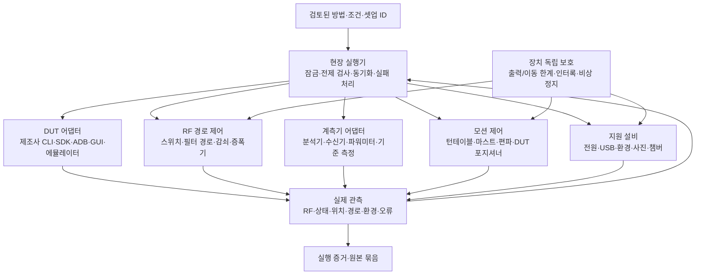
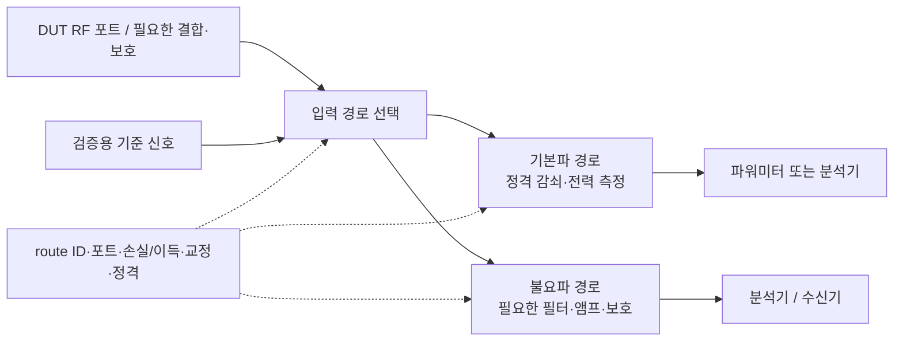

# 2. 하드웨어·셋업·제어

[전체 구성](00-overview.md) · 이전: [기준·방법](01-basis-and-methods.md) · 다음: [AI 운영](03-agent-and-orchestration.md)

## 2.1 목적

시험계획의 조건을 실제 DUT·계측기·RF 경로·자세·환경에서 재현하고, 설정이 실제로 이루어졌다는 관측을 남긴다. 담당자는 장비가 “연결된다”와 “이 시험에 필요한 기능이 검증됐다”를 구별한다. 공개 코드가 있더라도 해당 자산의 옵션·FW·통신·라이선스·측정 기능을 확인한다.

## 2.2 상세 구성도

## 2.3 설비 기능별 준비 목록

이는 **재사용/추가 여부를 판정할 기능 목록**이다. 모델이나 수량의 구매 확정 목록이 아니다. 자산 대장과 공개 코드 조사를 실제 현장과 대조해 [현장 확인표](05-workbook.md)를 작성한다.

| 기능 | 확인할 기존 자산·추가 후보 | 필수 확인과 검증 | 시점 |
|---|---|---|---|
| DUT 동작 | 제조사 시험 PC·도구, 필요 시 AP/통신시험기 | HW/FW/도구 버전, Tx 제어·실제 모드·정지·복구 | M1 |
| 전도 출력 | 분석기 또는 적합한 전력 측정계, 센서·결합기·감쇠기 | 방법 적합성, 주파수/전력/대역폭, 버스트·오버로드, 보정 | M1 |
| RF 경로 | 스위치 박스, 필터 분기, 가변 감쇠, 앰프 제어 | 포트 지도, 손실·이득·정합·격리·정격·반복성 | M1 필요 시 / M2 |
| 방사 측정 | 수신기/분석기, 안테나, 검증된 사이트 | 범위·거리·사이트 검증·안테나 계수·전치증폭기 선형성 | M2 |
| 방위·높이·편파 | 턴테이블, 마스트, 편파 구동기 | 실제 축·원점·피드백·가동 범위·속도·완료 | M2 |
| DUT 자세 | 다축 포지셔너·저유전 지그·케이블 지지 | 필요한 자세 자유도, 하중·위치 오차·산란·케이블 영향 | M2 필요 시 |
| AC 전도 | LISN/AMN, 선 전환·전원·수신기 | 제품 전원 구성, 보호 접지·결선·정격·잡음 | M2 적용 시 |
| DUT 전원·복구 | 프로그래머블 전원·전류 측정, 포트별 USB 전원, PDU | 상태 유지/차단, 충전·배터리 조건, 반복 복구 | M1부터 |
| 환경·관찰 | 온습도 센서, 필요 시 챔버, 카메라·문 센서 | 측정 영향, 센서 교정/시간, 사진과 시료 연결 | M1부터 필요한 범위 |
| 자가 점검 | 기준 신호원·검증 경로·센서, 필요 시 VNA | 드리프트·경로 오접속·손상 탐지, 점검 허용차 | M1부터 |
| SAR | 기존 SAR 로봇·프로브·팬텀·홀더·액체/온도 점검·검증원 | 버전/API·교정·시스템 검증·자세·스캔·불확도 | M3 |
| 운영 기반 | 현장 PC, UPS, 관리형 전원·네트워크, 저장공간 | 장애 시 동작·시각 동기·접근 통제·로컬 버퍼 | M1부터 |
| 자동 반출입 | 표준 지그·시료 ID·로더/이송 로봇 | 결합/분리·위치·파손·RF 영향·예외 시료 | M4 |

## 2.4 RF 스위치·필터·앰프 설계

수동 케이블과 고정 필터 자체에 명령을 보내는 것이 아니라 스위치로 해당 경로를 선택한다. 가변 감쇠기·앰프는 지원되는 이득/전원/바이패스 기능을 별도로 제어한다. 다음 그림은 논리 예시이며 포트 수·부품 선정·단일 실장 회로를 확정한 것이 아니다.

직원 작업 순서:

1. 방법별 측정 주파수·최대 예상 입력·필요 동적 범위를 먼저 적는다. 2.4 GHz 기본파 시험이라도 불요파 경로의 필요한 상한은 별도다. [§15.33](https://www.ecfr.gov/current/title-47/chapter-I/subchapter-A/part-15/subpart-A/section-15.33)와 적용 방법으로 정한다.
2. 각 자산의 실제 포트와 케이블·필터·감쇠기·앰프를 ID로 표시하고 모든 허용 경로를 작성한다. 사용하지 않는 포트의 종단 조건도 정한다.
3. 경로별 주파수 손실/이득, 반사·격리·반복성, 정격·앰프 압축/잡음·보호 영향을 평가한다. 보정값과 불확도 기여를 기록한다.
4. 장치 허용 조건에 맞춰 출력 억제 → 상태 확인 → 전환 → readback/관측 → 안정화 → 출력/측정 재개 순서를 정의한다. 무조건 hot switching하지 않는다.
5. 제어기 readback만으로 물리 RF 통과가 확인되는지 평가한다. 불충분하면 기준 신호/전력 관측 등 점검을 추가한다. 명령 ACK만으로 경로 검증을 완료하지 않는다.
6. 라우트와 보정 버전을 셋업·실행·원본에 고정한다. 케이블/스위치 교체 시 영향 경로를 재검증한다.

스위치 도입으로 잃는 동적 범위·증가한 불확도가 목표 방법에 허용되는지 확인해야 한다. “자동 전환됨”만으로 수동 직결과 동등한 측정이 아니다.

## 2.5 방사 위치 제어 설계

턴테이블은 방위, 마스트는 수신 안테나 높이, 편파 구동은 H/V, DUT 포지셔너는 제품 자세를 담당한다. 필요한 축은 적용 방법·제품·사이트에서 결정한다. 모든 방사시험에 특정 3축 장치를 필수로 가정하지 않는다.

- 좌표계·축 방향·각도/높이 단위·원점·허용 범위·하중·지그 기준점을 도면으로 고정한다.
- 케이블 꼬임·장력·충돌·종단 스위치·점유 상태를 확인한다. 실제 위치 readback과 이동 완료를 기록한다.
- 지그·모터·케이블·카메라가 결과에 미치는 영향을 기준 배치와 비교한다. EMC 방사와 SAR 위치 시스템의 요구를 혼합하지 않는다.
- 탐색과 최종 측정을 구분하고 선택한 최악 자세뿐 아니라 탐색 범위·축소 이유를 보존한다.
- 수동 자세 변경이 남으면 셋업 요청과 확인 절차에 넣는다. AI가 변경 완료를 추측하지 않는다.

## 2.6 어댑터 개발 요구사항

| ID | 요구 | 완료 증거 |
|---|---|---|
| R2-01 | 실제 자산 ID·제조사·정확 모델·옵션·FW·주소 식별 | 명판/조회와 대장 매핑 |
| R2-02 | API/SDK/SCPI/GUI 방식별 능력·OS·라이선스 등록 | 해당 기능의 호출·응답·오류 기록 |
| R2-03 | 장비·스위치·축·시험장 자원을 실행 중 독점 | 동시 요청 시 충돌 차단 |
| R2-04 | 명령 완료·실제 RF·경로·위치를 관측 | 타임아웃/불일치 시 성공 처리 안 함 |
| R2-05 | 방법별 교정·사이트·보정 유효성 검사 | 만료/조건 불일치 실행 차단 |
| R2-06 | 시간 제한·정지·비멱등 재시도 정책 | 통신 단절 시 중복 이동/출력 없음 |
| R2-07 | AI 서비스와 독립된 보호·제한 | 현장 통신/AI 장애 시 정의된 보호 동작 |
| R2-08 | 원본·설정·오류·관측 시간·시료·경로 연결 | 챕터 4에서 재현 가능한 묶음 인수 |

일반 역할 계약은 `identify`, `capabilities`, `observe`, `configure`, `start`, `wait_complete`, `fetch_raw`, `stop` 등으로 설계할 수 있다. 모든 장치가 같은 기능을 제공한다고 강제하지 않는다. 조회 불가 상태는 `unknown`이며 성공이 아니다. ADB 연결 성공이나 제조사 UI의 성공 문구도 실제 RF 검증을 대신하지 않는다.

## 2.7 작업 순서·산출물

| 작업 ID | 작업 | 산출물/완료 조건 |
|---|---|---|
| C2-01 | M1 자산·도구·교정·현장 인터페이스 확인 | 실제 구성 명세·결손 목록 |
| C2-02 | 직결 우선의 전도 셋업·포트 지도·보호/보정 설계 | 셋업 ID·연결도·점검/정지 절차 |
| C2-03 | 공개 코드 검토·라이선스 확인, DUT/계측 어댑터 구현 | 버전 고정 코드·가상/재생 결과 |
| C2-04 | 허용된 현장에서 조회→설정→RF 확인→원본 취득 | 실제 조합 동작·오류·기준 비교 기록 |
| C2-05 | RF 스위치 경로와 방사 축·지그·환경 연동 | 라우트/좌표/교정·측정 영향 검증 |
| C2-06 | 적용 AC·SAR 등 다른 스테이션 연동 | 분야별 제어·셋업·시스템 검증 |
| C2-07 | 수동 작업 빈도에서 자동 이송/지그 개선 선정 | 시간/품질 효과와 재검증을 포함한 도입안 |

공개 코드 인수는 [기존 조사](../../EQUIPMENT-CONTROL-RESEARCH-START.md)를 사용한다. `exact_source`가 매뉴얼/제품 페이지인지 소스 코드인지 확인하고, 범용 SCPI 라이브러리를 해당 모델 전용 드라이버로 오인하지 않는다. 후보 → 계약 검증 → 실장비 기능 검증 → 특정 방법 검증 → 운영 지원 순으로 상태를 올린다.

## 2.8 완료·인계

- [ ] M1 실제 자산·DUT 조합을 명시하고 측정·정지·재개·원본 취득을 확인했다.
- [ ] 작업자가 같은 도면과 지시로 셋업을 재현할 수 있다.
- [ ] 경로/모션/보정 오류를 탐지하고 영향을 받는 결과를 무효화한다.
- [ ] 원격 통신이 끊겨도 현장의 정의된 보호 동작과 기록이 유지된다.
- [ ] 다른 모델·FW·옵션을 검증된 것으로 자동 승격하지 않는다.

AI 담당에게 지원 능력·실행 계약·오류/복구·관측을, 데이터 담당에게 원본·셋업·보정 버전을 인계한다. 전도→방사→SAR의 시료 이동·배선 변경은 별도 작업이다. 최초에는 사람이 수행하거나 스테이션별 시료를 준비하고, 시료 구성 차이와 대표성은 시험계획에 기록한다.
