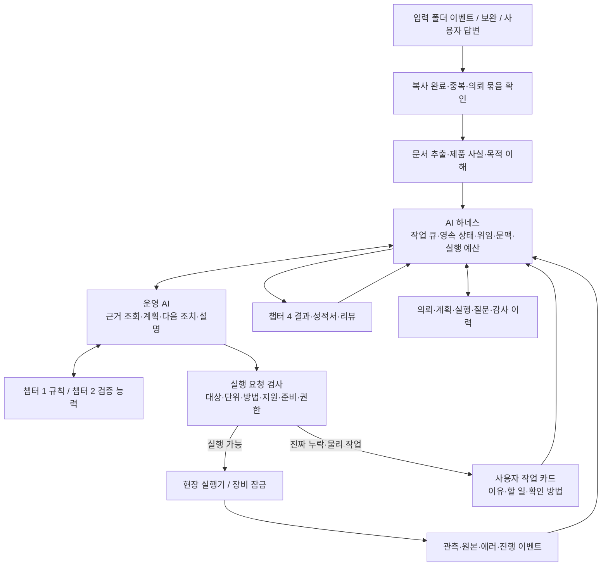
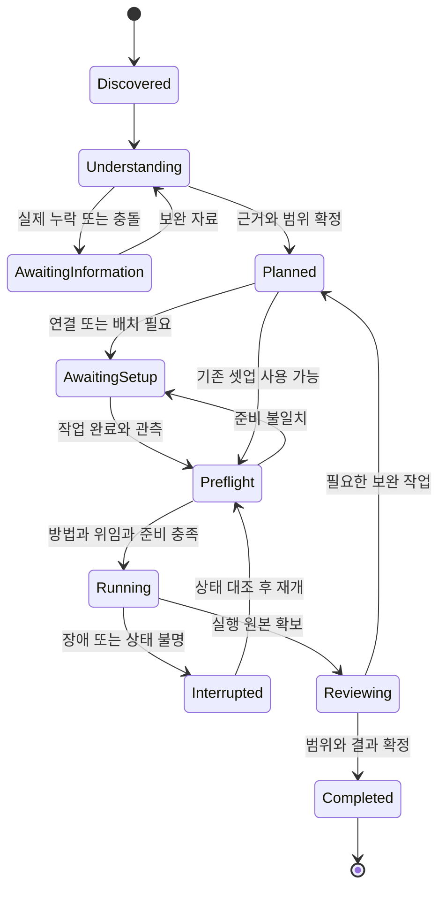

# 3. AI 자율 운영·하네스

[전체 구성](00-overview.md) · 이전: [설비·제어](02-hardware-and-control.md) · 다음: [데이터·운영](04-evidence-and-operations.md)

## 3.1 목적

사용자가 시험 종류와 장비 명령을 일일이 지정하지 않아도 AI가 자료를 이해하고 일을 이어 가도록 한다. AI는 판단·설명·계획·예외 분석을, 하네스는 영속 상태·권한·작업 큐·도구 호출·재개를 담당한다. MCP는 도구 인터페이스이며 그 자체가 자율 운영이나 측정 유효성을 보장하지 않는다.

성공한 사용자 경험: “업로드한 것 진행해 줘” → 자료에서 의뢰 식별 → 누락만 질문 → 필요한 연결 안내 → 실제 준비 확인 → 측정·보고·리뷰. 지시가 없는 새 의뢰는 스스로 발견해 요약과 착수 제안을 한다. 이미 해당 건을 맡겼다면 같은 승인을 반복 요청하지 않는다.

## 3.2 상세 구조

## 3.3 업무 상태와 운영 한계

이는 의뢰 흐름의 요약이다. 실제 구현은 의뢰·시험 항목·실행·보고서 상태를 분리한다. `Completed`가 합격을 뜻하지 않으며 유효한 부적합도 완료다. 각 항목은 적용성, 실행 상태, 데이터 유효성, 적합 판정, 발행 상태를 별도 필드로 둔다. 사용자의 보류·취소도 기록하고 실행 중 취소는 정의된 정지 절차를 거친다.

## 3.4 요구사항과 구현 지침

| ID | 요구사항 | 개발 지침·검증 |
|---|---|---|
| R3-01 | 명령 없이 신규 자료 감지 | 파일 안정화·업로드 완료 신호, 출력 폴더 제외, 동일 이벤트 중복 방지 |
| R3-02 | 신규/보완/중복/다른 의뢰 구분 | 파일 해시와 업무 ID를 별도 관리; 같은 파일을 두 의뢰가 참조 가능 |
| R3-03 | 제품·시장·목적을 자료에서 해석 | 사실/추론 분리, 스마트폰/FCC 고정값 금지 |
| R3-04 | 진짜 누락과 충돌만 질문 | 영향 항목·이유·담당·재개 조건 포함; 답변/위임 재사용 |
| R3-05 | 진행·보류·알림·승인 상태 영속화 | 대화창 종료·서비스 재시작 후 복원 |
| R3-06 | 검증된 능력 안에서 도구 실행 | 허용 동작·단위·범위·방법·교정·셋업 검사 |
| R3-07 | 동시 건과 장비 점유 관리 | 자원 예약과 실행 잠금 구분, 잠금 소유자·만료·재확인 |
| R3-08 | 불명확한 실행의 중복 방지 | 요청 ID·실행 원장, 시간 초과 후 상태 조회, 비멱등 재전송 금지 |
| R3-09 | AI/네트워크 오류에 대응 | 모델 타임아웃·제한된 재시도·작업 보류, 현장 보호 독립 |
| R3-10 | 외부 자료의 지시문을 운영 권한으로 쓰지 않음 | 문서/도구 출력 분리, 제한된 도구·비밀값 마스킹 |
| R3-11 | 무한 계획·재측정·알림 방지 | 단계·재시도·시간/비용 예산, 초과 시 원인 있는 예외 |
| R3-12 | 사람이 진행상태를 이해 | 현재 항목·대기 이유·필요 행동·결과·근거·지원 범위를 표시 |

## 3.5 실행 요청 계약

최소 필드: `case_id`, `sample_id`, `plan_version`, `run_id`, `step_id`, `request_id`, `operation`, `resource_ids`, `setup_id/version`, `route_id/version`, `method_id/version`, 파라미터와 단위, 전제, 기대 관측, 제한시간, 정지/복구 정책, 위임 근거, 증거 참조.

현장 실행기는 모델의 자유로운 텍스트를 임의 SCPI나 셸로 바로 실행하지 않는다. 검토된 어댑터 동작과 구조화된 인자를 사용한다. 정밀 스윕/트리거/모션은 장치·제어기가 수행한다. AI는 결과와 관측을 받아 다음 작업을 판단한다.

응답은 `accepted / running / completed / failed / unknown` 같은 실행 상태, 실제 관측, 오류 분류, 원본 위치·해시를 포함한다. 접수됐다는 응답과 측정 완료를 구별한다. 장치가 읽기 기능을 제공하지 않는 값은 관측된 것으로 기록하지 않는다.

## 3.6 복구 설계

| 상황 | 자동으로 할 수 있는 조치 | 재개 조건 |
|---|---|---|
| AI API 일시 장애 | 상태 저장·제한된 재시도·진행 알림 | 동일 업무/계획 버전 복원 |
| 계측 통신 시간 초과 | 장비/실행 상태 조회·원본 취득 여부 확인 | 중복 명령 위험 해소·셋업 유효 |
| DUT 송신 불명 | 측정 유효성 보류·검증된 중지/복구 | RF 상태와 모드 재확인 |
| 경로/축 불일치 | 관련 실행 중단·현장 보호 절차 | 실제 위치/연결과 보정 재검증 |
| 자료 보완 | 사실/규칙 영향 분석·관련 계획 재검토 | 변경 영향 항목·기존 결과 재사용 근거 |
| 저장소 장애 | 원본 내구 저장 불가 시 측정 중지 또는 검증된 로컬 버퍼 | 누락 없는 동기화·해시 확인 |
| 해석 불가/미지원 | 이유·필요 근거를 기록하고 해당 단계 보류 | 담당자의 정보 보완 또는 지원 검증 |

복구는 합격할 때까지 측정하는 규칙이 아니다. 실패·무효·재측정 이유를 모두 남긴다. 서비스 재시작 시 DB 상태와 실제 장비 상태를 대조하고 오래된 잠금 만료만으로 새 명령을 발행하지 않는다.

## 3.7 작업 순서·산출물

| 작업 ID | 작업 | 산출물/완료 조건 |
|---|---|---|
| C3-01 | 폴더 인수·원본 식별·자료 묶음·안정화 구현 | 신규/보완/중복 이벤트 증거 |
| C3-02 | 제품 사실·목적·누락 해석과 대화 연결 | 출처 있는 사실·최소 질문·대상 선택 |
| C3-03 | 영속 큐·상태·위임·알림·재개 구현 | 재시작/동시 건/중복 이벤트 결과 |
| C3-04 | 방법·능력 조회와 실행 계약 연결 | 가상/재생에서 잘못된 요청 차단 |
| C3-05 | 실제 M1 흐름과 보고/리뷰 도구 연결 | 단계별 수동 지시 없는 실제 실행 |
| C3-06 | 방사/AC/SAR 셋업 변경·다중 자원·복구 확장 | M2/M3의 조건별 상태·예약 검증 |

최초 구현은 기존 `labflow`의 상태·자료·계획 기반을 조사해 확장한다. 기존 함수/테이블을 새 설계와 대조한 후 변경하며 문서에 있는 모듈명이 다른 PC의 현재 구현과 같다고 가정하지 않는다. 논리 역할마다 별도 에이전트 프로세스를 만들 필요는 없다.

## 3.8 직원이 수행할 수용 시험

1. 제품명/규격명 없는 스마트폰 자료와 리모컨 자료를 각각 넣어 분류·준비 상태를 확인한다.
2. 미국/EU/목적 누락, 참고 FCC 보고서만 있는 경우를 비교한다.
3. 안테나 정보·출력 목표 누락, 문서 충돌에 대한 질문을 확인하고 보완 후 재질문하지 않는지 확인한다.
4. 복사 중 파일·중복 이벤트·복수 의뢰·출력 폴더를 입력으로 만들어 잘못된 착수/연결을 검사한다.
5. “나중에”, “업로드한 것 진행해 줘”, 기존 위임이 있는 경우를 구별한다.
6. 실행 도중 서비스 재시작·장비 타임아웃을 넣고 중복 송신/이동/측정과 원본 손실을 검사한다.

실제 AI 호출 평가와 결정적인 상태/계약 테스트를 분리해 기록한다. 가짜 모델 응답만으로 제품 이해 능력을 완료 처리하지 않는다. 실제 장비가 없는 경우 계약 개발까지 가능하지만 C3-05와 현장 운영 완료는 미검증으로 남긴다.
