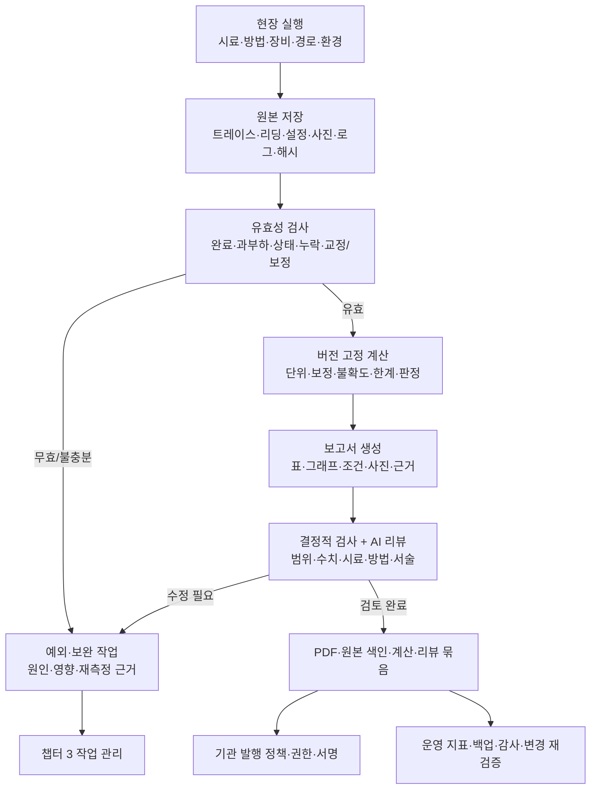

# 4. 원시 데이터·성적서·검증·운영

[전체 구성](00-overview.md) · 이전: [AI 운영](03-agent-and-orchestration.md) · 다음: [작업 양식](05-workbook.md)

## 4.1 목적

측정값이 어떤 시료·방법·장비·경로·설정에서 나왔는지 증명하고 동일 원본으로 결과를 다시 계산한다. AI는 설명과 검토를 돕지만, 수치·한계·보정·판정은 버전 관리된 계산과 근거로 생성한다. 시험 기술 담당과 품질 담당이 이 구조를 실제 측정으로 검증한다.

## 4.2 상세 구조

## 4.3 데이터 계약

| 객체 | 필수 식별·내용 | 변경 원칙 |
|---|---|---|
| 의뢰/시료 | case/sample ID, 고객/모델, HW/FW, 개조·대표성·자료 버전 | 변경 이력·이전 사실 보존 |
| 계획/방법 | 적용 근거·판본, 조건 행, 누락/비적용 이유, method/plan version | 실행 시작 버전 고정 |
| 셋업 | 실제 asset ID·교정, 포트·route, 지그·자세·보정·사이트 | 물리 변경마다 영향 판정 |
| 실행 | run/step/request ID, 명령·관측 시각, 성공/중단/무효, 로컬/서버 시간 | 추가 기록, 실패 보존 |
| 원본 | 장치 원래 파일/트레이스, 단위·형식, 위치·해시·크기, 실제/가상/재생 구분 | 원본 불변, 수정본 별도 |
| 계산 | 원본 참조, 처리 단계·코드/환경 버전, 보정/불확도, 한계/판정 규칙 | 재계산 새 버전 |
| 보고 | report ID/revision, 범위·상태, 각 표/그림의 결과 참조, 리뷰·발행 기록 | 재발행/정정 이력 보존 |

예시 저장 구조는 `case/<id>/runs/<run-id>/{manifest,raw,settings,photos,logs}`와 `calculations/<version>`, `reports/<revision>`이다. 실제 경로/저장소 제품은 현장 보존·접근 정책으로 정한다. 경로만 저장하지 않고 파일의 해시·크기·스키마·데이터 출처를 함께 기록한다. 표준·고객 정보·비밀값은 공개 Git에 넣지 않는다.

## 4.4 요구사항

| ID | 요구 | 검증 방법 |
|---|---|---|
| R4-01 | 모든 보고 수치는 원본·계산으로 연결 | 표/그래프의 값 선택 후 원본 역추적 |
| R4-02 | 관측/계산/판정과 AI 서술 분리 | AI가 없는 수치나 조항을 추가하면 검사 실패 |
| R4-03 | 실제·가상·재생 원본 구분 | 실측 성적서에 가상 원본 혼입 차단 |
| R4-04 | 원본과 실패·재측정 이력 보존 | 수정/삭제·중복·누락 탐지, 이유 확인 |
| R4-05 | 보정·불확도·판정 규칙 버전 고정 | 독립 기준 계산과 재현 비교 |
| R4-06 | 과부하·압축·잡음·상태·설정 불일치 탐지 | 알려진 이상 원본으로 무효 판정 |
| R4-07 | 적용 시험·조건 커버리지 검사 | 누락·비적용 근거·부분 보고 표시 |
| R4-08 | 보고 수정과 시험 재실행 분리 | 서술 수정에 불필요한 재측정 안 함 |
| R4-09 | 발행 준비·내부 완료·공식 발행 구분 | 기관 정책 없는 공식 발행 표시 차단 |
| R4-10 | 백업·복원·접근·변경 영향 운영 | 실제 복원, 권한 테스트, 버전 영향 추적 |

불확도에 따른 판정은 적용 방법·기관 규칙으로 정한다. 모든 규격에 동일한 guard band를 임의 적용하거나, 불확도를 무조건 빼서 합격시키지 않는다. 경로 손실·앰프 이득의 부호와 단위를 명시하고 순서·보간·적용 주파수를 재현한다. 반올림 전 판정과 표시 자릿수도 규칙으로 고정한다.

## 4.5 성적서 구성

1. 보고서 ID·개정·발행 상태, 의뢰자/제조자·시험소, 시험 목적과 명시 범위.
2. 제품·시료·HW/FW·무선 모드·안테나·전원·시험용 구성과 실제 제품의 차이.
3. 적용 규정·KDB/표준 판본, 시험방법·편차·조건 선택/축소 근거.
4. 사용 장비·교정·사이트·환경·셋업·연결/배치 사진.
5. 항목별 시험조건·원본 기반 표/그래프·보정·불확도·한계·판정.
6. 미실시/비적용·무효·중단·외부 평가 참조·전체 범위 요약.
7. 검토·승인/발행 정보와 원시자료/계산 추적 색인.

위 구성은 설계 기준이다. 정확한 필수 기재 사항은 챕터 1의 적용 방법과 기관 절차로 확인한다. PDF, 기계가 읽을 결과 JSON, 원본 manifest, 리뷰 이력을 함께 산출한다. M1 보고서에는 **전도 출력 한 항목 범위**가 드러나야 한다.

자동 검사는 식별자·범위·값·단위·계산·참조 누락을 확인하고, AI 리뷰는 조건/설명/근거 간 의미적 불일치를 찾는다. AI 리뷰 통과만으로 측정 유효성이 생기지 않는다. 리뷰 지적은 `서술 수정 / 재계산 / 근거 보완 / 셋업 점검 / 근거 있는 재측정`으로 분류한다.

## 4.6 작업 순서

| 작업 ID | 작업 | 산출물/완료 조건 |
|---|---|---|
| C4-01 | M1 원본·manifest·저장 실패·버전 계약 | 실제/가상 분리 저장과 해시 확인 |
| C4-02 | 출력 계산·보정·판정 및 항목 보고 구현 | 독립 계산 비교·PDF 값 역추적 |
| C4-03 | 자동 검사·AI 리뷰·수정 작업 연결 | 오류 주입 시 올바른 지적·조치 |
| C4-04 | M1 실측 비교와 고장 시나리오 검증 | G1 증거 묶음·지원 범위 |
| C4-05 | 나머지 b/g/n 및 후속 분야 보고·커버리지 | 항목별 요구와 원본 전체 매핑 |
| C4-06 | 반복 운전·백업 복원·운영 인계 | G2/G3 현장 인수 기록·운영 절차 |

## 4.7 현장 인수 시험

**측정 전에** [검증 계획 양식](05-workbook.md)에 시험건 수·반복량·기간·조건·기준값·허용차·필수 장애·개입 목표를 확정한다. 본 문서는 근거 없는 숫자를 대신 정하지 않는다. 미확정 상태는 가상 개발을 막지 않지만 실제 비교의 합격 선언은 막는다.

| 검증 층 | 확인할 것 | 증거와 한계 |
|---|---|---|
| 데이터·계산 | 단위·보정·반올림·한계·경계·누락 | 알려진 기준 계산; 실측 정확도 입증 아님 |
| 계약·재생 | 상태·자원 잠금·중복·타임아웃·스키마 | 로그/가상 결과; 하드웨어 검증 아님 |
| 실제 단일 조합 | 실제 DUT와 장비로 출력·원본·보고 | 독립 기준 측정과 사전 허용차 비교 |
| 방법·셋업 확대 | 방사/경로/자세/AC·조건 행렬 | 해당 방법의 측정 영향·재현성 비교 |
| 운영 | 재시작·장애·복원·다중 건·개입 | 실제 운전 기록·지원 범위·한계 |

최소 고장 후보: 잘못된 시료 ID, 교정/보정 만료, 경로 불일치, DUT 무송신/잘못된 모드, 입력 과부하, 통신 시간 초과, 위치 불일치, 저장 실패, AI 중단, 보완 자료로 계획 무효화. 현장 담당은 안전한 재현 방식과 비상 정지/복구 절차를 먼저 정한다. 위험한 고장을 실제 장비에 무계획으로 주입하지 않는다.

## 4.8 운영 지표와 유지보수

개입을 `자료 보완 / 물리 셋업 / 일상 기술 판단·수치 전사 / 장애·미지원 / 기관 발행`으로 나누어 횟수·분·원인을 기록한다. 정상 지원 건의 일상 기술 개입 목표는 0회다. 성공 건만 골라 무인화율을 계산하지 않고 전체 접수·지원·실행·완료·중단의 분모를 함께 보고한다.

운영 대시보드에는 작업 대기/장비 점유·완료시간·무효/재측정률·기준 편차·원본 추적 완전성·교정/보정 만료·저장/복원 상태를 표시한다. 처리량 개선은 이 측정값에서 반복 병목을 찾은 후 RF 경로/지그/이송 자동화에 반영한다.

방법·FW·어댑터·스위치/케이블·보정·사이트·지그·AI 모델/프롬프트가 바뀌면 영향을 받는 검증을 다시 수행한다. AI 변경은 접수·판단·계획 평가를, RF 경로 변경은 측정/보정 검증을 특히 포함한다. 실패 시 이전 검증 버전으로 돌아갈 수 있는 배포·복구 기록을 유지한다.

## 4.9 최종 인계 기준

- [ ] 선언한 범위의 실제 결과·원본·계산·보고·리뷰가 연결되고 재현된다.
- [ ] 유효한 부적합과 무효/미완료가 구별되며 부분 보고에 범위가 표시된다.
- [ ] 정상 건의 기술 개입과 실제 남은 물리 작업을 측정했다.
- [ ] 장애·재시작·복원 후 잘못된 셋업이나 오래된 결과를 사용하지 않는다.
- [ ] 운영 담당자가 지원 범위·시작·중단·예외 연락·복구·변경관리 절차를 수행할 수 있다.

이 증거로 해당 범위의 운영을 인수한다. 전도 출력 한 항목이나 b/g/n 실증 결과를 전체 FCC RF·EMC·SAR 완료로 확대 보고하지 않는다.
