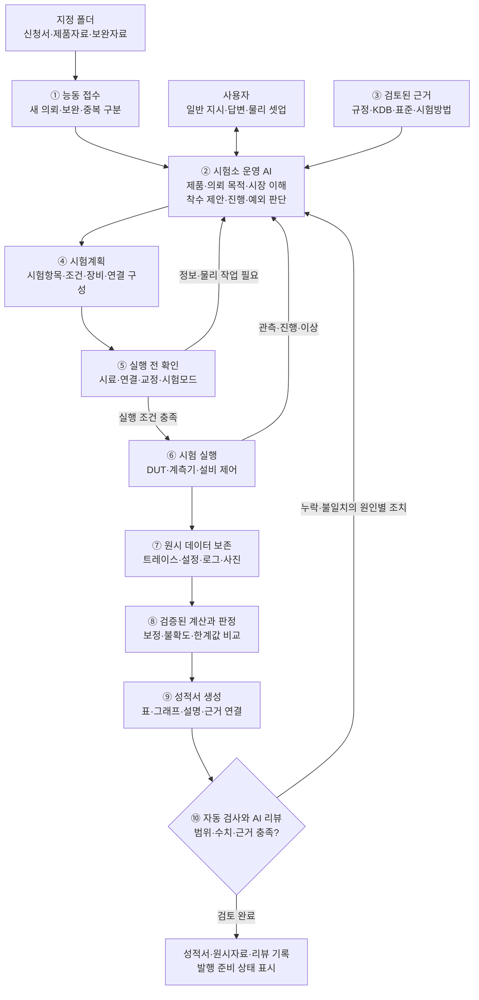
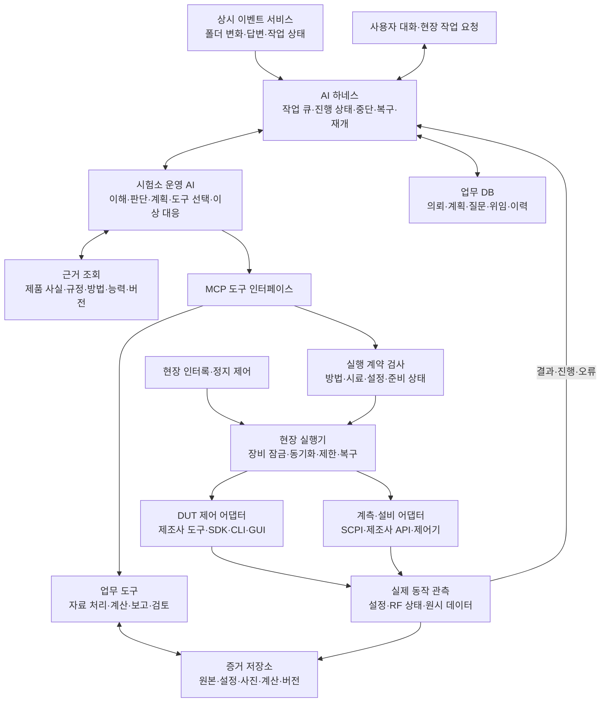
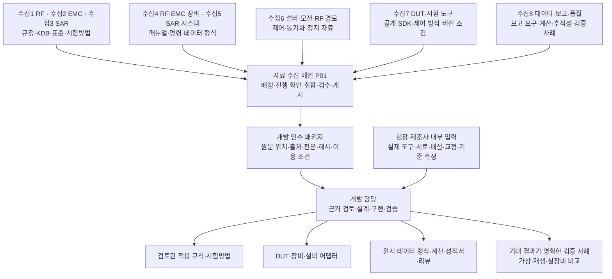
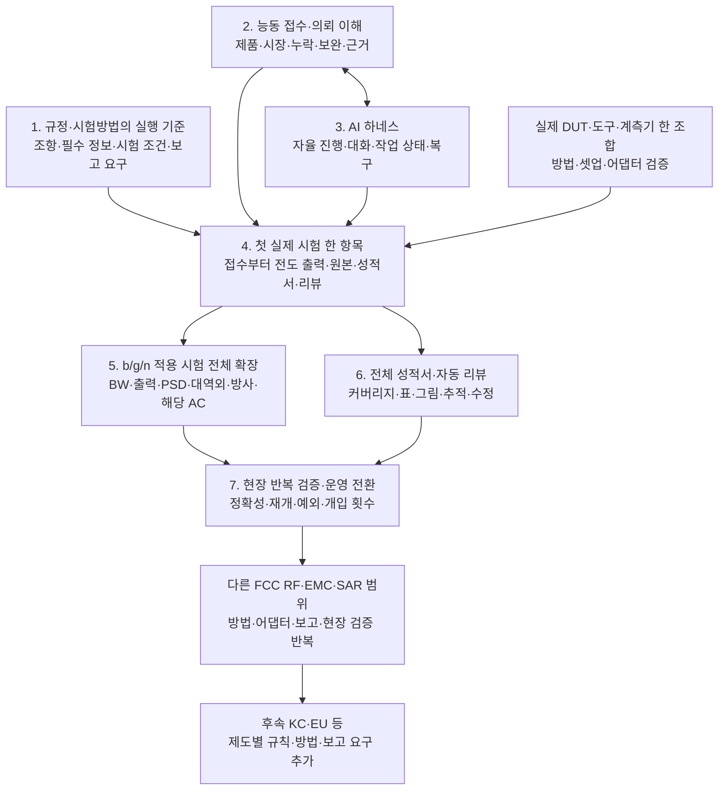

# AI 무인 시험소 — 전체 파이프라인 구조도

작성일: 2026-10-23 (Asia/Seoul). 기존 사용자 결정과 설계를 시각화한 **목표 구조**다. 이 문서 작성이 기능 구현·실장비 검증 완료를 뜻하지 않는다.

1차 구축 목표는 **FCC RF·EMC·SAR**다. 첫 전체 흐름 실증은 **스마트폰 2.4 GHz Wi-Fi b/g/n / §15.247**이며, 모든 접수를 스마트폰/FCC로 가정하지 않는다. 사용자는 자료를 넣고 필요한 물리 연결·교체·배치를 수행한다. AI는 새 일을 발견하고, 제품과 의뢰를 이해하며, 시험·데이터·성적서·리뷰까지 진행한다.

네 그림은 각각 **운영 흐름 → 구성요소의 역할 → 자료가 기능으로 바뀌는 과정 → 개발 순서**를 보여 준다. 상자는 논리적인 역할이며, 상자마다 별도 AI 모델·세션·서버를 만들겠다는 뜻은 아니다. 현재 수집1~수집8은 개발 자료를 준비하는 세션이고, 완성 제품의 시험소 운영 AI와 구별한다.

## 1. 실제로 운영될 전체 흐름

새 자료가 들어오면 명령을 기다리지 않고 분석·착수 제안을 만든다. ‘업로드한 것 진행해 줘’ 또는 해당 업무의 사전 위임이 있으면 같은 착수 승인을 반복하지 않는다. 자료에 신청 시장이 없으면 제품 분석을 계속하면서 목적만 확인한다. 참고 FCC 성적서가 있다는 이유로 신청 시장까지 FCC로 확정하지 않는다.

운영 AI는 실행 결과를 관찰하며 다음 작업을 조정한다. 리뷰 지적은 문서 수정·재계산·근거 보완·필요한 재측정으로 구분한다. 유효한 부적합 결과는 그대로 보고하며, 합격할 때까지 반복하는 흐름을 만들지 않는다. 미완료·무효·미지원은 부적합과 별도 상태다.

연결 구성은 전도 RF·방사·AC·SAR마다 달라질 수 있다. 필요한 물리 변경은 AI가 안내하고 사용자가 수행하며, 완료 응답과 실제 확인 근거를 해당 의뢰·셋업 버전에 연결한다. 성적서 작성·리뷰와 공식 발행·서명·인증기관 제출의 상태는 구별하며, 발행은 구성된 기관 권한·절차에 따른다.

## 2. 무엇을 구축하고 각각 어떤 역할을 맡는가

| 구성요소 | 책임과 만들어야 할 것 | 현재 기반 / 추가 개발 |
|---|---|---|
| 능동 접수 | 파일 복사 완료 확인, 업로드 묶음·기존 의뢰 연결, 신규/보완/중복 분류, 의미 있는 변화 알림 | 자료 패키지 인수 기반 있음. 제품 폴더 감시·자동 해석·능동 알림은 추가 개발 |
| 운영 AI | 문서에서 사실과 목적 추출, 근거 조회, 누락/충돌 판단, 시험계획·다음 작업 선택, 사용자 대화, 이상 원인 분석 | 자율 운영 루프는 추가 개발. 스마트폰/FCC를 미리 입력하는 방식에 의존하지 않음 |
| AI 하네스 | 모델에 필요한 문맥과 도구 제공, 영속 작업 큐, 진행/대기/보류, 의뢰별 위임, 알림 중복 방지, 재시작 후 재개 | 기존 DB·이력 기록 재사용. 상시 실행·작업 소유권·복구 체계는 추가 개발 |
| 근거·방법·능력 저장소 | 원문·판본·조항, 제품 사실과 출처, 적용 규칙, 시험방법, 장비/DUT 지원 조합·교정·보정 | 장비 DB와 자료/방법 등록 기반 있음. 원문 기술 검토·적용 규칙·검증된 방법 프로필은 추가 개발 |
| MCP와 실행 계약 | AI의 의도를 의미가 정해진 도구 호출로 전달하고 입력·단위·대상·버전·전제 검사 | 오프라인 MCP 11개 도구 있음. 실제 시험 제어 도구와 실행 계약 확장은 추가 개발 |
| 현장 실행기·어댑터 | 정확한 장비/시료 연결, 세션 잠금, DUT 설정, 실제 RF 확인, 측정 동기화·원본 취득·정지 | 실장비 제어 미구현. 제조사 도구/모델/옵션/FW별로 개발·검증 |
| 증거·계산 | 원본 보존, 조건·방법·보정·불확도 연결, 재현 가능한 계산·판정, 변경 영향 추적 | 원본 해시·오프라인 실행과 공통 계산 2개 기반 있음. 방법별 처리와 검증 확장 |
| 성적서·리뷰 | 검증된 결과에서 표·그래프·설명 생성, 범위/근거/수치 검사와 AI 리뷰, 수정 작업 연결 | HTML/PDF/JSON 초안 기반 있음. 방법별 양식·커버리지·AI 리뷰·발행 정책은 추가 개발 |

AI가 다음 일을 판단하고, 하네스가 그 일을 계속 이어 갈 수 있게 관리하며, MCP는 도구 호출 통로를 제공한다. 수치 계산과 실행 전제 검사는 버전이 고정된 코드로 재현한다. 현장의 정밀 타이밍·인터록·정지는 AI 응답에 의존하지 않는다. 그림의 현장 인터록은 현장 제어와 장치에 적용되며 AI가 우회하는 도구가 아니다.

기존 Python/SQLite 기반에 논리 기능을 추가하고, 현장 장비에 접근하는 실행기는 시험 PC에 둔다. 초기부터 기능마다 서버를 분리할 필요는 없다. 실제 제조사 도구의 OS·라이선스·인터페이스를 확인해 어댑터를 선택한다. ADB 연결이나 GUI 성공 문구만으로 RF 제어 능력이 입증되지는 않는다. 통신 에뮬레이터나 기존 시험 SW를 쓰는 경우도 동일한 제어·관측 계약으로 연결한다.

클라우드 개발 세션과 현장 장비망은 구별한다. 원격 AI와 현장 실행기를 연결할 경우 인증된 중계·작업 소유권·연결 단절 동작을 따로 검증한다. 현재 클라우드가 시험 장비를 제어할 수 있다는 가정은 없다.

업무 DB는 진행 상태를, 증거 저장소는 원본을 보존한다. 검색 인덱스는 원본과 검토된 규칙을 찾는 보조 수단이다. 제품 사실 → 적용 조항 → 계획/방법 → 실행/셋업 → 원본 → 계산/판정 → 성적서 항목을 ID와 버전으로 연결한다. 자료 수정은 새 버전으로 남기고 영향을 받은 계획·결과만 재검토한다.

## 3. 개발에 필요한 자료는 어디에서 와서 무엇이 되는가

| 필요한 자료 | 담당·입수 경로 | 자료로 개발할 기능 / 확인할 내용 |
|---|---|---|
| FCC RF 규정·KDB 첨부·참조 표준 | 수집1, 기존 수집 보존 | 적용 조건·시험항목·방법·필수 입력·한계값·판본/전환 규칙 |
| FCC EMC 규정·측정 표준·사이트 요구 | 수집2 | 제품/포트/전원별 적용성, 방사/전도 조건, 셋업·검파·측정 범위 |
| FCC SAR/노출 규정·KDB·표준 | 수집3 | 평가 필요성, 위치·동작·동시송신 조건, 노출 근거와 시험 범위 연결 |
| RF·EMC 계측기·수동 부품 매뉴얼 | 수집4, 장비 대장과 연결 | 모델/옵션/FW별 명령, 동기화, 오류 처리, 트레이스·파일 전송, 입력 한계 |
| SAR 시스템·프로브·팬텀·전용 SW 자료 | 수집5 | 제조사 API·파일 형식, 시스템 검증·교정, 전용 제어와 데이터 처리 |
| 챔버·마스트·턴테이블·RF 경로·인터록 자료 | 수집6 + 현장 확인 | 위치/경로 제어, 장치 간 동기화, 연결 확인·정지·복구와 측정 영향 |
| DUT·시험 펌웨어·제조사 도구·기존 시험 SW | 수집7은 공개 자료 조사, 실제 패키지는 제조사/현장 | API/CLI/GUI/에뮬레이터의 제어 범위, 모델/HW/FW 호환성, 설정값과 실제 RF 비교 |
| 필수 보고 요소·계산·불확도·품질 요구·공개 사례 | 수집8 + 시험소 내부 정책 | 규격에서 원시 데이터/보고 형식 도출, 수치 추적·검토 규칙·발행 상태 설계 |
| 실제 의뢰·시료·안테나/Tune-up·Power Target·모드 정보 | 고객/제조사 입력, AI가 누락 식별 | 제품/시료 프로필, 제조사 시험 설정의 대표성, 조건·채널·체인·출력 선정 |
| 실제 자산 옵션/FW·교정·보정·배선·사이트·운영 권한 | 현장 입력과 장비 조회 | 현장 능력 대조, 연결 구성, 실행 전제·사용 가능한 방법/도구 등록 |
| 기준 측정·원시 데이터·기존 성적서·시험 기록 | 사용자 보유 자료와 후속 현장 비교 | 새 형식으로 독립 재현, 허용 차이·실패 탐지·일상 개입 횟수 검증 |

수집자는 자기 로컬 폴더에만 기록하고, 메인(P01)만 Git 게시를 수행한다. 공개 코드·허용된 원문·색인은 GitHub로 공유하고, 고객 원본·제한 자료는 권한 있는 저장소에 보관해 인수 정보로 연결한다. 수집 완료는 기술 검토나 장비 제어 검증 완료가 아니다. 수집 메인은 운영 AI를 대신해 실제 시험을 하는 역할이 아니다.

첫 자료 묶음은 [b/g/n 우선 자료](../../handoff/WIFI24_BGN_FIRST_BATCH.md)의 공식 원문, 필요한 KDB 전체 첨부와 실제 채택 표준/정오표, 첫 계측기·DUT 제어 문서다. 정확한 요청 ID·공식 접근 링크는 해당 문서를 사용한다. 원문은 최신 발행 여부와 해당 시험건에 허용되는 판본을 따로 확인한다. 공개 성적서는 양식/검증 사례이며 규정 원문이나 계측 원시 데이터를 대체하지 않는다.

원문 확보 후 조항별 적용 조건·필수 입력·방법·출력·보고 요구를 구조화하고, 원문과 대조한 규칙 및 시험방법 프로필로 만든다. AI 추출 결과를 곧바로 운영 규칙으로 등록하지 않는다. 현행 내부 SOP가 없어도 표준에서 SOP와 양식을 설계할 수 있고, 기존 SOP/시험건은 실제 재현과 차이 확인에 사용한다.

## 4. 어떻게 개발하고 어떤 순서로 검증하는가

1~3은 함께 진행할 수 있다. 실제 방법의 실행 가능 판정에는 확보·검토한 원문이 필요하다. 자료가 오기 전에도 접수 이벤트·상태·도구 계약·가상 어댑터를 개발할 수 있으며, 그 결과는 합성/가상으로 표시한다. 4에서 성적서·리뷰의 최소 기능까지 연결하고, 5와 6을 함께 확장한다. 마지막 단계가 되기 전부터 각 계산·방법·어댑터를 검증한다. 전체 FCC/전 장비 문서 수집 완료를 첫 개발의 대기 조건으로 두지 않는다.

| 단계 | 개발 방법 | 완료를 확인할 증거 |
|---|---|---|
| 1. 실행 기준 | 원문·판본을 고정해 필수 사실 → 적용 조건 → 시험방법 → 보고 증거를 연결 | 정상·경계·비적용·미확정 사례에서 기대한 요구사항/근거가 나옴 |
| 2. 접수·이해 | PDF/표/문서 해석과 출처 추출, 의뢰 묶음·보완 연결, 제품/목적 추론과 누락 질문 | 제품명·규격명 없는 지시와 무지시 업로드 처리, 스마트폰/리모컨·미국/EU 구별, 반복 질문 방지 |
| 3. 하네스 | 기존 코어에 영속 이벤트·작업 큐·모델 호출·도구 선택·결과 관측·재개 추가 | 보류 후 답변, 중복 이벤트, 대화 종료, 모델 오류와 서비스 재시작에도 중복 실행 없이 이어짐 |
| 4. 첫 실장비 흐름 | 가상 API/CLI/제한 기능형 DUT로 계약 확인 후 실제 한 조합의 전도 출력과 보고를 연결 | 지시→설정 응답→실제 RF 관측의 일치, 기준 측정 대조, 원본에서 한 항목 성적서까지 추적 |
| 5. 시험 확장 | 방법별 설정·처리·유효성·최악 조건·셋업 변경을 추가하고 매번 실측 대조 | 필수 시험 누락·잘못된 조건·열/출력 저하·연결 변경 탐지, 비적용/보류/완료 구분 |
| 6. 보고·리뷰 | 구조화 결과 기반 템플릿, 재계산·커버리지 검사와 AI의 근거 검토 결합 | 의도적으로 넣은 단위·수치·시료·판본·그림·누락 오류를 탐지하고 수정 작업으로 연결 |
| 7. 운영 검증 | 실제 의뢰 반복, 독립 기준 비교, 중단·복구·백업/복원·버전 변경 시험 | 사전에 정한 측정 허용 차이 충족, 지원된 정상 건의 일상 기술 개입 0회, 물리/정보/예외 개입 별도 집계 |

첫 b/g/n 완료는 스마트폰 전체 FCC 인증이나 FCC RF·EMC·SAR 전체 완료가 아니다. RF 범위의 측정 완료, 연결해야 할 RF exposure 등 외부 근거, 보고서 리뷰와 공식 발행 준비를 각각 추적한다. SAR와 다른 FCC 분야는 공통 접수·하네스·데이터를 재사용하되 고유 시험방법·장비·계산·현장 검증을 추가한다. KC/EU에서도 기존 측정값을 무조건 재사용하지 않고 해당 방법·조건·근거 충족 여부를 검토한다.

## 5. 현재 위치와 첫 시연

현재 재사용할 수 있는 것은 장비 DB, 자료 패키지 인수, 의뢰/방법/계획/오프라인 실행 저장, 원본 해시 보존, 공통 계산 2개, HTML/PDF/JSON 초안 및 오프라인 MCP다. 능동 접수·운영 AI·자율 하네스·실장비 어댑터·방법별 측정·자동 리뷰의 통합은 앞으로 구축해야 한다. 이 구조도는 새 구현의 완료 증거가 아니다.

첫 시연은 **자료를 넣기만 해도 AI가 새 의뢰를 발견하고 제품·목적을 이해해 누락과 다음 작업을 알리는 모습**이다. 이어 ‘업로드한 것 진행해 줘’라는 일반 지시와 보완 답변으로 작업이 이어지는지 보여 준다. 그다음 실제 전도 출력 한 항목을 원시 데이터·성적서·리뷰까지 연결한다.

일상 운전에서 사람이 조건을 대신 선택하거나 다음 단계를 눌러 주지 않는 것을 목표로 한다. 초기 방법/어댑터 검증과 현장 구축 작업은 별도 개발 작업으로 기록한다. 지원하지 않는 새 모델/도구는 그 사실과 필요한 지원 작업을 식별하고, 검증되지 않은 명령을 임의로 운영에 투입하지 않는다.

관련 기준: [전체 계획](../../PLAN.md) · [시스템 설계](../../IMPLEMENTATION.md) · [첫 b/g/n 상세 설계](../superpowers/specs/2026-10-23-smartphone-wifi24-bgn-design.md) · [7단계 로드맵](wifi24_delivery_roadmap.md) · [수집1~수집8 역할](../../handoff/parallel/README.md).
