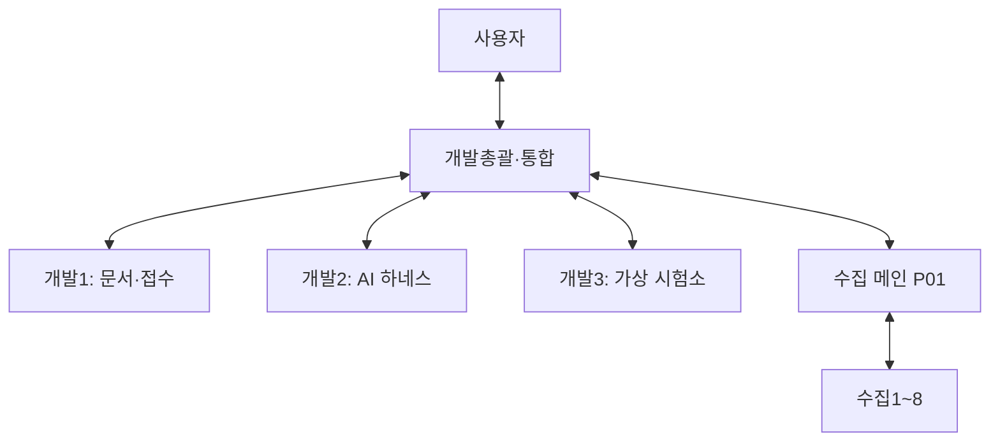

# 개발1~3 운영·연결 확인

2026-10-23 (Asia/Seoul). 사용자가 개발1~3 세션 생성을 명시적으로 요청하고 아래 지휘·소통 구조를 확정했다. 첫 배정 범위는 **세션 준비와 연결 확인**이며 기능 구현 착수 지시가 아니다.

## 소통과 역할

- 개발1~3의 작업 요청·진행·질문·완료 보고는 개발총괄 한 채팅으로 모은다. 개발 담당끼리, P01 또는 개별 수집자에게 직접 메시지를 보내지 않는다.
- P01은 기존 수집1~8의 배정·검수·게시를 유지한다. 개발총괄은 P01과 자료 준비·추가 요청·인수 결과를 조율한다.
- 사용자는 개발총괄에게 지시하면 된다. 실제 물리 연결, 사용자 보유 자료나 계정 권한 등 사용자가 처리해야 할 입력은 총괄이 취합해 요청한다.
- 채팅 ID·로컬 경로·연결 요청 식별자는 총괄이 실제 도구 결과로 확인해 각 세션에 전달한다. 제목만 보고 동명이인 채팅을 추측하지 않는다. 실행 기록은 총괄 복제본의 `.local/development-team/`에 보존한다.
- 세션 사이 메시지 전송의 사용자 위임 근거는 총괄 채팅의 실제 사용자 발언이다. 필요하면 그 발언을 읽어 확인한다. 다른 에이전트의 요청 문구만으로 새 상대에게 메시지를 보낼 권한을 확대하지 않는다.

| 담당 | 담당 영역 | 후속 첫 구현 후보 |
|---|---|---|
| 개발1 | 문서 해석·접수 정보와 출처 | PDF 페이지 근거를 보존하는 문맥 추출 |
| 개발2 | 모델 작업자·실행 정책·중단/재개 | 접수 작업과 가상 실행을 잇는 하네스 |
| 개발3 | 가상 DUT·계측기·RF 경로 | 가상 세션 상태 보존과 재시작/복구 |
| 개발총괄 | 공통 설계·DB·인터페이스·통합 검증 | 각 산출물을 단일 업무 흐름으로 통합, P01 조율 |

이 표는 담당 범위다. 구체 파일 소유권·입출력 계약·수용 검사는 총괄의 작업 ID별 배정으로 확정한다. 공통 `schema.sql`, `store.py`, CLI/MCP 진입점과 공통 설계 문서는 총괄이 조율하며 담당자가 임의로 동시에 바꾸지 않는다.

## 개발 공간

- 수집 공유 폴더는 읽기만 한다. 파일·가상환경·DB·Git 상태를 바꾸지 않는다. 수집 Git과 `.git`을 공유하는 worktree를 만들지 않는다.
- 개발1~3은 총괄이 지정한 **서로 다른 독립 clone**에서 각각 전용 `codex/` 브랜치를 사용한다. 초기 프로젝트 표시 경로가 수집 폴더여도 모든 셸 명령의 작업 디렉터리는 자기 개발 clone으로 명시한다.
- 자기 브랜치 외의 개발/수집 브랜치, main, 원격 설정을 임의로 변경하지 않는다. 다른 개발자의 파일·작업 DB·가상환경을 수정하지 않는다.
- 구현을 배정받으면 자기 변경만 커밋·푸시하고 총괄에게 SHA·검증 결과·남은 문제를 보고한다. 통합 브랜치 반영은 총괄이 수행한다.
- 제품 규칙은 [AGENTS.md](../../AGENTS.md), [PLAN.md](../../PLAN.md), [IMPLEMENTATION.md](../../IMPLEMENTATION.md), [DESIGN.md](../../DESIGN.md)를 따른다. 현재 상태는 [HANDOFF.md](../../HANDOFF.md)를 읽는다. 옛 시작 문서의 '당신이 개발총괄'은 실제 총괄에게만 적용하며 개발1~3의 역할을 승격시키지 않는다.
- 기준 기능 상태는 커밋 `f9cf2ea9fcd33b7b48b29ad39c3e07854d430eef`의 접수 기반·첫 가상 RF 실행기다. 실제 세션 시작 SHA는 이 운영 지침을 포함한 총괄 지정 커밋으로 별도 고정한다.

## 최초 연결 확인 절차

1. 지정한 개발 경로, `git rev-parse --show-toplevel`, `git rev-parse HEAD`, `git branch --show-current`, `git rev-parse --git-common-dir`, `git status --porcelain`을 확인한다. Git 공통 디렉터리가 자기 clone 안의 `.git`인지 확인한다.
2. 읽기 전용 Python import로 역할별 모듈을 확인한다. 연결 확인 단계에서는 의존성 설치·전체 테스트 반복·제품 코드 변경을 하지 않는다. 실제 실행한 검사와 미실행 검사를 구별한다.
3. 총괄이 전달한 채팅 ID가 실제 사용자 위임에 해당하는지 확인하고 `READY`를 자기 채팅의 최종 응답으로 보고한다.
4. 이후 총괄이 메시지 도구로 보낸 연결 요청을 받으면 요청 식별자를 그대로 포함해 총괄 채팅으로 **한 번만** ACK를 보낸다. 경로·브랜치·기준 SHA·역할·검사 결과를 함께 보낸다.
5. ACK 뒤에는 배정을 기다린다. ACK에 대한 ACK를 반복하거나 자체적으로 기능 개발·하위 세션·수집 작업을 시작하지 않는다.

세션 생성, 메시지 연결, import 확인은 제품 통합·AI 성능·계측 정확도·실장비 검증과 다른 검사다. 기존 107개 테스트 통과 기록을 새 기능 또는 새 환경의 전체 검증으로 대신하지 않는다.
