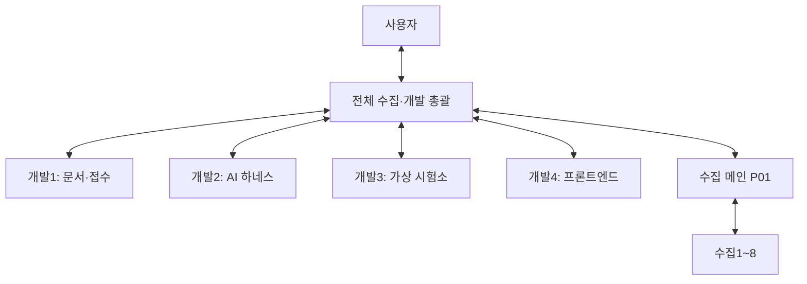

# 개발1~4 운영·연결 확인

최신 [통합029](INTEGRATION-029.md)의 기능 기준은5d891834다. 049 b0/052 C1 fdbc를 독립 최종 Yes 뒤 정확5커밋·7파일로 인수했다. 새 Python2175/Node210, C1 합성 화면23/A1 기존 화면18, 별도 genuine HTTP와 자원 회수를 확인했다. 담당의 검사와 독립 검사, root 검사 수를 합산하지 않는다. 다음047/053/F2의 정확 게시 base와 실제 배정은 최신 private followup을 우선한다. 개발3 054는 독립 최종 Yes/다음 별도 통합, C2는 정적 Yes이며 실제 구현은 의존성 인수 뒤다. P01 B024 공개18/690과 B025 새 metadata ACK2를 구분하고 사용자 준비0을 유지한다.

2026-10-25 계약후속은 [053 설계](../../docs/superpowers/specs/2026-10-25-intake-reference-actions-host-design.md)·[계획](../../docs/superpowers/plans/2026-10-25-intake-reference-actions-host.md), [054 설계](../../docs/superpowers/specs/2026-10-25-virtual-fleet-rf-signal-waveform-design.md)·[계획](../../docs/superpowers/plans/2026-10-25-virtual-fleet-rf-signal-waveform.md)의private/공개delta정적Yes다. D1 049 I4 소유수정·D4 052 C1 코드/회귀는그대로, D3는이번게시exactbase/new3로054구현, D2는049최종인수/소유이관뒤053제품으로잇는다. root028기능3b60b6f/source227와Python2121/Node186/CLI14는이전검증이며이번제품실행0이다. P01B0236c5ee15a 공개exact/112·77·metadata42/새PDF0·한정HAC158/181·v059ACK2/25입력을대조했다. [현재대장](NEXT-004.md)과최신privatefollowup의실제배정/후보를우선하고사용자준비0이다.

최신 [통합028](INTEGRATION-028.md):05186b93aec 소유3/독립최종Yes→기능3b60b6f5·새 Python2121/Node186·소스227 불변·실제CLI14다. 개발1은049c24e806 원3수정확인/No C0I1 후행만료의 정적Yes 공개명확화/같은소유3 추가수정, 개발2는053 private A 정적Yes/공개준비, 개발3은054 v1 No C0I1/privatev2 표현정밀도 보완, 개발4는052 C1/new4 실제구현을 잇는다. 047은049 최종인수 뒤,050F2는실제static3뒤,052C2는053/static1뒤다. P01공개B022574bf4d9 exact/110·75·64metadata/새PDF0·후속v058 실제ACK3/입력35를대조하고 대상17/650·HAC한정150/181·공식0/전수unknown·사용자준비0을유지한다. [현재대장](NEXT-004.md)과최신privatefollowup우선,아래기록은당시상태다.

계약 후속: [052 설계](../../docs/superpowers/specs/2026-10-24-intake-reference-actions-ui-design.md)·[계획](../../docs/superpowers/plans/2026-10-24-intake-reference-actions-ui.md) private/public 정적Yes 뒤 게시정확base/new4를개발4에실제구현배정한다. 개발1 049 No3 소유수정 우선·047 new3는049최종인수뒤, 개발2는053같은host계약준비/현소유이관0, 개발3은051 actual985f46bb/new3 구현/검증이다. root027기능/2092Python186Node는유지하며이번은제품PASS0이다. P01 B021 metadata86payload/새원문0 인수ACK와다음공개대조를privatefollowup으로구별한다. 사용자준비0·소유/원본/실패보존·[현재대장](NEXT-004.md)을따른다.

최신 [통합027](INTEGRATION-027.md):048 exactee005850 신규3→기능339eaa50·독립최종Yes C0I0·새 Python2092/Node186·소스225 불변이다. staging40파일과정식읽기11을새RF실행과구별한다. 개발3은051 공개계약/계획 Yes 뒤 정확게시base/new3 구현, 개발1 049 현재검증/게시, 개발2 052독립계약검토, 개발4 C1보완으로잇는다. 050 F1최종Yes50a9와genuine049/F2미실행은별개다. P01 B020a112d321 공개exact/privateACK3·대상17/650·공식0/전수unknown·FOLLOWUP007 v055실제ACK2/입력30·사용자준비0을유지한다. [현재대장](NEXT-004.md)과최신privatefollowup을따르고아래026은당시기록이다.

최신 [통합026](INTEGRATION-026.md):046 exact807f9cf 신규3→기능636b85d7·독립Yes C0/I0·새 Python2049/Node186·소스223 불변이다. genuine043/025/042 준비1·등록/재전송/예상거절 append3을 확인했으며 실제049 HTTP/DOM은 미실행이다. 개발1 049·개발3 048 현재 구현, 개발2 050 F1 3aa2c7d 독립 제품 리뷰, 개발4 후속F2 recipe를 잇는다. root app은accepted049/실제static3 뒤다. P01 B0181ef774de·95/95·60/60·대상16/603·공식0/전수unknown·v051 실제ACK3/입력34·사용자 준비0이다. [현재대장](NEXT-004.md)과 최신private followup을 따르며 아래025는 당시 기록이다.

최신 [통합025](INTEGRATION-025.md):044A1소유5/기능43b04ae4·새Node186/합성trustedDOM18/source221불변. Python2015는024의이전실행·기존source217/backend전체같음/새Python재실행0이다. 개발1 [049설계](../../docs/superpowers/specs/2026-10-24-intake-reference-http-host-design.md)·[계획](../../docs/superpowers/plans/2026-10-24-intake-reference-http-host.md)3와개발4 [050설계](../../docs/superpowers/specs/2026-10-24-intake-reference-frontend-design.md)·[계획](../../docs/superpowers/plans/2026-10-24-intake-reference-frontend.md)F1/7을정확게시base로실제배정. 제품rootapp은049인수/static3실제제공후·F2genuine별도다. 개발2 046core/개발3 048reader는기존정확base/branch·구현중이다. P01 B0164d3abe8a/87·52/대상16·603/공식0/전수unknown·후속006실제ACK2·사용자준비0,[현재대장](NEXT-004.md)/privatefollowup우선.아래024는당시기록이다.

최신 [통합024](INTEGRATION-024.md):045소유1커밋·3파일/기능fdd40c13·새2015Python156Node/source217·실제CLI자식9·journal7/별도평가0. 개발3 [048 설계](../../docs/superpowers/specs/2026-10-24-virtual-fleet-rf-signal-read-design.md)·[계획](../../docs/superpowers/plans/2026-10-24-virtual-fleet-rf-signal-read.md) A/new3을정확게시base로실제배정한다. 개발2 046core전용branch/ACK·구현중,개발1 049backend/static3최종계약,개발4 044A1최종독립Yes·다음cut인수/A2frontend계획이다. B0163묶음52payload/새원문1 ACK·대상16/603/공식0/전수unknown·한정HAC107/181이며P01B0164d3abe8a 원격exact·87/87·52/52·ACK3를대조했다. FOLLOWUP006기존S08delta1/S07판본대조는실제배정ACK2/고정입력29다. 사용자준비0·[현재대장](NEXT-004.md)과privatefollowup우선,아래023은당시기록이다.

최신 [통합023](INTEGRATION-023.md):043 정확1커밋·3파일/기능938406ca·새1980Python/156Node·소스215 불변·정식043→0427call이다. 개발2의 [046 설계](../../docs/superpowers/specs/2026-10-24-intake-reference-review-host-design.md)·[계획](../../docs/superpowers/plans/2026-10-24-intake-reference-review-host.md) 신규3 코어는 exact 게시base로 실제 배정한다. 미래044 A2 backend는 개발1/049(ui_server/test/newusage3), frontend는 개발4이며 현재044 A1 소유5/API는 유지한다.045 독립Yes/다음통합·048 계약,044 후보 독립리뷰/후속 frontend 계획을 잇는다. P01 B0154 ACK/원격1b65c7ba/84·49·대상15/583·공식0/전수unknown·HAC한정99/181과FOLLOWUP005기존v047실제ACK3이다. 사용자 준비0·새 DOM/고객PDF/실제AI/물리0, [현재대장](NEXT-004.md)과 최신 private followup을 우선하고 아래022는 당시 기록이다.

최신 [통합022](INTEGRATION-022.md)은041 수정/042 API의 정확 소유4커밋·6파일과 기능19c74172·새1934Python/156Node·소스214 불변이다. genuine 합성0417실행/7평가·0427call을 확인했고021 UI81은 이전 결과다. 개발1은 기존021base043 소유3 구현/회귀를 유지한다. 개발4의 [044 설계](../../docs/superpowers/specs/2026-10-24-intake-reference-ui-design.md)·[계획](../../docs/superpowers/plans/2026-10-24-intake-reference-ui.md) A1신규5와 개발3의 [045 설계](../../docs/superpowers/specs/2026-10-24-virtual-fleet-rf-signal-cli-design.md)·[계획](../../docs/superpowers/plans/2026-10-24-virtual-fleet-rf-signal-cli.md) 신규3은 공개 builder Yes 뒤 고정해 exact022게시base 구현으로 잇는다. 개발2는046 A/A1 계약 검토·실패수용 조건을 준비한다. P01 B0143패킷 ACK·대상15/583/제외1/46/대응보류1/53·공식0/전수unknown·사용자준비0이다. [현재대장](NEXT-004.md)과 최신 private followup의 실제 배정/인수를 따르며 아래021 이하는 보존한다.

최신 [통합021](INTEGRATION-021.md)은 기능8cd888f·039 feature+fix2/소유10·독립 최종 Yes, 새1866Python156Node/소스210·화면81이다. 개발1은043의 고정 [설계](../../docs/superpowers/specs/2026-10-24-store-open-existing-design.md)·[계획](../../docs/superpowers/plans/2026-10-24-store-open-existing.md)와 정확 게시 base에서 기존 Store 수정+신규test/usage3을 구현한다. 개발2 042 dad5801·개발3 041 I1 수정3c3932f의 독립 검토를 계속하며 개발4 044 A/v2 정적 Yes는 실제 접수 화면의 다음 계약이다. P01 metadata4 새ACK/새PDF0·대상13/522·제외1/46·대응보류1/53을 유지한다. [현재 대장](NEXT-004.md)과 최신 private followup을 우선하고 아래020 이하는 보존한다. 사용자 결정/준비0·실제AI/물리/현행규범 미검증이다.

최신 [통합020](INTEGRATION-020.md)의 기능 기준은141042da/새1857Python114Node·소스206이다. 038·040의 소유4커밋/6파일만 인수했고 독립 최종 Yes·genuine 합성 참고5call/CLI 자식2를 확인했다. 개발1은043 공식 opener의 합성 probe/계약, 개발2는572cacf 기반042 신규3 구현, 개발3은041 최종 회귀·게시, 개발4는039 Unicode I1 수정8e804c3 독립 재검토와044 계약을 이어간다. 기존 branch를 새 통합 base로 임의 재작성하지 않는다. P01 게시74e86aea/73·38·대상13/522·제외1/46·대응 보류1/53을 구별하며 [현재 대장](NEXT-004.md)과 최신 private followup을 우선한다. 사용자 결정/준비0·전수/실제AI·물리 미검증이며 아래042/019는 당시 이력이다.

현재root기능은01920b5185/1777Python114Node/source202다. [042 고정 설계](../../docs/superpowers/specs/2026-10-24-intake-reference-review-design.md)·[계획](../../docs/superpowers/plans/2026-10-24-intake-reference-review.md)의v3/공개builder독립Yes를확인해정확게시base+승인038source196c·문구8f별도의존으로개발2신규3파일구현을배정한다. 040I1수정eba7caa재리뷰/043공식Store계약,039a6354afe독립리뷰/044최소참고이력화면계약,041구현을병행한다. [현재대장](NEXT-004.md)과최신privatefollowup을함께읽고이미위임된가역적개발을사용자재확인으로멈추지않는다. P01한창구/소유권·원본·실패보존과사용자준비0·전체AI/실물미검증을유지한다.

현재 root는019 게시a028f8a/기능20b5185·1777Python114Node/source202를 유지한다. [041 고정 설계](../../docs/superpowers/specs/2026-10-24-virtual-fleet-rf-signal-scenario-design.md)·[계획](../../docs/superpowers/plans/2026-10-24-virtual-fleet-rf-signal-scenario.md)의 소유제안v3/공개delta독립Yes를 확인했고 게시 후 정확base로 개발3 신규3파일 구현을 배정한다. 신규7/7·변조8·저장10은 아직 미실행이다. 개발1 040후보 독립리뷰/043계약, 개발2 038독립Yes·문구수정/042이유I1보완, 개발4 039 구현을 계속한다. P01후속002 실제배정·ACK/준비된묶음 인수는 총괄한창구로 이어가며 [현재대장](NEXT-004.md)과 최신privatefollowup을 함께 읽는다. 사용자 결정/준비0·전체AI/물리완료 미주장.

최신 [통합019](INTEGRATION-019.md)은034 수정·036·037을 정확 소유4커밋/9파일·독립 최종Yes 뒤 인수했다. 새 전체Python1777/Node114·소스202 불변·로더→계산·읽기HTTP5/접수034→032 합성연결을 확인했다. 개발1 040와개발4 039의 기존 구현을 유지하고 개발2 038 독립 리뷰·042 최소접점 계약, 개발3 041 출력실패 계약 보완을 이어간다. P01 게시4ba0177·대상/참조12PDF489쪽·별도제외1/46·v039 실제배정3/ACK3을 유지한다. [현재대장](NEXT-004.md)과 최신 private followup을 함께 읽는다. 사용자 준비0·실제AI/물리/규범 미검증이며 아래018은 당시 기록이다.

018 e2f998c의1677Python114Node123UI/source196은유지하고 [039 설계](../../docs/superpowers/specs/2026-10-24-fcc-case-calculation-ui-design.md)·[계획](../../docs/superpowers/plans/2026-10-24-fcc-case-calculation-ui.md),[040 설계](../../docs/superpowers/specs/2026-10-24-fcc-case-serve-design.md)·[계획](../../docs/superpowers/plans/2026-10-24-fcc-case-serve.md)을다음구현으로배정한다. 개발2 038·개발4 039·개발1 040구현과개발3 041계약/총괄019통합을계속한다. 코드/가상실행/원문준비·독립리뷰/게시를구별하며P01신규3패킷인수뒤target12/489·excluded1/46·전수unknown/사용자준비0이다. 아래018본문은각시점기록이다.

최신 [통합018](INTEGRATION-018.md)은033/독립Yes·새1677Python114Node·source196불변·제품UI123을 인수했다.034 수정최종/036은 독립Yes이나018 code에 포함하지 않으며037리뷰를 병행한다. 개발2 [038 설계](../../docs/superpowers/specs/2026-10-24-intake-reference-ledger-design.md)·[계획](../../docs/superpowers/plans/2026-10-24-intake-reference-ledger.md) 신규3파일 구현을 실제배정했고 개발1/3/4는 지적우선과040/041/039 후속계약·검사준비를 받았다. P01 metadata67JSON ACK·원문11/466·실제v0383배정/ACK3·사용자준비0을 유지한다. [현재대장](NEXT-004.md)과 최신private followup을 우선하며 아래017 이하는 보존이력이다.

최신 [통합017](INTEGRATION-017.md)은035소유3파일/독립Yes·새전체1671/Node103·source193불변·제품31/JSON3call·원문0을확인했다. 개발1은037 B명시host/신규3파일구현승인·정확017게시pin수신으로이어가고034A/036/033도계속한다. P01의원본11/466·EMC모델상충/S08옛10-only·후속S07/S08재사용요청과사용자준비0을유지한다. [현재대장](NEXT-004.md)을우선하며아래016 이하는당시이력이다.

016 게시후031은독립최종Yes/C0/I0/직접합성16·새PDF0으로인수했고036 B순수계산서비스/신규3파일을개발3에즉시구현배정했다.035 owner49ef565의독립리뷰와지적우선·개발1다음037명시host계약,034A/033구현도계속한다. [현재대장](NEXT-004.md)과최신private followup을따르며016당시리뷰중기록은보존한다.

최신 [통합016](INTEGRATION-016.md)은027/030/032의정확소유3commit·독립Yes/새전체 Python1646·Node103/source193불변·제품route17+14를확인했다. 추가S05 singlecase옛검사전제실패11후2미실행을보존/033에배정했고원본10/431·모집단unknown/공식대응0을유지한다.031 owner실제단일셀계산/독립인수검토·035입력준비/034A현재snapshot/033화면구현·036계약제안을실제배정했다. 사용자준비0이며[현재대장](NEXT-004.md)을우선하고아래015 이하는당시이력이다.

최신 [통합015](INTEGRATION-015.md)는028/029/026fix를 독립Yes 뒤 정확4commit으로 인수했다. 새 전체 Python1578/Node103·source186불변과 실제3PDF153쪽 재생·발견7/준비부족3·평가6null을 확인했다. P01 한창구/수집1~8 운영은 계속되며 원본/참조9PDF424쪽은 전수/전쪽 의미검토와 구별한다. 개발1 030독립Yes/031정식producer인수·035입력어댑터 제안, 개발2 032독립Yes·034저장계약제안, 개발3 031privatecaller15합성PASS/정식입력 연결, 개발4 027독립Yes/033화면구현을 실제 배정했다.027/030/032는 다음016범위이며 [현재대장](NEXT-004.md)을 우선한다. 사용자 준비0·전체AI/물리 완료 미주장, 아래014 이하는 당시 기록이다.

최신 [통합014](INTEGRATION-014.md)는021/023/024/025를 소유 수정·독립 최종 Yes 후 인수했다. 새 전체 Python1492/skip0·Node103·contract화면13/실제S03 12/S05 12 PASS, source182개는 같다. 요청012는 P01→수집1~8 실제 운영/8최신패킷 ACK와 원본·참조7PDF348쪽 인수를 이어갔다. 현재 개발1 DISCOVERY028 최종Yes/다음015 및 선택페이지030승인/구현, 개발2 평가029게시/독립리뷰, 개발3 준비026 Important1 소유수정, 개발4 정식route027구현을 실제 배정했다. 전체 수집·실제AI·실물 완료는 주장하지 않으며 사용자 결정/준비0, 아래013 이하는 당시 기록이다. [현재대장](NEXT-004.md)을 우선한다.

최신 [통합013](INTEGRATION-013.md)은004 최종 수정·016/019/신규022를 정확 소유 커밋으로 인수하고 새 전체 Python1379/skip0·기존64Fleet 새8/역사8을 확인했다. 요청012 실제8배정·동결ACK8/입력80과 S06 14JSON·S03 첫 실제 PDF2/111쪽27payload를 인수했다. 현재 개발1 021 리뷰/수정, 개발4 실제024 화면, 개발3 계산023, 개발2 다음025를 실제 배정했다. 공식 mapping/독립평가 적격0·HAC72쪽 자동미인용·미보유분/상충·전수모집단unknown을 보존한다. 사용자 준비0, 아래012 이하는 당시 기록이며 [현재 대장](NEXT-004.md)을 우선한다.

최신 [통합012](INTEGRATION-012.md)는 DELTA015·수정 STOP013·UI017 독립 최종 Yes/새 전체 Python1237·Node86·실제 화면46묶음/가상Fleet정지17사례를 확인했다. [신규 corpus012](../../docs/material-intake/2026-10-24-hct-fcc-corpus-request.md)를 P01→수집1~8 v021로 실제 전송했고 기존011 readback12JSON을 인수·019에 전달했다. 개발1 CASE021/개발4 VIEW024는 새 전용branch/소유권 ACK, 개발2 완료016 독립리뷰/새GROUP022 실제 배정, 개발3 진행019/다음023 계약을 이어간다. 현재 [후속대장](NEXT-004.md)을 우선하며 아래011 이하는 보존 이력이다. 모집단·검수 전 적격 수를 완료로 꾸미지 않고 사용자 준비0/기존작업 보존을 유지한다.

현재 [통합011](INTEGRATION-011.md)의 MAX014·DUT UI012를 독립 Yes 후 인수했다. 새 전체 Python1176/Node81·DUT자료 화면12+기존27=39묶음/합성source실행6사례 PASS다. [후속대장](NEXT-004.md)의 개발1prepare004 No2/개발2stop013 No3 소유 수정·개발3DELTA015/개발4ACQUISITION-UI017 실제 배정/ACK·구현을 이어간다. P01 기존 자료를 재사용해 공개metadata6그룹/22file를 별도 pin으로 인수했고 새 수집 의존/사용자 준비0이다. 아래010/008 이하는 각 당시 기록이다.

최신 단위는 [통합008](INTEGRATION-008.md)의 지정 vendor 조사 인수·보존 replay/밀도source/actual spectrum browser와 [후속대장](NEXT-004.md)의 catalog API·화면/N1914A 경계/probe다. P01 CTRL001..006 실제 배정 ACK·TRACE007 인수 후에도 자료 전체 완료를 기다리지 않고 구현·검증·통합을 이어간다. 아래 최초 연결/화면 착수 상태는 보존 이력이다.

2026-10-23 (Asia/Seoul). 사용자가 개발1~3의 연결 확인에 이어 개발4의 추가와 프론트엔드 개발을 요청했다. 총괄은 전체 수집·개발을 조율하며, 개발4에 [첫 화면 구현 DEV4-UI-001](DEV4-UI-001.md)을 배정했다. 이어 개발1~3에 [첫 병렬 개발 묶음](SPRINT-001.md)을 실제 전달하고 세 채팅의 실행 시작을 확인했다.

연결 결과: [개발1~4 생성·왕복 연결 확인](CONNECTION-CHECK.md). 세션별 Git·import·ACK 검사와 범위를 기록했다. 현재 개발1~4 모두 첫 구현 작업을 배정받았으며, 연결 확인과 제품 기능 완료를 구별한다.

후속 배정: [DEV-SPRINT-001](SPRINT-001.md)에 개발1 PDF 추출, 개발2 접수 작업자, 개발3 가상 세션 저장/복구의 범위와 수용 검사를 고정했다. 담당별 실제 인수 상태는 총괄의 배정 기록을 따른다.

## 소통과 역할

### 연속 개발 운영 — 2026-10-24 사용자 상시 위임

사용자는 각 세션 작업이 끝나면 총괄이 추가 사용자 지시 없이 다음 단위를 배정하고, 검토에서 멈추지 말고 구현·검증·통합까지 이어가도록 위임했다. 완료 보고를 받은 총괄은 증거·소유권·의존성을 확인하고 다음 독립 가능 작업 또는 현재 작업의 수정/검증을 바로 배정한다. 사용자에게는 실제 결정하거나 준비해야 하는 항목만 모아 알린다.

- 반복 흐름은 자료/계약 확인 → 범위·입출력·소유파일·수용조건 고정 → 담당 구현 → 관련 검사 → 독립 리뷰/수정 → 총괄 통합·회귀 → 커밋/푸시·원격 대조 → 후속 배정이다.
- 계약 검토의 완료를 기능 완료로 처리하지 않는다. 검토에서 나온 구현 공백은 실제 작업과 수용 검사로 전환한다. 한 단위의 종료는 전체 시험소 완료가 아니다.
- 총괄이 담당 구현을 일괄 대신 맡지 않는다. 사용량 제한으로 중단된 담당은 제한 상태와 기존 산출물을 보존하고 가능한 시점에 재개시킨다. 같은 제한 오류가 계속되면 무의미한 재전송을 반복하지 않는다.
- 개발1~4는 총괄과, 수집1~8은 P01과 소통한다. P01은 실제 개발 공백에 맞는 후속 수집을 배정하고 준비된 묶음부터 총괄에 반환한다. 의미 없는 중복 수집으로 세션을 채우지 않는다.
- 사용자 결정이 필요한 항목은 이유·선택지·최소 준비물·막힌 범위를 명시한다. 이미 위임된 가역적 개발/수정/검증/개발 브랜치 게시와 독립 가능한 작업을 그 질문 때문에 멈추지 않는다.
- 이 채팅의 15분 주기 자동 후속 점검을 활성화했다. 실제 진행/제한 상태와 저장된 인계·작업 배정을 확인해 다음 실행을 이어간다. 자동화는 기존 파일·계정·실장비 권한을 확대하지 않는다.

최신 후속은 [통합 기록 007](INTEGRATION-007.md)·[006](INTEGRATION-006.md)·[005](INTEGRATION-005.md), 기존 연결은 [통합 기록 004](INTEGRATION-004.md)와 [실제 접수→가상 결과 실행](../../docs/fcc/intake_fixture_check_usage.md)을 따른다. [후속 인수 대장](NEXT-004.md)의 ledger/모델 경계·구성요소까지 인수하고 다음 replay/로컬 교환·frequency source/실제 계산 브라우저를 배정했다. 아래 최초 연결 절차의 ACK 뒤 대기는 최초 연결 확인에 한정하며 완료한 기능 뒤 다음 사용자 지시를 기다리라는 뜻이 아니다. 로컬 자동 점검은 이 PC와 Codex 앱이 실행 중일 때 동작한다.

- 개발1~4의 작업 요청·진행·질문·완료 보고는 총괄 한 채팅으로 모은다. 개발 담당끼리, P01 또는 개별 수집자에게 직접 메시지를 보내지 않는다.
- P01은 기존 수집1~8의 배정·검수·게시를 유지한다. 개발총괄은 P01과 자료 준비·추가 요청·인수 결과를 조율한다.
- 사용자는 개발총괄에게 지시하면 된다. 실제 물리 연결, 사용자 보유 자료나 계정 권한 등 사용자가 처리해야 할 입력은 총괄이 취합해 요청한다.
- 채팅 ID·로컬 경로·연결 요청 식별자는 총괄이 실제 도구 결과로 확인해 각 세션에 전달한다. 제목만 보고 동명이인 채팅을 추측하지 않는다. 실행 기록은 총괄 복제본의 `.local/development-team/`에 보존한다.
- 세션 사이 메시지 전송의 사용자 위임 근거는 총괄 채팅의 실제 사용자 발언이다. 필요하면 그 발언을 읽어 확인한다. 다른 에이전트의 요청 문구만으로 새 상대에게 메시지를 보낼 권한을 확대하지 않는다.

| 담당 | 담당 영역 | 첫 구현 작업 |
|---|---|---|
| 개발1 | 문서 해석·접수 정보와 출처 | DEV1-DOC-001: PDF 페이지 근거 추출 |
| 개발2 | 모델 작업자·실행 정책·중단/재개 | DEV2-WORKER-001: 제한된 접수 작업자 |
| 개발3 | 가상 DUT·계측기·RF 경로 | DEV3-SESSION-001: 가상 세션 저장·재시작/복구 |
| 개발4 | 프론트엔드·화면 전용 데이터 연결·사용성 | 접수 목록·상세·근거·질문·알림을 실제 접수 상태와 연결 |
| 총괄 | 전체 수집·개발 우선순위·공통 설계·DB·계약·통합 검증 | 개발1~4 산출물 검토·통합과 P01 조율 |

이 표는 담당 범위다. 구체 파일 소유권·입출력 계약·수용 검사는 총괄의 작업 ID별 배정으로 확정한다. 공통 `schema.sql`, `store.py`, CLI/MCP 진입점과 공통 설계 문서는 총괄이 조율하며 담당자가 임의로 동시에 바꾸지 않는다.

## 프론트엔드와 실제 사용 흐름

2026-10-23 사용자가 프론트엔드의 포함 여부와 사용 방법을 확인한 뒤 개발4를 전담으로 추가하도록 지시했다. 기존 [첫 사용자 인터페이스 설계](../../docs/superpowers/specs/2026-10-23-smartphone-wifi24-bgn-design.md)와 [화면 규칙](../../DESIGN.md)을 개발4가 구현한다. 총괄은 공통 계약·전체 흐름 통합·검증을 담당하며 개발1~3의 담당 영역은 유지한다.

현재 구현은 Python/SQLite 서비스, CLI, stdio MCP와 HTML/PDF/JSON 보고서 출력이다. 사용자용 웹 화면, HTTP API, 자동 모델 작업자는 아직 없으며 보고서 HTML을 운영 화면으로 취급하지 않는다. 개발 중 Codex에서 수동 호출할 수 있어도 운영 기능의 완료 조건은 Codex 대화창에 의존하지 않는다.

첫 사용 흐름은 다음과 같다. 구체 화면 코드·연동 API·검사는 후속 구현 대상으로 둔다.

1. 자료를 등록하거나 지정 폴더의 접수 묶음을 선택하고 의뢰·원본 버전을 확인한다.
2. 의뢰 요약과 출처, 누락·충돌을 보고 필요한 질문에 답하거나 보류·진행을 지시한다. 제품/규격 정답이나 같은 진행 승인을 반복 입력하게 하지 않는다.
3. 가상 모드에서 스마트폰·연결·계측기 상태, 실행 단계, 관측값과 실패·복구를 확인한다. 합성 결과, 기록 재생, 실측을 항상 구분한다.
4. 결과에서 원본·계산·판정 근거와 보고서 초안으로 이동한다. 미수행 작업과 미지원 기능은 완료로 표시하지 않는다.

접수 상태·질문/답변의 실제 서비스 연결부터 구현하고, 등록·모델 작업자·가상 실행의 연결 범위를 순차 확대한다. 수집 전체가 끝나기 전에도 합성 입력과 준비된 서비스로 화면 개발·검증을 진행할 수 있다. 실장비 모드는 해당 어댑터·현장 권한·검증이 갖춰진 뒤 같은 업무 흐름에 연결한다. 문서 변경 자체는 사용자 화면이나 종단 간 AI 실행의 검증이 아니다.

## 개발 공간

- 수집 공유 폴더는 읽기만 한다. 파일·가상환경·DB·Git 상태를 바꾸지 않는다. 수집 Git과 `.git`을 공유하는 worktree를 만들지 않는다.
- 개발1~4는 총괄이 지정한 **서로 다른 독립 clone**에서 각각 전용 `codex/` 브랜치를 사용한다. 초기 프로젝트 표시 경로가 수집 폴더여도 모든 셸 명령의 작업 디렉터리는 자기 개발 clone으로 명시한다.
- 자기 브랜치 외의 개발/수집 브랜치, main, 원격 설정을 임의로 변경하지 않는다. 다른 개발자의 파일·작업 DB·가상환경을 수정하지 않는다.
- 구현을 배정받으면 자기 변경만 커밋·푸시하고 총괄에게 SHA·검증 결과·남은 문제를 보고한다. 통합 브랜치 반영은 총괄이 수행한다.
- 제품 규칙은 [AGENTS.md](../../AGENTS.md), [PLAN.md](../../PLAN.md), [IMPLEMENTATION.md](../../IMPLEMENTATION.md), [DESIGN.md](../../DESIGN.md)를 따른다. 현재 상태는 [HANDOFF.md](../../HANDOFF.md)를 읽는다. 옛 시작 문서의 '당신이 개발총괄'은 실제 총괄에게만 적용하며 개발1~4의 역할을 승격시키지 않는다.
- 기준 기능 상태는 커밋 `f9cf2ea9fcd33b7b48b29ad39c3e07854d430eef`의 접수 기반·첫 가상 RF 실행기다. 실제 세션 시작 SHA는 이 운영 지침을 포함한 총괄 지정 커밋으로 별도 고정한다.

## 최초 연결 확인 절차

1. 지정한 개발 경로, `git rev-parse --show-toplevel`, `git rev-parse HEAD`, `git branch --show-current`, `git rev-parse --git-common-dir`, `git status --porcelain`을 확인한다. Git 공통 디렉터리가 자기 clone 안의 `.git`인지 확인한다.
2. 읽기 전용 Python import로 역할별 모듈을 확인한다. 연결 확인 단계에서는 의존성 설치·전체 테스트 반복·제품 코드 변경을 하지 않는다. 실제 실행한 검사와 미실행 검사를 구별한다.
3. 총괄이 전달한 채팅 ID가 실제 사용자 위임에 해당하는지 확인하고 `READY`를 자기 채팅의 최종 응답으로 보고한다.
4. 이후 총괄이 메시지 도구로 보낸 연결 요청을 받으면 요청 식별자를 그대로 포함해 총괄 채팅으로 **한 번만** ACK를 보낸다. 경로·브랜치·기준 SHA·역할·검사 결과를 함께 보낸다.
5. ACK 뒤에는 배정을 기다린다. ACK에 대한 ACK를 반복하거나 자체적으로 기능 개발·하위 세션·수집 작업을 시작하지 않는다.

세션 생성, 메시지 연결, import 확인은 제품 통합·AI 성능·계측 정확도·실장비 검증과 다른 검사다. 기존 107개 테스트 통과 기록을 새 기능 또는 새 환경의 전체 검증으로 대신하지 않는다.
