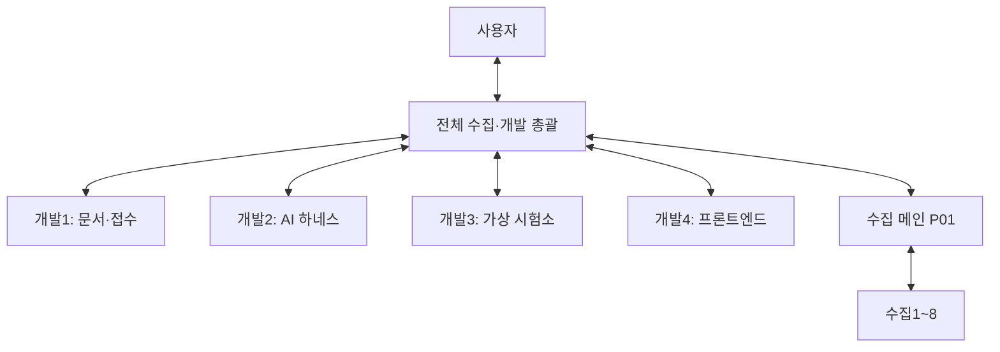

# 개발1~4 운영·연결 확인

현재 [통합011](INTEGRATION-011.md)의 MAX014·DUT UI012를 독립 Yes 후 인수했다. 새 전체 Python1176/Node81·DUT자료 화면12+기존27=39묶음/합성source실행6사례 PASS다. [후속대장](NEXT-004.md)의 개발1prepare004 No2/개발2stop013 No3 소유 수정·개발3DELTA015/개발4ACQUISITION-UI017 실제 배정/ACK·구현을 이어간다. P01 기존 자료를 재사용해 공개metadata6그룹/22file를 별도 pin으로 인수했고 새 수집 의존/사용자 준비0이다. 아래010/008 이하는 각 당시 기록이다.

최신 단위는 [통합008](INTEGRATION-008.md)의 지정 vendor 조사 인수·보존 replay/밀도source/actual spectrum browser와 [후속대장](NEXT-004.md)의 catalog API·화면/N1914A 경계/probe다. P01 CTRL001..006 실제 배정 ACK·TRACE007 인수 후에도 자료 전체 완료를 기다리지 않고 구현·검증·통합을 이어간다. 아래 최초 연결/화면 착수 상태는 보존 이력이다.

2026-10-23 (Asia/Seoul). 사용자가 개발1~3의 연결 확인에 이어 개발4의 추가와 프론트엔드 개발을 요청했다. 총괄은 전체 수집·개발을 조율하며, 개발4에 [첫 화면 구현 DEV4-UI-001](DEV4-UI-001.md)을 배정했다. 이어 개발1~3에 [첫 병렬 개발 묶음](SPRINT-001.md)을 실제 전달하고 세 채팅의 실행 시작을 확인했다.

연결 결과: [개발1~4 생성·왕복 연결 확인](CONNECTION-CHECK.md). 세션별 Git·import·ACK 검사와 범위를 기록했다. 현재 개발1~4 모두 첫 구현 작업을 배정받았으며, 연결 확인과 제품 기능 완료를 구별한다.

후속 배정: [DEV-SPRINT-001](SPRINT-001.md)에 개발1 PDF 추출, 개발2 접수 작업자, 개발3 가상 세션 저장/복구의 범위와 수용 검사를 고정했다. 담당별 실제 인수 상태는 총괄의 배정 기록을 따른다.

## 소통과 역할

### 연속 개발 운영 — 2026-10-24 사용자 상시 위임

사용자는 각 세션 작업이 끝나면 총괄이 추가 사용자 지시 없이 다음 단위를 배정하고, 검토에서 멈추지 말고 구현·검증·통합까지 이어가도록 위임했다. 완료 보고를 받은 총괄은 증거·소유권·의존성을 확인하고 다음 독립 가능 작업 또는 현재 작업의 수정/검증을 바로 배정한다. 사용자에게는 실제 결정하거나 준비해야 하는 항목만 모아 알린다.

- 반복 흐름은 자료/계약 확인 → 범위·입출력·소유파일·수용조건 고정 → 담당 구현 → 관련 검사 → 독립 리뷰/수정 → 총괄 통합·회귀 → 커밋/푸시·원격 대조 → 후속 배정이다.
- 계약 검토의 완료를 기능 완료로 처리하지 않는다. 검토에서 나온 구현 공백은 실제 작업과 수용 검사로 전환한다. 한 단위의 종료는 전체 시험소 완료가 아니다.
- 총괄이 담당 구현을 일괄 대신 맡지 않는다. 사용량 제한으로 중단된 담당은 제한 상태와 기존 산출물을 보존하고 가능한 시점에 재개시킨다. 같은 제한 오류가 계속되면 무의미한 재전송을 반복하지 않는다.
- 개발1~4는 총괄과, 수집1~8은 P01과 소통한다. P01은 실제 개발 공백에 맞는 후속 수집을 배정하고 준비된 묶음부터 총괄에 반환한다. 의미 없는 중복 수집으로 세션을 채우지 않는다.
- 사용자 결정이 필요한 항목은 이유·선택지·최소 준비물·막힌 범위를 명시한다. 이미 위임된 가역적 개발/수정/검증/개발 브랜치 게시와 독립 가능한 작업을 그 질문 때문에 멈추지 않는다.
- 이 채팅의 15분 주기 자동 후속 점검을 활성화했다. 실제 진행/제한 상태와 저장된 인계·작업 배정을 확인해 다음 실행을 이어간다. 자동화는 기존 파일·계정·실장비 권한을 확대하지 않는다.

최신 후속은 [통합 기록 007](INTEGRATION-007.md)·[006](INTEGRATION-006.md)·[005](INTEGRATION-005.md), 기존 연결은 [통합 기록 004](INTEGRATION-004.md)와 [실제 접수→가상 결과 실행](../../docs/fcc/intake_fixture_check_usage.md)을 따른다. [후속 인수 대장](NEXT-004.md)의 ledger/모델 경계·구성요소까지 인수하고 다음 replay/로컬 교환·frequency source/실제 계산 브라우저를 배정했다. 아래 최초 연결 절차의 ACK 뒤 대기는 최초 연결 확인에 한정하며 완료한 기능 뒤 다음 사용자 지시를 기다리라는 뜻이 아니다. 로컬 자동 점검은 이 PC와 Codex 앱이 실행 중일 때 동작한다.

- 개발1~4의 작업 요청·진행·질문·완료 보고는 총괄 한 채팅으로 모은다. 개발 담당끼리, P01 또는 개별 수집자에게 직접 메시지를 보내지 않는다.
- P01은 기존 수집1~8의 배정·검수·게시를 유지한다. 개발총괄은 P01과 자료 준비·추가 요청·인수 결과를 조율한다.
- 사용자는 개발총괄에게 지시하면 된다. 실제 물리 연결, 사용자 보유 자료나 계정 권한 등 사용자가 처리해야 할 입력은 총괄이 취합해 요청한다.
- 채팅 ID·로컬 경로·연결 요청 식별자는 총괄이 실제 도구 결과로 확인해 각 세션에 전달한다. 제목만 보고 동명이인 채팅을 추측하지 않는다. 실행 기록은 총괄 복제본의 `.local/development-team/`에 보존한다.
- 세션 사이 메시지 전송의 사용자 위임 근거는 총괄 채팅의 실제 사용자 발언이다. 필요하면 그 발언을 읽어 확인한다. 다른 에이전트의 요청 문구만으로 새 상대에게 메시지를 보낼 권한을 확대하지 않는다.

| 담당 | 담당 영역 | 첫 구현 작업 |
|---|---|---|
| 개발1 | 문서 해석·접수 정보와 출처 | DEV1-DOC-001: PDF 페이지 근거 추출 |
| 개발2 | 모델 작업자·실행 정책·중단/재개 | DEV2-WORKER-001: 제한된 접수 작업자 |
| 개발3 | 가상 DUT·계측기·RF 경로 | DEV3-SESSION-001: 가상 세션 저장·재시작/복구 |
| 개발4 | 프론트엔드·화면 전용 데이터 연결·사용성 | 접수 목록·상세·근거·질문·알림을 실제 접수 상태와 연결 |
| 총괄 | 전체 수집·개발 우선순위·공통 설계·DB·계약·통합 검증 | 개발1~4 산출물 검토·통합과 P01 조율 |

이 표는 담당 범위다. 구체 파일 소유권·입출력 계약·수용 검사는 총괄의 작업 ID별 배정으로 확정한다. 공통 `schema.sql`, `store.py`, CLI/MCP 진입점과 공통 설계 문서는 총괄이 조율하며 담당자가 임의로 동시에 바꾸지 않는다.

## 프론트엔드와 실제 사용 흐름

2026-10-23 사용자가 프론트엔드의 포함 여부와 사용 방법을 확인한 뒤 개발4를 전담으로 추가하도록 지시했다. 기존 [첫 사용자 인터페이스 설계](../../docs/superpowers/specs/2026-10-23-smartphone-wifi24-bgn-design.md)와 [화면 규칙](../../DESIGN.md)을 개발4가 구현한다. 총괄은 공통 계약·전체 흐름 통합·검증을 담당하며 개발1~3의 담당 영역은 유지한다.

현재 구현은 Python/SQLite 서비스, CLI, stdio MCP와 HTML/PDF/JSON 보고서 출력이다. 사용자용 웹 화면, HTTP API, 자동 모델 작업자는 아직 없으며 보고서 HTML을 운영 화면으로 취급하지 않는다. 개발 중 Codex에서 수동 호출할 수 있어도 운영 기능의 완료 조건은 Codex 대화창에 의존하지 않는다.

첫 사용 흐름은 다음과 같다. 구체 화면 코드·연동 API·검사는 후속 구현 대상으로 둔다.

1. 자료를 등록하거나 지정 폴더의 접수 묶음을 선택하고 의뢰·원본 버전을 확인한다.
2. 의뢰 요약과 출처, 누락·충돌을 보고 필요한 질문에 답하거나 보류·진행을 지시한다. 제품/규격 정답이나 같은 진행 승인을 반복 입력하게 하지 않는다.
3. 가상 모드에서 스마트폰·연결·계측기 상태, 실행 단계, 관측값과 실패·복구를 확인한다. 합성 결과, 기록 재생, 실측을 항상 구분한다.
4. 결과에서 원본·계산·판정 근거와 보고서 초안으로 이동한다. 미수행 작업과 미지원 기능은 완료로 표시하지 않는다.

접수 상태·질문/답변의 실제 서비스 연결부터 구현하고, 등록·모델 작업자·가상 실행의 연결 범위를 순차 확대한다. 수집 전체가 끝나기 전에도 합성 입력과 준비된 서비스로 화면 개발·검증을 진행할 수 있다. 실장비 모드는 해당 어댑터·현장 권한·검증이 갖춰진 뒤 같은 업무 흐름에 연결한다. 문서 변경 자체는 사용자 화면이나 종단 간 AI 실행의 검증이 아니다.

## 개발 공간

- 수집 공유 폴더는 읽기만 한다. 파일·가상환경·DB·Git 상태를 바꾸지 않는다. 수집 Git과 `.git`을 공유하는 worktree를 만들지 않는다.
- 개발1~4는 총괄이 지정한 **서로 다른 독립 clone**에서 각각 전용 `codex/` 브랜치를 사용한다. 초기 프로젝트 표시 경로가 수집 폴더여도 모든 셸 명령의 작업 디렉터리는 자기 개발 clone으로 명시한다.
- 자기 브랜치 외의 개발/수집 브랜치, main, 원격 설정을 임의로 변경하지 않는다. 다른 개발자의 파일·작업 DB·가상환경을 수정하지 않는다.
- 구현을 배정받으면 자기 변경만 커밋·푸시하고 총괄에게 SHA·검증 결과·남은 문제를 보고한다. 통합 브랜치 반영은 총괄이 수행한다.
- 제품 규칙은 [AGENTS.md](../../AGENTS.md), [PLAN.md](../../PLAN.md), [IMPLEMENTATION.md](../../IMPLEMENTATION.md), [DESIGN.md](../../DESIGN.md)를 따른다. 현재 상태는 [HANDOFF.md](../../HANDOFF.md)를 읽는다. 옛 시작 문서의 '당신이 개발총괄'은 실제 총괄에게만 적용하며 개발1~4의 역할을 승격시키지 않는다.
- 기준 기능 상태는 커밋 `f9cf2ea9fcd33b7b48b29ad39c3e07854d430eef`의 접수 기반·첫 가상 RF 실행기다. 실제 세션 시작 SHA는 이 운영 지침을 포함한 총괄 지정 커밋으로 별도 고정한다.

## 최초 연결 확인 절차

1. 지정한 개발 경로, `git rev-parse --show-toplevel`, `git rev-parse HEAD`, `git branch --show-current`, `git rev-parse --git-common-dir`, `git status --porcelain`을 확인한다. Git 공통 디렉터리가 자기 clone 안의 `.git`인지 확인한다.
2. 읽기 전용 Python import로 역할별 모듈을 확인한다. 연결 확인 단계에서는 의존성 설치·전체 테스트 반복·제품 코드 변경을 하지 않는다. 실제 실행한 검사와 미실행 검사를 구별한다.
3. 총괄이 전달한 채팅 ID가 실제 사용자 위임에 해당하는지 확인하고 `READY`를 자기 채팅의 최종 응답으로 보고한다.
4. 이후 총괄이 메시지 도구로 보낸 연결 요청을 받으면 요청 식별자를 그대로 포함해 총괄 채팅으로 **한 번만** ACK를 보낸다. 경로·브랜치·기준 SHA·역할·검사 결과를 함께 보낸다.
5. ACK 뒤에는 배정을 기다린다. ACK에 대한 ACK를 반복하거나 자체적으로 기능 개발·하위 세션·수집 작업을 시작하지 않는다.

세션 생성, 메시지 연결, import 확인은 제품 통합·AI 성능·계측 정확도·실장비 검증과 다른 검사다. 기존 107개 테스트 통과 기록을 새 기능 또는 새 환경의 전체 검증으로 대신하지 않는다.
