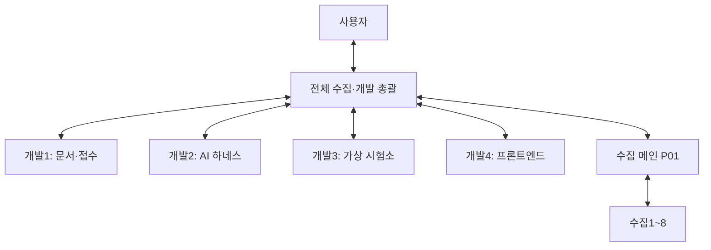

# 개발1~4 운영·연결 확인

2026-10-31 경로 통합 완료. 프로젝트 `.local/development/integration`과 `workspaces/dev1`~`dev4`의 고정5만 재사용한다. 원 C루트160폴더 중 고정5/비Git2를 실제 이전하고, 냉각153과 임시2는 실제 바이트·Git 보존/해시 대조 후 회수해 C루트 autolab0·등록5를 확인했다. 담당4의 common733 인수/후보 보존·각 branch push/원격 exact·새 cwd/branch guard를 인수했다. 삭제 후 managed28/Node13·새 합성 PDF/MOCK→가상 측정·계산·저장/DRAFT·HTTP5/실제 Chromium 조회가 통과했고 실제 모델/실물0이다. 결과·실패는 runs, 공통 도구는 toolchains, 고유 보존은 archive로 둔다. 원 이력 바이트·Codex25/25·Vertex6/3072·승인·실패·unknown은 유지한다. 경로 정리를 원 Goal 완료로 보지 않고 [후속 대장](NEXT-004.md)의 원 후보 수정·독립 검수·통합을 이어간다. 실행은 [관리 경로 안내](../../docs/fcc/managed_runtime_paths_usage.md)를 따른다.

2026-10-27 `GOAL-PREHARDWARE-001` 진행. schema HTTP400 원 실패1과 재개 preflight의 not_run을 보존하고 같은 합성 시험건에서 실제 Codex7회 정상 JSON/도구 dispatch를 관측했다. 원17+실패1+후속7=누적25/상한25·잔여0이다. 가상 DUT 시작·센서 취득/읽기로 raw−19.5dBm(acquisition tick15/setup18)을 얻었고 독립 Decimal과 일치했다. 그러나 마지막 결정은 stop 대신 advance여서 decision_budget/bounded, finalizer held/execution_incomplete·builder0·저장 결과/초안 없음이다. 실제 연결/형식 성공과 전체 업무 실패를 구별하며 독립 평가 b590885를 보존했다. 원/후속 loop 합산93.094초·회당 최대24.14초/60초·재시도0, 새7회 관측 usage 부분합 input379522/output843/reasoning159·전체비용/토큰상한 미확인이다. 원 profile35파일/SQL/실패 receipt와 u01의131파일은 불변이다. 사용자 지시에 따라 자체 달력 만료만 제거한 bacdbb2와 terminal prefix 호환9a14414는 독립 검수·실제 retained 기록 readback 뒤 수용했으며 원 permit/소모 이력을 바꾸지 않았다. 새 한도/프로필 우회·추가 Codex/Vertex 호출0이다. 정확 N9030A subset603614d/de2d766은 원 No/C1을 보존한 독립 재검수2 Yes 뒤 수용했고 같은 첫 source6의 analyzer through 경로−0.75+11.75=11dBm·invalid 설정 상태 보존을 총괄이 확인했다. Android 공식 SDK4/561파일 무결성은 확인했지만 OS/ADBserver0이며 최신 RAM1895<3584MiB다. 새 guest RF bridge 후보의 독립 No/C1·C2는 담당 수정 중이다. 종료 지침01c8d65를 독립5 qualified 뒤 수용했고 새 root PDF/MOCK5/runtime1→저장/DRAFT 회귀1을 통과했으나 실제 행동 개선은 미검증이다. 개발2는 전체 근거를 보존하는 목적 관련 prompt 투영, 개발4는 실제 시도/보류 조회 화면을 구현 중이다. 가상 MOCK 종단의 저장/초안 성공을 실제 AI 업무 성공으로 대체하지 않는다. 규격/방법 자동 판단·규범 판정·실측/현장/전체 시험소는 미완료다. 공유/원본 읽기전용·Un-licensed 우선·Licensed/raw 보류와 무료 크레딧 한도를 유지한다. P01 채팅 도구 부재로 신규 수집 전달0이며 기존 근거를 재사용한다. [현재 배정](NEXT-004.md#goal-prehardware-001--2026-10-26-명시-재개)을 따른다.

2026-10-26 [통합066](INTEGRATION-066.md) 최신 기능 `b728f78b` / 고정 source/runtime 검증 모집단333. 디지털 트윈 전체 목표와 첫 SM-A176U Un-licensed 전도 출력 한 조건을 유지한다. PDF 실행 전 native preflight41·문구024, 산출물 없는 현재 질문 화면994, 공동 evidence 선예약d0fa, 명시 불확도 DRAFT 부록17cf와 단절/복구실패f507을 독립 검수·총괄 관련 검증 뒤 수용했다. 새 root 공개 CLI 오류2는 각각 MOCK5/8 결정·가상runtime1에서 incomplete/저장complete/DRAFT를 보존했으며 정상 업무 성공으로 세지 않는다. 개발1 앱 연결 오류는 원 대화를 보존한 기존 임시 작업자가 등록3만 이어가고, 개발2 완료-current host3·개발3 명시 불확도 workflow3·개발4 현재 질문390 도구2를 실제 배정했다. 실제 AI 전체 과업·규범 판정·실측/현장은 미완료다. 추가 실제 모델0·Codex17/Vertex6 소진·사용자 준비0이며 [현황](../../PLAN.md#2026-10-25-디지털-트윈-목표와-첫-연결-현황)·[배정](NEXT-004.md#first-twin--2026-10-25-실제-후속-배정)을 우선한다. 아래는 보존 이력이다. 공개 시연 --port 도구222와 strict-ready3bc 수정은 원 No를 보존한 독립 typed4·총괄 구문 검사 뒤 수용했다. 회귀 발견성851f는 독립 정적 Yes·총괄 표준 발견8 PASS로 수용했으며 원8 논리를 새8 논리로 더하지 않는다.

2026-10-26 [통합066](INTEGRATION-066.md) 후속: RF 현재/역사 기록 호환3ba·근거 결합 조건 gate fcb·RF 문법/최소 질문002·같은 접수 결과 readonly99a를 독립 검수 뒤 기능77c6d6cd/source304에 수용·정상 push/원격 exact 대조했다. 새 root RF101·gate24·parser48·화면 Python125/Node28과 별도 genuine HTTP/DOM32·typed16은 각 실행 분모이며 전체 완성률이 아니다. 원 회귀 실패·집계99 오기·probe KeyError·Playwright 경로 준비 오류·독립 관측/미실행을 보존했다. 실제 Codex 누적17 중 원 응답의 계획은 조건 결합/명시 duty 단위 두 질문으로 blocked이며 원문/permit을 바꾸지 않는다. finalizer576·비교e4·예외 큐cbcc는 동결/독립 검수, 담당의 fresh MOCK2 종단과 사용자용 opt-in 시연·정식 실제 AI host는 미수용/구현 중이다. 개발1 current facts read3·개발2 registered workflow host3·개발3 비교 CLI3·개발4 opt-in 시연3을 실제 배정했다. P01 방법 관계3/근거metadata8/미해결12의 SOURCE8·후행 대조를 닫았고 새12PDF는 private raw 보관ACK/본문 승인0이다. [한 장 현황](../../PLAN.md#2026-10-25-디지털-트윈-목표와-첫-연결-현황)·[실제 소유/후속](NEXT-004.md#first-twin--2026-10-25-실제-후속-배정)을 우선하며 규범 판정·실측/현장·전체 무인화는 미완료다. 같은 Vertex6/3072 소진·추가 모델0·비용null·사용자 준비0을 유지하며 아래는 보존 이력이다.

2026-10-26 [통합065](INTEGRATION-065.md): 같은 가상 실행의 setup 기록6ca를 독립 qualified Yes 뒤 기능51640d4e에 인수·정상 게시·원격 대조했다. 새 관련120 PASS/비소유286 raw-native 불변, 독립 원5 PASS+incomplete1과 fault2/static1을 구별한다. 개발1 native a626·개발2 loop da52 독립 검수와 개발2 plan exact6 연결·개발3 같은 run 결과 builder·개발4 계획 미리보기의 실제 구현을 잇는다. P01 XML16단락/조건부6fact와 FCC96PDF 보관 인수·후행 대조를 닫았으나 현행 규범/적격18·전체쪽수null·전체AI업무/실측·현장 미완료는 유지한다. [PLAN 현황](../../PLAN.md#2026-10-25-디지털-트윈-목표와-첫-연결-현황)·[실제 배정](NEXT-004.md#first-twin--2026-10-25-실제-후속-배정)을 따르며 새실모델0·소진Vertex6/3072·사용자준비0이다.

2026-10-26 [통합064](INTEGRATION-064.md): 같은 접수 7단계 화면·계획 설정의 센서/평가 연결·근거 없는 계획값 null 보류를 기능0e0950fd/source290에 인수·정상 게시했다. root 화면14/실제10/분리 오류10·센서67·접수113와 후행4 PASS, 원 No/준비 오류·독립 한계를 구별한다. 현재 같은 코드의 합성 PDF1은 scripted 접수/취득/저장 검증이며 전체 AI 업무 성공이 아니다. [PLAN 한 장](../../PLAN.md#2026-10-25-디지털-트윈-목표와-첫-연결-현황)과 [FIRST-TWIN 실제 배정](NEXT-004.md#first-twin--2026-10-25-실제-후속-배정)에 다음 코드/배타 소유/근거 공백을 유지한다. 새 실제 모델/장부 초기화/실물0·기존 후보/실패/수집1~8/원본과 무료 크레딧 조건은 보존한다. 아래는 당시 기록이다.

2026-10-26 [통합063](INTEGRATION-063.md): 제공 기록 화면817b와 명시 설정의 DUT/계측기 연결798을 기능e9e08435에 인수했다. 새 Python162와 별도121, Node23·genuine HTTP/DOM12·별도 오류15를 전체 업무 완료와 구별한다. 첫 지식 packet을 private 검수 인수하고 P01의 N01/S07·N02/S06을 실제 요청했다. 현재 후보·후속 코드·배타 소유는 [FIRST-TWIN](NEXT-004.md#first-twin--2026-10-25-실제-후속-배정), 전체 8구분 공백은 [PLAN](../../PLAN.md#2026-10-25-디지털-트윈-목표와-첫-연결-현황)을 따른다. 기존 실패·각 분모·담당 clone·원본·실제 모델 누적과 소진 Vertex 예산을 보존하며 독립 검수 뒤 즉시 다음 구현을 잇는다. 아래는 당시 기록이다.

2026-10-25 [통합062](INTEGRATION-062.md): 개발1 G3·개발3 동일 가상 입력 모델 비교를 기능71b90495에 인수하고 새 관련209 PASS를 확인했다. 원 관측 실패·분모·실제 모델0을 보존한다. 최신 사용자의 전체 디지털 트윈 업무 범위는 [PLAN 현황표](../../PLAN.md#2026-10-25-디지털-트윈-목표와-첫-연결-현황), 현재 실제 코드 배정·배타 소유·P01 첫 packet 요청은 [FIRST-TWIN](NEXT-004.md#first-twin--2026-10-25-실제-후속-배정)을 우선한다. 기존 후보·WIP·독립 기대·수집1~8·소진 Vertex 예산을 보존하며 root가 검수·통합·회귀·게시 뒤 다음 배정을 이어간다. 아래는 과거 시점 기록이다.

2026-10-25 [통합061](INTEGRATION-061.md): 개발2 단일 가상 행동 효과평가 0c7 신규3을 독립 qualified Yes 뒤 기능3f99c543/source288에 인수했다. 새 총괄 관련 Python124 PASS와 기존286 raw 불변을 확인했다. 독립 원42는 일치41·준비 형상 불일치1을 보존하며 별도 선봉인2 PASS와 합산하지 않는다. 메모리 증거의 일관성·관측효과만 평가하고 전체 task/권위/실물 검증은 미완료다. 담당 첫 준비의 임시 raw 미보존·traceback만 보존 한계도 남긴다. 개발1 G3·개발3 동일입력 비교·개발4 제공기록 화면의 실제 구현을 유지하고 개발2 저장기록 readonly 연결 계약을 다음 배정했다. P01 B052 혼합11 구조확인/known550쪽+raw보류1/쪽수null의 인수·후행대조를 닫아156/156·corpus121/121·보존142/전체쪽수null/known부분9741을 구별한다. 동일 Vertex6/3072 소진·무료크레딧 전용·새실모델0·사용자준비0이며 아래는 당시 기록이다.

2026-10-25 [통합060](INTEGRATION-060.md): 개발3 가상작업자 동일입력 Codex/Vertex 비교 설계·계획2를 private 정적Yes·공개53필드 type/C1/본문규범2 독립Yes 뒤 게시했다. 정보부족 합성case1·기존API3/row15/batch8·후보형식/binding만 고정하고 과업/행동/effect/closedloop·등록8은 후속이다. 독립12논리 봉인은미실행이며5구체seam은첫관측전후행고정한다. source286/기능8b5d362b 불변, 새제품0이다. 개발1G3·개발2효과평가·개발4제공기록화면은정확SETUP/새봉인뒤CORE-GO를실제로받아담당구현을잇는다. P01B050 후행대조154/154·corpus119/119·보존118≠적격118/대상18·690쪽이다. 새실모델0/동일소진Vertex6/3072·무료크레딧전용/비용null·사용자준비0이며 아래는당시기록이다.

2026-10-25 [통합059](INTEGRATION-059.md): 개발4 제공 캠페인 기록 전용 화면 설계·계획2를 private v2·공개7묶음 type/C1 독립Yes 뒤 게시했다. 원/effective/출처·부분합/null·14형상/history20·readback-only 보호GET/시작전 genuine reader1/불변cache·권위false2를 고정한다. 새독립14논리/47예정 봉인은 제품/HTTP/DOM0이며 정확base/소유기존8/SETUP 뒤 담당구현으로 잇는다. 개발1 G3 SETUP직접대조·새기대봉인, 개발2 효과평가 CORE-GO 실제구현, 개발3 동일입력비교 정적Yes 뒤 공개투영을 유지한다. P01 B049 후행대조153/153·corpus118/118·보존106≠적격106/대상18·690쪽이다. source286/기능8b5d362b·새실모델0/소진Vertex6/3072·무료크레딧전용/비용null·사용자준비0이며 아래는당시기록이다.

2026-10-25 [통합058](INTEGRATION-058.md): 개발1 G3 접수 claim 전 합성 context 준비 설계·계획2를 v2 원No/I1 보존·v3 최소수정 정적Yes·공개19절 type/C1 독립Yes 뒤 게시했다. 준비창 whole-job 재대조와 반환 뒤 기존once/public8·claim eligibility의 범위를 구별하고 retain 부작용·업무DML0·실제issuer 권위OPEN을 고정한다. source286/기능8b5d362b 불변이며 새제품0이다. 개발2 효과평가는 새독립14논리/42예정 봉인·정확039 SETUP 뒤 실제 CORE-GO, 개발3 동일입력비교 계약·개발4 제공기록화면 v2 정적Yes 뒤 공개투영/새봉인을 잇는다. P01 B048 후행대조152/152·corpus117/117·보존94≠적격94/대상18·690쪽을 닫았다. 새실모델0·소진Vertex6/3072·무료크레딧전용/비용null·사용자준비0이며 아래는당시기록이다.

2026-10-25 [통합057](INTEGRATION-057.md): 개발2 단일 가상 행동 효과평가의 공통 설계·계획2를 private 정적Yes와 공개15절 type/C1 동등성 독립Yes 뒤 게시했다. packet9/output14·명령결과/관측효과·모순/누락·task미평가/score null·권위false를 고정하며 기존host12/producer18/wire5·source286/기능8b5d362b는 불변이다. 새제품/모델 실행0이며 새독립기대 봉인과 정확base/전용clone/신규3 소유 뒤 담당구현으로 잇는다. 개발1 G3v2 정적검수·개발3 virtual operator 동일입력비교계약·개발4 제공기록 전용표시v2와 P01 기존8 수집을 유지한다. 동일Vertex6/3072소진·무료크레딧전용·비용null·사용자준비0이고 아래는당시기록이다.

2026-10-25 [통합056](INTEGRATION-056.md): 개발3 제공 캠페인 기록 reader146 신규3과 문서 후속8ebe를 각각 독립 qualified 제품Yes/정적Yes 뒤 기능8b5d362b/source286에 인수했다. 새root26 PASS·기존284 raw불변이며 원32/54의자동53PASS/fixture No1·상충replay의개별history상세한계를 보존한다. 원unknown/제공재생effective·dedup·known부분합/null·권위false2를 읽는 순수API로 새실모델/ledger수정0이다. 확정 nested 공개usage를 개발4 전용표시v2로 인계하며 개발2 효과평가 정적Yes→공개투영/새기대봉인, 개발1 G3준비v2를 잇는다. P01 B047 새12PDF private인수와후행대조를닫아151/151·corpus116/116·보존83≠적격83/대상18·690쪽을구별한다. 추가실모델0·동일Vertex6/3072소진·무료크레딧전용·비용null·사용자준비0이며 아래는당시기록이다.

2026-10-25 [통합055](INTEGRATION-055.md): 개발1 단일 접수 host·개발2 가상 명령1회·개발4 등록7 보호 화면의 정확12를 독립 qualified Yes 뒤 기능db2cadae/source284에 인수했다. 새 총괄 Python55+119+163=337 PASS·Node 고유134 PASS이며 원 관측기 오류·파일cap초과와 미귀속handle 한계를 보존한다. 접수 host 실제 issuer와 단일 가상행동의 과업평가는 미연결이다. 개발1 G3 working-context 준비·개발2 효과평가·개발3 제공기록 reader146 독립검수/공개usage·개발4 제공기록 화면 전용 매핑을 실제 후속 배정했다. P01 B046 새10PDF private 인수와 후행 대조를 닫아150/150·corpus115/115·보존71≠적격71/대상18·690쪽을 구별한다. 추가 실제모델0·기존Codex16/Vertex6(연결4/실패2)·동일예산6/3072소진·무료크레딧전용·비용null·사용자준비0이다. 아래는 당시 기록이다.

2026-10-25 [통합054](INTEGRATION-054.md): 개발2의 가상 명령1회 실행과 개발3의 제공 기록 조회 설계·계획4를 독립 최종 정적 Yes 뒤 공통 게시했다. 원 M1·PUBLIC-I1과 수정 전 문서를 보존하며 실제 구현·기능 성공과 구별한다. 두 담당에게 정확 게시 base의 독립 clone·신규3 소유·새 기대 봉인을 고정한 뒤 구현을 잇는다. 개발1은43c4·개발4는0268의 기존 정확 기준과 소유를 유지한다. 기능b9344609/source280 불변·새실모델0·기존Codex16/Vertex6(연결4/실패2)·소진6/3072·무료크레딧전용·비용null·사용자준비0이다. P01 B044 새12PDF는 private 확인대기 인수/ACK 후 후행 대조 중이며 적격증분0·본문/모델송신0이다. 아래는 당시 기록이다.

2026-10-25 [통합053](INTEGRATION-053.md): 개발1 단일 접수 실행 진입점의 설계·계획을 private 및 공개 투영 독립 정적 Yes 뒤 게시했다. noauth·유계 모의 구현과 실제 API 실행 승인을 구별하며 실제 issuer 미연결 상태는 실행 전 not_run/auth unknown으로 닫는다. 기능b9344609/source280은 그대로다. 개발4는0268 독립 clone·새 기대 봉인 뒤 등록7 화면 기존6의 CORE-GO를 받아 구현을 이어간다. 개발2 가상명령1회 계약은 공개 투영 중이며 개발3 기록 조회는 공개 형상 누락의 최소 수정을 배정했다. B043 후행 대조로 collector147/147·corpus112/112·인수대기0을 닫고 보존37PDF/2327쪽과 적격18PDF/690쪽을 구별한다. 새실모델0·기존Codex16/Vertex6(연결4/실패2)·동일6/3072소진·무료크레딧전용·비용null·사용자준비0을 유지한다. 아래는 당시 기록이다.

2026-10-25 [통합052](INTEGRATION-052.md): 개발2 Codex 첫 가상판단5e 신규3을 독립 최종Yes 뒤 기능b9344609/source280에 인수했다. 새root25 PASS/실패·error·skip0·기존278raw불변이며 fresh full64 관측→가상capture종료→단일concrete D2→genuine decoder를결합하고 proposal파견/평가0을유지한다. 등록7 보호UI의003-v2/private3·공개2 정적Yes를확인해 공통설계·계획을게시하고 새기대봉인/정확base뒤개발4기존6실제구현으로잇는다. B043은원PDF12/46203572B·P01표기1284쪽을exact19private보존인수했으며issuer/date/model/rights미확인·적격가산0·본문/모델송신0이다. 실제Codex16/Vertex6(4성공2실패)·동일소진예산6/3072·무료크레딧전용/비용null·사용자준비0와P01한창구·원본읽기전용을유지한다. 전체AI/실물/현행규범/전수/무인화는미완료며아래는당시기록이다.

2026-10-25 [통합051](INTEGRATION-051.md): 개발1 단일 Codex 접수 실행 경계 c9d 신규3을 독립 최종Yes 뒤 기능238e075f/source278에 인수했다. 새root26 PASS/fail·error·skip0·기존276raw불변이며 승인 full context→claim1→단일 concrete D2→genuine strict→complete1을 결합한다. 원기대A8/13검수·실패와 native handle 미귀속1 한계를 보존하고 담당26/관련121·독립/총괄 분모를 구별한다. 새실모델0·기존Codex16/Vertex6(연결4·실패2)·무료크레딧전용/동일누적6/3072소진/비용null을 유지한다. 개발2 first-decision 독립검수, 개발1 후속host·개발3 readonly비교·개발4 등록7 화면계약 수정·공통수용을 계속한다. 수집은P01 v081의기존8역할을유지하고 사용자추가준비0·원본읽기전용/실물·현행규범·전수·전체업무미완료다. 아래는당시기록이다.

2026-10-25 [통합050](INTEGRATION-050.md): 보호 Vertex 화면과 접수·의뢰 이해 등록 경계를 기능abd7bece/source276에 인수했다. 화면115·비교64·CLI30·접수경계34·가상72의 개별 관련 Python 회귀와 기존 Node115를 구별한다. 실제 Vertex6은 Argon LOW/MEDIUM/HIGH·Flash HIGH 성공4, Flash LOW 시간초과·MEDIUM HTTP429 실패2다. 원 LOW unknown은 보존하고 같은 응답의 별도 replay/회계정정만 수행했으며 재호출0이다. 독립 원문대조92/92·회계 종료 Yes와 연결4/6을 구별하고 동일 누적6/3072 소진 후 추가호출을 차단했다. 무료크레딧 전용·비용 unknown/null·업무품질 not_assessed/score null·ADC둘불변을 유지한다. 개발1 단일 Codex 접수·개발2 첫 가상판단 후보는 독립검수, 개발3 후속 readonly 비교·개발4 등록7 화면 계약 보완을 실제 배정했다. P01 metadata ACK146/146·corpus111/111과 미검수 운반12PDF를 구별하며 대상18/690·사용자 준비0·실물/규범/전수/전체무인화 미완료를 유지한다. 아래는 당시 기록이다.

2026-10-25 [통합049](INTEGRATION-049.md): 접수 literal schema helper ea5·Vertex 비교 b88/e7/9c00·생산 Codex CLI e829/b9df의 정확 소유9를 독립 최종 Yes 뒤 기능a19ff43f/source271에 인수했다. 새 root 관련34+41+30=105 PASS/fail·error·skip0이며 원 No/I1/I2·norm4 Yes·usage5 호환 관측과 원 기대를 보존한다. 저장 profile→D1 설정→단일 D2→strict/receipt/누적 ledger 경계를 구현했고, known 실패의 호출0·최초 D2 오류/영수증을 후속 기록 실패에서도 보존한다. 생산 CLI로 같은 연결 pair를 SOL/ASTRA 각1회 실행해 complete2/strict2·누적 actual16을 확인했으나 업무 품질은 not_assessed/score null이다. 기존 접수 신규6의 독립 의미6pass·별도 Store/current6pass도 구별한다. Vertex 생성0이며 개발4 보호 UI11의 독립 검수·실제 결합과 첫 유계6을 이어간다. 개발1 inputpack004 인수 뒤 최소 업무 경계, 개발2 가상 operator 입력3, 개발3 업무 registry 계약을 후속 배정했다. 무료체험 전용·같은 누적예산·기존 ADC/원본/소유권 보존·P01 한창구와 사용자 준비0을 유지하며 전체AI업무·실물/현행규범/전수/전체무인화는 미완료다. 아래는 당시 기록이며 최신 정확 배정은 private followup을 우선한다.

2026-10-25 [통합048](INTEGRATION-048.md): Vertex REST producer f57와 응답 검증 누락 수정20bd의 정확new3을 독립 최종 Yes 뒤 기능8d155f8c/source267에 인수했다. 새 root native 합성31 PASS/fail·error·skip0·기존265raw불변이다. 원후보No/I1·새수정12 API·원 기대·관측기 오류를 별도 보존한다. 정확 REST thinkingLevel·분리 ADC metadata/quota·단일 worker/refresh/POST·유계 timeout/취소/부분·정제 receipt18을 구현했으며 실제 Vertex 생성은 아직0이다. 수정 정책의 실제 Codex 접수3×2는 strict6·독립 의미6pass/불충분0·score null로 확인했다. 원4pass2불충분은 그대로이며 누적 actual14/동일 wire 재생이 아니다. 개발1은 신규6 API0 저장/조회, 개발2 CLI e829는 독립 검수, 개발3 비교 b88a는 독립 기능 검수, 개발4 UI11은 실제 HTTP/DOM 구현을 이어간다. 무료 체험 전용·대상/quota·기존 ADC 보존·등록 합성 입력과 누적 예산을 유지한다. P01 Vertex1/1·FCC145/145/corpus110/110·대상18/690/official0, 사용자 준비0·공유/원본 읽기전용·실물/현행규범/전수/전체업무 미완료다. 아래는 당시 기록이며 최신 정확 배정은 private followup을 우선한다.

2026-10-25 [통합047](INTEGRATION-047.md): Vertex profile88ebe와 Windows8.3 잠금 우회 수정6b089를 독립 최종 Yes/C0I0M0 뒤 기능197e0b28/source265에 인수했다. 새 root36 중35 PASS·권한제한 symlink1 skip이며 실제8.3검사3은 skip0이다. 독립296 API와 원 No/I1·원 기대·관측기 오류를 별도 보존한다. 모델별 LOW/MEDIUM/HIGH·MEDIUM 기본/출력/timeout 저장·CAS revision·plain settings16/hash를 구현했고 실제 인증·모델 호출은 이 모듈에서0이다. 개발2 Vertex REST/new3·개발3 비교 runner/new3·개발4 보호 연결 화면11은 각각 독립 clone/전용 branch에서 실제 구현을 계속한다. 승인 범위는 등록 합성 입력·대상/auth·무료체험·누적예산으로 고정하고 per-run 선택을 허용하며 임의 입력·예산 reset은 차단한다. Codex 정책 후속6은 별도 독립 wire 봉인 뒤 실행하며 현재 누적 실제 Codex8/Vertex0이다. P01 Vertex1/1·FCC145/145/corpus110/110·대상18/690/official0, 사용자 추가 준비0·공유/원본 읽기전용·실물/현행규범/전수/전체업무 미완료를 유지한다. 아래는 당시 기록이며 정확 최신 배정은 private followup을 우선한다.

2026-10-25 [통합046](INTEGRATION-046.md): 개발3 pure operator 경계와 생성자 수정, 개발4 DOCX 보호 조회 화면을 독립 최종 Yes 뒤 기능99f1bfea/source263에 인수했다. 새 root Python248·Node70이 fail/error/skip0으로 통과했다. Node reporter 형식의 관측기 오류는 원 로그를 보존해 재실행 없이 확인했으며 담당/이전 검사 수와 합산하지 않는다. 개발1 Vertex profile의 Windows8.3 잠금 우회 I1은 추가 수정6b089f91을 받아 원 기대의 독립 재검수 중이다. 개발2 별도 Vertex REST/new3 구현을 유지하며 개발3 비교 runner/new3·개발4 보호 연결 화면11은 정확 게시 base에서 단위 구현을 병렬로 진행하고 실제 의존성 결합은 총괄에서 검증한다. P01 Vertex 첫 공식 자료 묶음은 receiver 대조·ACK로1/1 닫았다. 무료 체험 크레딧 전용·분리 ADC/대상·quota 일치·기존 ADC 보존을 유지하며 실제 Vertex 생성0·Codex 누적8이다. 사용자 추가 준비0·공유/원본 읽기전용·실장비/현행규범/전수/전체 무인화 미완료다. 아래는 당시 기록이며 최신 정확 배정은 private followup을 우선한다.

2026-10-25 [Vertex AI 추가 연결](../../docs/superpowers/specs/2026-10-25-vertex-ai-connection-design.md)을 개발1 설정 저장/new3·개발2 보존 CLI WIP 후 별도 REST/new3·개발3 비교 runner/new3·개발4 보호 UI/11로 실제 배정했다. 모델 gemini-4-argon/gemini-3.8-flash 각각 LOW/MEDIUM/HIGH·MEDIUM 기본과 공식 global/us/eu·REST thinkingLevel을 고정하며 자동 retry/continuation·다른 API 우회0이다. 분리 ADC/대상·quota exact·project ACTIVE/API ENABLED와 대상 콘솔의 무료 체험 크레딧/잔여90일을 확인했고 기존 ADC·결제/IAM은 변경0이다. 최초 실제 Vertex 생성6 유계 승인을 준비했으며 아직 생성0이다. [통합045](INTEGRATION-045.md) 기능229ae019/source261·새 root 경계29+jobs22 PASS와 기존 Codex 실제8/의미4pass2불충분을 구별한다. 개발3 4e229의 생성자 M1은 최소 수정 배정, 개발4 DOCX48b19e9 기존10은 독립 제품 검수 중이다. P01 Vertex S04-B0001 별도 실제배정·기존 FCC145/145/corpus110/110·대상18/690/official0은 유지한다. 사용자 추가 준비0·공유/원본 읽기전용·실물/현행규범/전수/전체 무인화 미완료다. 아래는 당시 기록이며 최신 정확 배정은 private followup을 우선한다.

2026-10-25 Codex CLI 응답 producer 공통 계약: private v3의 독립 정적Yes/C0I0M0 뒤 native CLI 단일함수/정확new3·tuple2/receipt18/artifact9/error11/event8을 고정했다. 공개기계계약은source-map의contracts만값동일하게투영하며절대경로·원modelraw·owner관측대장을제외한다. 기존canonical prompt/caller literal schema를수송하고analysis나operator정답을core에고정하지않으며request별metadata1+model1/재시도0·bounded수집/첫control/partial·회수·원격unknown을구별한다. 제품실행은아직0이고정확게시base/독립clone/전용branch에서개발2실제구현으로잇는다. 통합044기능ce665f1e/source261·새root211 PASS/독립95·누적실제CLI8/접수6strict6·독립의미4pass2불충분은별도기존결과다. 개발1API0 working6저장/현재조회는owner검증후독립검수중이며후속일반불확실회수기존2구현·개발3pure2/new3실제구현·개발4보호화면기존10실제검증을유지한다. P01B041인수/공개/receiver종료와145/145·110/110·대상18/690/official0은유지한다. 사용자추가준비0·공유/원본읽기전용·실물/현행규범/전수/전체업무미완료다. 아래는당시기록이며최신정확배정은private followup을우선한다.

2026-10-25 [통합044](INTEGRATION-044.md): 개발2 평가aa312+I1~I4수정f67의 정확3을 독립 최종Yes 뒤 기능ce665f1e에 인수했다. 새root211 PASS·source261/기존259 raw불변·최종3GitLF exact다. 독립95=원84+경계11/새genuine0·원goal-only10 label차이·No236proof와owner예산일탈을 보존한다. 실제Codex 누적8(연결2+접수6), 새strict6·독립의미4pass/2불충분·score null을 구별한다. 개발1은 원응답의API0 working6 완료/현재snapshot6을 보고했고 root144opaque인수·독립검수 중이며 후속불확실회수 기존2의 실제구현을764ca91로 배정했다. 개발3pure2/new3은 독립preseal뒤 같은정확base의새clone에서 구현하고, 개발2CLIproducer v3는 정적리뷰·개발4보호화면기존10은 실제검증 중이다. P01 B041은source15/receiver17/실제ACK·공개b8c2aa를닫아145/145·110/110·인수대기0이며 대상18/690·보류5/254·보존25/1043≠적격25·official0은같다. 사용자추가준비0·원실패와원10053미확정·공유원본읽기전용/Un-licensed우선·실물/현행규범/전수/전체업무미완료를유지한다. 아래는당시기록이며최신배정은private followup을우선한다.

2026-10-25 Codex 개발 검증 후속: native CLI의 SOL/ASTRA로 동일 합성 접수3×2를 실제 실행해 완결6/strict6을 확인했다. 이전 연결2와 구별한 누적8이며 모델 전체 품질점수null·독립 의미평가6행의 통과4/불충분2를 확인했다. 정보 부족 사례의 시험 관련 구성 미확인 누락2를 확인해 원 응답/기대를 보존하고 일반 prompt 정책·usage 기존2의 최소 회수 규칙을 고정했다. 개발1은 조건부 API0 admission의 독립 정적 Yes 뒤 per-model working Store/fresh claim/full public context exact에 한해 원 실제 응답의 offline-origin 인수를 실제 배정받았으며 결과는 아직 대기다. 개발3은 원 runner/callback I1을 보존하고 pure operator builder/decoder2·고정오류/한도·신규3 공통 계약을 독립 정적 Yes 뒤 공개하며 정확 게시base/newclone에서 구현으로 잇는다. 실제 모델의 가상 operator 행동은0이고 개발2의 concrete CLI producer v3와 private host 결합은 후행이다. 개발2 assessment 원No/I4를 고친 f67 신규3 후보는 원격·119proof 인수 뒤 원84 독립 재검증 중이며 아직 총괄 기능 인수0이다. 개발4 기존10은 exact9fc 독립clone에서 실제 구현·보호 HTTP/DOM 검증 중이다. P01 B041 metadata14JSON/PDF0·실제ACK/receiver17·source15·공개b8c2aa를 root가 대조해 collector145/145·corpus110/110·인수대기0을 닫았으며 대상18/690·보류5/254·보존25/1043≠적격25·official0·vendor001002각각1/1은 같다. 새 수집v080은 선택/배정0이며 같은403 반복 요청은0이다. 사용자 추가 준비0·공유/원본 읽기전용·Un-licensed 우선·원10053 미확정·실물/현행규범/전수/전체시험소 미완료를 유지한다. 현재 기능5d247f22/source259·root043 관련270 PASS는 이전 검증이고 이번은 공통 계약 게시다. 아래는 당시 기록이며 최신 실제 배정은 private followup을 우선한다.

2026-10-25 [통합043](INTEGRATION-043.md): 개발1 readonly1f828과 개발3 aperture69f41e5를 독립 최종 Yes 뒤 기능5d247f22에 정확2커밋/소유6으로 인수했다. 새 root 관련270 PASS·source259/기존255 raw 불변·최종6 GitLF exact다. 독립 DOCX46/native0·aperture62/부모2와 담당·이전 회귀를 구별하며 원 관측기 실패·no-op close 잔여 fd 한계·valid-shape body/bit 초과 미실행을 보존한다. 개발4 보호 POST 공통 설계/계획·기존10 소유와 합성 retention 입력4 준비를 닫았고 독립 UI 기대 봉인·정확 게시 base/전용 branch 뒤 실제 구현으로 잇는다. 개발2 assessment aa312 신규3은 원격/88proof 인수 뒤 별도 독립 리뷰 중이며 다음 Codex CLI producer 계약을 계속한다. 개발1 합성 의뢰3·개발3 실제 가상 operator provenance도 실제 후속 배정했다. 사용자 CLI 우선·SOL/ASTRA 연결2건/업무 AI0/score null·추가 준비0을 유지한다. P01 vendor001/002 각각1/1·002 새PDF0·v079 수집2 실제 배정과 FCC 대상18/690·보존25/1043≠적격25·official0을 구별한다. 공유/원본 읽기 전용·Un-licensed 우선·원10053 미확정·실물/현행규범/전수/전체업무 미완료다. 아래는 당시 기록이며 최신 정확 실행 배정은 private followup을 우선한다.

2026-10-25 후속 UI 공통 계약: DOCX 보존 결과를 기존 source 인증·session/CSRF/read scope·단일 lease가 적용되는 current POST의 명시 docx_retained 분기로 읽는 설계·계획을 고정했다. host의 실제 단일 artifact ID/exact5 선택과 history의 선택 안내 헤더·원 exact6/4/11·별도 UI2MiB/구조2000/issues128·동시429/종료/last-good을 기존10 파일 소유로 한정한다. 독립 정적 Yes/C0I0M1 뒤 선택 소멸 문구를 성공 history 헤더 없음으로 좁혔고, 일반 metadata GET은 선택 헤더를 제공하지 않는 경계를 명시했다. 이번 UI 제품 실행0이며 D1 readonly 후보1f828의 독립 제품 인수와 정확 최신 base/전용 branch 배정 뒤 개발4가 실제 retention→admission→보호 POST→DOM을 구현·검증한다. 개발1 후보1f828은 exact 소유·원격/clean·유계 proof를 root가 인수하고 독립 readonly46 qualifying Yes 뒤 총괄 통합을 준비한다. 개발3 후보69f41e5도 원격·소유·proof 인수 뒤 별도 독립 제품 리뷰 중이며 두 후보의 총괄 기능 인수는 아직0이다. 개발2 assessment는 새 가상 정상/복구/위임 거절을 검증 중이고 완료 후 Codex CLI producer 계약을 잇는다. 사용자 CLI 우선·SOL/ASTRA 합성 연결2건/업무 AI0/score null 결정은 유지하며 준비된 의뢰 시나리오와 가상 operator provenance 후속도 실제 배정했다. P01 vendor001·002는 각각 receiver 대조 뒤1/1 닫았고 002의13파일 대조 영수증을 root가 인수했다. 002 새PDF/새원문/native기술사실0이다. 별도 기존 색인의 중복 없는 LTE Band13 보고서 한 주소를 v079/S02-B0043으로 수집2에 실제 배정했으며 아직 새PDF/대상은 가산0이다. FCC 대상18PDF/690쪽·보존25/1043≠적격25·official0은 같다. source257/기능530b5306·기존 root420 PASS와 원10053 미확정·공유 원본 읽기 전용·실물/현행규범/전수/전체업무 무인화 미완료를 구별한다. 아래는 당시 기록이며 최신 실제 배정은 private followup을 우선한다.

2026-10-25 사용자 후속 결정: 개발·검증의 첫 실제 모델 연결은 Codex CLI다. 현재 Codex에서 선택 가능한 SOL/ASTRA로 합성 시나리오를 실행하고 결과·실패 근거로 하네스를 수정·회귀하며 이후 다른 API 모델을 같은 조건으로 비교한다. root 로컬 CLI0.163.0-alpha.11.2와 모델 cache를 확인하고 gpt-6.1-sol 및 gpt-6-astra를 각각1회 실제 비대화형 호출했다. 동일한 합성 empty-evidence prompt/request SHA·호출 전 기대를 사용했고 두 process exit0/응답JSONL turn.completed·도구item0/기존 decoder PASS·기대 일치를 확인했다(SOL4.984초, ASTRA7.141초). 실제 CLI 응답2건은 연결·request/producer 결합 검증이며 의뢰 이해 정확도·가상 operator 행동·실물/규범 검증이나 모델 품질 점수가 아니다. 실행 원본은 private 새 Temp에 보존하며 실제 모델 품질 점수null·기존 순수 API의 model_execution_verified=false를 유지한다. 기존 prompt builder→Codex CLI raw response→엄격 decoder/독립 평가를 첫 producer로 닫고 모델명·요청·응답·오류/타임아웃/usage·입력/기대 pin을 묶는다. 기존 FleetHarness의 fixture/ai_model_called=false report를 실제 모델 실행 증거로 바꾸지 않으며 가상 operator의 명시 실행 provenance/허용 proposal·거절/동일 scenario 평가는 별도 공통 계약으로 잇는다. 개발2 assessment 신규3을 보존해 제출한 직후 DEV2-CODEX-CLI-PRODUCER-CONTRACT-20261025-001의 sibling private 보완을 이어가도록 실제 전달했다. 개발1 readonly·개발2 assessment는6ddf, 개발3 aperture는c43d 정확 base의 전용 독립 clone/branch에서 실제 구현 중이며 개발4 보호 source POST v2는 인수·검토 뒤 배정한다. 고객 원문/실측/암호는 CLI 입력에 포함0이고 실장비/현장/Office/포털 제출0이다. 특정 모델명 질문은 응답 완료이며 키/로그인 변경 요청 없이 현재 경로를 검증했다. 이후 외부 API 모델 ID·wire 지원은 개별 연결 설정으로 명시하며 Codex slug를 그대로 전용하지 않는다. 아래의 CLI 실행0/모델 답변 대기는 당시 기록이고 이 후속 결정·실행 범위가 우선한다.

2026-10-25 사용자 결정 반영: 실제 AI는 API로 연결하고 여러 모델을 사용할 계획이다. 단일 공급자·모델명을 먼저 정하기 위한 질문은 응답 완료로 닫는다. 구현은 공급자별 지원 프로토콜·endpoint·model ID를 명시하는 연결 설정에서 모델을 선택·교체하고 같은 고정 시나리오의 입력·응답·판정 이력을 비교하는 방향이다. 모든 모델이 같은 wire 형식을 지원한다고 가정하거나 특정 기본 모델/SDK를 임의로 고정하지 않는다. 기존 prompt builder→실제 API raw response→엄격 decoder→기존 evaluator의 직접 경로를 재사용한다. 개발2의 진행 중 assessment 신규3/정확 base6ddf·RED·미커밋은 유지하고, 제출 직후 기존 producer private3을 이 결정에 맞게 최소 보완하도록 실제 전달했다. 개발1 readonly 구현·개발3 aperture·개발4 보호된 source 조회 화면·P01 수집은 계속하며 모델명 선택을 대기 조건으로 삼지 않는다. 프로토콜별 실제 지원 범위와 이후 구현 소유·실행 연결 설정은 별도로 고정한다. 현재 실제 모델 호출0/score null이고 키 조회·요청/과금 호출·고객 원문/실측/암호 송신·실물/현장 실행을 이 결정만으로 수행하지 않는다. 기존 검증·원 실패·공유 원본/담당별 branch·파일 소유를 보존한다. 아래의 옛 모델명 답변 대기 문구는 당시 기록이며 이 결정이 우선한다.

2026-10-25 통합042 후속 공개 계약: private 독립 정적 Yes와 공개 편집 Yes 뒤 [DOCX 보존 관측](../../docs/superpowers/specs/2026-10-25-intake-docx-retained-observation-design.md), [별도 복구 근거 평가](../../docs/superpowers/specs/2026-10-25-virtual-fleet-meter-recovery-assessment-design.md), [명시 timebase/aperture 적분](../../docs/superpowers/specs/2026-10-25-virtual-fleet-rf-aperture-alignment-design.md)의 설계·계획6을 고정했다. 개발1은 기존3의 readonly admission API1을 정확 게시 base로 바로 배정하며 HTTP/UI gate와 분리한다. 개발2·3은 각각 신규3의 실제 구현 전에 별도 독립 사건/Fraction·부분창/Fraction·Decimal 기대를 봉인 중이다. 개발4에는 full exact6을 일반 metadata GET에 넣지 않고 기존 보호 source POST current의 명시 별도 variant·요청 시 admission·기존 session/CSRF/read scope를 유지하는 sibling private v2를 실제 배정했다. 원042 응답에 임의 키 추가0이며 UI 한도·transport/DOM 최소 소유는 v2 검토 뒤 닫는다. P01 vendor 첫 묶음 S04-B0001-v1의 exact10JSON/109132B를 root가 byte/content-scope ACK1해 private 카탈로그·어댑터 계획에 반영했다. P01 선택 근거11과 부분 유보 N09/N12를 구별하고 receiver 재대조 전 최종 vendor 카운터를 확정하지 않는다. 후속 DEV-RF-TIMEBASE-DATASHEET-002는 기존 인용/URL 재사용 우선의 좁은 요청을 실제 전송했고 FCC 수치/새PDF 증분·v079 미선택은 같다. 이번 새 제품/API/fixture 실행0·source257 불변이며 기능은530b5306/기존 root420 PASS다. source_id의 공개 core 정규화를 빠뜨린 metadata 관측 오류·반증·정정을 보존하고 원 평가 규범은 바꾸지 않았다. 기존 공급자·모델명 또는 미정 답변대기·실제AI0/score null·원10053미확정·공유원본읽기전용·실물/현행규범/전수/전체업무 무인화 미완료를 유지한다. 최신 정확 배정·검증은 private followup을 우선한다.

2026-10-25 [통합042](INTEGRATION-042.md): 개발1 fd192의 현재 DOCX 참고 결과 실제 bytes/readback/등록·provenance 보존을 독립 최종 Yes 뒤 기능530b5306에 인수했다. 새 root 관련420 PASS·source257/소유2 제외 기존255 raw 불변·기존3 GitLF exact이며, 독립 retention35+observer6·legacy/native/consumer 및 자동 scan 준비 실패를 구별한다. 실패 뒤 정상 committed artifact가 남을 수 있고 no-op close 잔여 fd는 API 회수 성공이 아니다. 개발1 관측 admission·개발4 최소 GET/DOM 공통 계약 private3과 개발2 별도 recovery 평가 v2 정적 Yes·개발3 aperture v2 delta 검토를 실제 후속으로 잇는다. P01 vendor aperture 요청은 수집4에 실제 배정됐고 root dispatch metadata4만 인수했으며 FCC 수치/새PDF증분은 같다. 서비스·모델명 또는 미정만 기존 답변대기·모델호출0/score null·원10053미확정·공유원본읽기전용·전체시험소/실물/현행규범/전수미완료다. 아래는 당시 기록이며 최신 exact 배정은 private followup을 우선한다.

2026-10-25 [통합041](INTEGRATION-041.md): 개발3 가상 meter 주파수 복구349a를 독립 최종 Yes 뒤 기능af602e4b에 인수했다. 위임/실제fresh 충돌에서 frequency-only 논리1 뒤 같은runtime의 새 sensor/meter acquire/read/fetch·source/revision/tick을 확인하며 report 평가/물리정리는 미평가다. 새 root 관련142 PASS·source257/기존255raw불변·신규3GitLF exact, 독립genuine19/경계61/미평가후행5와 owner26/105/trace9를 구별한다. 개발1 fd192 DOCX 보존 후보312proof를 인수해 독립 제품리뷰 중이며, 개발2 별도 합성평가·개발3 명시timebase/ZOH aperture 수학·개발1 retained 관측 공통계약을 실제 배정해 UI 공급으로 잇는다. P01에는 N1921A/N1911A의 기존공식 timebase/aperture/trigger 근거 재사용 요청 DEV-RF-APERTURE-METADATA-001을 실제 전송했으며 FCC카운터/새PDF증분은 같다. 서비스·모델명 또는 미정만 사용자 답변대기, 모델호출0/score null·공유원본읽기전용·원10053미확정·전체시험소/실물/현행규범/전수미완료다. 아래는 당시 기록이며 최신exact배정은private followup을 우선한다.

2026-10-25 [통합040](INTEGRATION-040.md): 개발4 데모4059→문법 수정a6a0를 독립 최종 Yes 뒤 기능e2ce65db에 인수했다. 명시 --intent-view로 합성 claim/원034/제공 대조 제안2를 GET/DOM까지 연결하며 default bounded worker·최초 오류·원7·caller Store 수명은 유지한다. 새 root 데모51+직접 부모22=73 PASS, source255/소유2 제외 기존253 raw 불변·최종3 GitLF exact다. 원No/C0I0M1의 중간 flag 허용은 core/test4줄 최소 수정과 독립 문법25로 닫았으며 원4059 genuine10·owner cold/51/후속10과 분모를 구별한다. 개발1 DOCX 보존 후보 게시·개발3 가상 복구 독립 최종 증거를 잇는다. 개발2 별도 합성 recovery 평가 private3과 개발4 DOCX 보존 UI 접점 조사도 실제 배정했다. 실제 producer의 서비스·모델명 또는 미정만 사용자 답변 대기이며 다른 개발은 계속한다. P01 수치/새 수집요청0·원10053 미확정·모델호출0/score null·공유/원본 읽기 전용은 같고 전체 시험소/현행규범/FCC 전수/실물은 미완료다. 아래는 당시 기록이며 최신 정확 배정은 private followup을 우선한다.

2026-10-25 [통합039](INTEGRATION-039.md): 개발2의 순수 prompt·엄격 응답 경계1c44→0cee를 독립 최종 Yes 뒤 기능839a58d9에 인수했다. 새 총괄 관련71 PASS·source255/기존253 raw 불변·신규3 GitLF exact이며 실제 모델 호출0·품질 점수null이다. 활성 caller 예외의 context 누출 원No와 수정·독립18/72 및 관측기 실패를 보존한다. 개발1 DOCX artifact 보존은 실제 구현 중, 개발3 후보349a3931은 owner26/105와 가상 trace9 정상 게시 뒤 독립 제품 검증 전, 개발4 후보4059의 Minor1 최소 후속a6a0dd80은 owner10 뒤 독립 delta 대조 중이다. 개발2 다음 실제 producer는 기존 직접 경로를 재사용하며 서비스·모델명 또는 미정만 사용자에게 비동기 확인 중이다. 다른 구현은 계속한다. P01 수치·신규 수집요청0·공유/원본 읽기 전용·Un-licensed 우선은 같으며 실제 AI/현행 규범/FCC 전수/실물과 전체 업무·물리 무인화는 미완료다. 아래는 이전 당시 기록이며 최신 exact 배정은 private followup을 따른다.

2026-10-25 후속 공개 계약: private 독립 정적 Yes/C0I0M0·공개 편집 Yes 뒤 [DOCX 실제 artifact 보존](../../docs/superpowers/specs/2026-10-25-intake-docx-reference-retention-design.md)과 [가상 meter 주파수 충돌 복구](../../docs/superpowers/specs/2026-10-25-virtual-fleet-meter-frequency-recovery-policy-design.md)를 고정했다. 개발1은 기존3 확장/API1·실제 bytes/readback/등록/provenance/첫 오류·유계정리, 개발3은 신규3·명시 위임하 frequency-only configure1→같은 runtime 새 sensor/meter 취득 행동이다. 원 native DTO/미해석 질문·기존041 차단·report 평가/물리정리 미평가를 유지한다. 정확 게시 base·전용 branch로 실제 배정하며 개발3의 후보/owner test 전 독립 기대 봉인을 선행한다. 이번 새 제품/fixture/API/RF 실행0·source253 불변이며 기능 기준은 통합038의23fbf981이다. 개발4는8c0b8bda/전용branch/기존3의 데모 연결 실제 배정과 ACK 뒤 구현 중, 개발2 후보1c44는 선봉인 뒤 독립 제품리뷰 중이다. 개발2의 후행 독립 No I1은 활성 caller 예외가 정제 오류의 context에 남는 경계로 재현돼 소유 신규3 안의 최소 수정을 실제 배정했으며 원No와 예외를 보존한다. 현재 사용자 추가 준비/결정0·P01 신규 수집요청0이며 이전 검증·미확정10053과 모든 원 실패는 그대로다. 최신 정확 actual 배정은 private followup을 따른다.

2026-10-25 [통합038](INTEGRATION-038.md): 개발1 DOCX 참고 d4e→공통 Store 종료 수정290·개발4 제공 대조 화면088·개발3 저장 CW 관측 reader b23→d269의 정확5커밋을 독립 최종 Yes 뒤 기능23fbf981에 인수했다. 새 총괄 접수/Store327·화면 확인39·저장 관측/공통 파일47·Node37 PASS, source253/기존241 raw 불변·최종15 GitLF exact다. 화면 최초39 중 WinError10053 error1은 원 로그를 보존하고 unchanged 단독1/확인39와 구별하며, 조사의 미소비 body/early-close 경합 가설은 미확정이다. 원 d4e No·독립 관측기 실패22와 read-only 보충·b23 native1/최종d269 원자료 재실행0을 보존한다. 전체/옛 앱·원RF·실제AI/실물은 새 실행0이다.

개발2 pure model boundary1c44ee4 신규3은 원격 제출/owner67 뒤 별도 독립 제품리뷰의 사전 oracle 준비 중이며 총괄 제품 수용 전이다. 개발1 다음 DOCX artifact 보존 private v2 exact3은 완료/byte 인수·독립 정적 검토, 개발3은 가상 장비 관측/복구 공백 한 단위 private3 설계, 개발4는 [057 명시 대조 데모 계약](../../docs/superpowers/specs/2026-10-25-intake-test-intent-demo-connection-design.md)의 원 No I1을 보존한 private v2 정적 Yes·공개 편집 Yes 뒤 정확 게시 base/전용 branch·기존3 실제 구현으로 잇는다. 개발2 다음 caller 연결의 private3도 실제 배정했다. 총괄은 담당 제품을 일괄 대신 구현하지 않는다.

P01 B039/B040 receiver·실제 byte ACK·공개 대조를 닫고 B040 이전 묶음 hash I1의 정상 수정4f2966 exact JSON1/leaf5를 확인했다. collector144/144·corpus109/109은 자료/제외/보류 인수 수다. 대상·참조18PDF/690쪽·직접보류5/254쪽·보존25/1043쪽≠적격25·official0, 신규PDF/대상 증분0·v079 선택/배정0이다. HTTP403을 원문 부재/권리/FCC 거부로 해석하지 않는다. Un-licensed 우선·raw/Licensed 암호 보류·공유/원본 읽기 전용·원문/실측/암호 공개Git/모델0을 유지한다. 추가 사용자 결정/준비0, 실제 AI 품질·실물/현장·현행규범·FCC 전수·전체 시험소 업무/물리 무인화는 미완료다. 정확 게시·실제 배정/후행 상태는 최신 private followup을 우선하며 아래는 당시 기록이다.

2026-10-25 [의뢰 모델 입력·응답 경계](../../docs/superpowers/specs/2026-10-25-intake-test-intent-model-boundary-design.md)와 [계획](../../docs/superpowers/plans/2026-10-25-intake-test-intent-model-boundary.md)을 private 독립 정적 Yes/C0I0M0와 공개 편집 Yes 뒤 고정했다. 합성 메모리 view의 순수 prompt builder와 엄격한 response decoder 신규3이며 실제 모델 호출·송신·후보 품질 평가는 아직 없다. 문서 literal golden17 대조와 실제 함수 검증을 구별하고, 게시한 정확 base·전용 branch·소유를 개발2에 실제 배정해 구현으로 잇는다.

개발1 d4e DOCX 접수 연결은 독립 No/C0I1을 보존한다. 부모 Store의 실제 SQLite close 뒤 중단 예외가 예약 반환을 건너뛰는 결함을 확인했으며, 원 신규3을 동결하고 Store 코드와 기존 Store 테스트의 두 파일만 별도 명시 소유로 수정 배정했다. 개발4 088의 화면 소유7은 원격 제출과 owner 전용14·host25·Node37·별도 cold native2메서드/3chain 증거를 인수했으며 독립 제품 검증 중이다. 개발3은 4e67347e 기준 reader 신규3의 실제 배정과 ACK 뒤 구현한다. 현재 수용 기능12ba7eae/source248은 그대로이며 이번 새 제품 실행은0이다.

P01 B039 공개2838·실제 receiver/ACK1·v078 배정ACK를 총괄이 대조했다. B040은 14JSON64242B/PDF0의 실제 byte ACK1과 후행 receiver 검증을 마쳤으나 공개 c190의 이전 묶음 해시 결합 I1을 발견해 원 실패를 보존하고 exact1 수정4f2966의 후행 대조를 잇는다. collector144/144·corpus109/109은 자료/제외/보류 검토 인수 수이며 대상 PDF 수가 아니다. 대상/참조18/690·직접 보류5/254·전체 보존25/1043≠적격25·official0을 유지한다. 두 HTTP403 기록은 원문 부재·FCC 거부·권리 제한의 증거가 아니며 신규 원문/대상 증분0이다. v079는 선택·배정 전이며 효용 없는 반복 수집을 만들지 않는다. 사용자 준비0, 실제 AI·실물·현행 규범·전수와 전체 시험소는 미완료다. 최신 실제 배정과 후행 검증은 private followup을 우선한다.

2026-10-25 [저장 CW 수학 관측 읽기 설계](../../docs/superpowers/specs/2026-10-25-virtual-fleet-rf-signal-waveform-observation-read-design.md)·[구현 계획](../../docs/superpowers/plans/2026-10-25-virtual-fleet-rf-signal-waveform-observation-read.md)은 private 독립 정적 Yes/C0I0M0 뒤 공개한 신규3 계약이다. 원 성공055 summary를 명시해 현재 pending/final NT identity·raw bytes/SHA와 저장 수학/과거context의 결합을 확인하고 exact10 사본을 읽는다. 계산/048·RF·평가 재실행·현재 RF 저장소/생산자인증·ABA/보편적handle복구를 주장하지 않는다. 고정오류8/예산/최초surfaced Base와유한정리·수용행렬을고정하며 공개editorial Yes·정확게시base/전용branch·원입력/소유신규3 실제배정뒤 개발3이구현한다. 계보 제품0 수용은 별도 최종Yes 뒤 인수했고 owner0481/원쌍1/메모리음성6+fail반사실1·native13당시관측과 root/독립API0을 구별한다. 현재 기능12ba7eae·게시08d22f8/source248는같고 이번제품검사0이다. 개발1 DOCX접수34 담당PASS/부모회귀·개발4화면구현/합성genuine·개발2닫힌순수모델경계v2는각소유에서진행하며 아직총괄제품인수0이다. P01 B038 f16c54e/정확public3·receiver/후행대조142/142·107/107와 v077 actualsend1/ACK1을닫았고 후행B03914JSON60275B/PDF0/HTTP403·본문미열람·새관찰0은 실제byteACK1 뒤receiver/게시대기다. 대상18/690·직접보류5/254·보존25/1043≠적격25·official0과 사용자준비0을유지한다. 실제AI/실물/현행규범/전수/전체시험소미완료이며 최신배정/후행결과는private followup을우선한다.

2026-10-25 [통합037](INTEGRATION-037.md): 의뢰 제공 검토 계약평가2399와 합성 접수demo의 원No I2를 해소한fb4→a884 정확 신규6을 독립 Yes 뒤 기능12ba7eae에 인수했다. 새 총괄 평가44·데모32 PASS와 native3/SQLite·자원회수·source248/기존244 raw 불변을 확인했다. 관측 helper2 오류는 원 실패를 보존하고 저장 로그·proof로 대조했으며 검사 재실행0이다. 전체/Node/옛 앱은 재실행0, 실제AI score null·가상/실측 분리다. 개발1 DOCX 접수 원본 신규3·개발3 제품0 CW 계보검토는 실제 exact 배정/ACK 후 진행하며, 개발4 제공 대조 결과 UI 공통범위7 공개→정확base 구현과 개발2 공급자 독립 순수모델경계 정적 검토를 잇는다. P01 닫힌141/141·106/106·대상18/690·보류4/204·보존24/993≠적격24/official0과 후행B03850쪽/15payload 실제byteACK1·receiver/공개대장 대기를 구별한다. target증분0·root본문parse0이다. 사용자 준비0·실제AI/실물/현행규범/전수/전체시험소 미완료, 최신 실제 배정/후행 결과는 private followup을 우선한다.

2026-10-25 [통합036](INTEGRATION-036.md): 명시CW 관측 CLI922 신규3을 독립 Yes 뒤 기능de309473에 인수했다. 새 총괄32/fail·error·skip0와 별도 genuine045준비1→055관측1·native회수/source4 불변·source244/기존242 raw 불변을 확인했다. 이전 전체2310/Node230/앱16/035의204·22·21 재실행0이다. 개발1 DOCX 접수 원본 참고 API 공개 계약→정확base/new3 실제 구현, 개발3 신규제품0의 snapshot/성공summary 계보 검토를 다음 배정으로 잇는다. 개발2 평가2399 독립 제품리뷰·후속 실제모델 경계 private 준비, 개발4 원057 No I2를 보존한a884 delta리뷰/후속 UI 공통계약을 유지한다. P01 B037 actualACK/receiver/public 대조141/141·106/106·대상18/690·보류4/204·보존24/993≠적격24/official0·v076 실제 배정/가산0이다. 사용자 준비0·실제AI/실물/현행규범/전수 미완료이며 최신 exact 배정/후행 결과는 private followup을 우선한다.

최신 [통합035](INTEGRATION-035.md): DOCX/제공 의뢰 근거 각각 신규3·별도 UI test1을 독립 Yes 뒤 기능dd2c64c0로 인수했다. 총괄 새204·22·21 각 fail/error/skip0·source242/시작238 중237 raw 불변이며 앞선 전체2310/Node230/앱16 재실행0이다. DOCX 실제 페이지 unavailable/접수 requires_parser, 원 질문·부분 query null·12 false권한, 원10053/관측기 실패를 보존한다. 개발1 접수 연결 private 계약·개발2 최소 평가 private 정적 리뷰, 개발3 CLI·개발4 합성demo 공개5a515153/new3 실제 구현을 잇는다. P01 B035/B036 정확 public/receiver140/140·105/105 대조와 별도 metadata 재사용 ACK/다음 누락PDF를 구별하며 대상18/690·보류3/141·보존23/930·official0·사용자 준비0·실제AI/실물/현행규범/전수 미완료다. 정확 핀·최신 실제 배정은 private followup을 우선한다.

최신 [통합034](INTEGRATION-034.md):055 관측/공통 writer의 독립 최종 Yes·정확7을 기능4042772d로 인수했고 새 전체 Python2310/fail·error·skip0·source238/기존232 불변이다.033 Node230/정식 로컬 앱16은 이전 실행이다. 두 No/실패·실제 ineffective-close 한계는 보존한다. 개발1 DOCX·개발2 공개7c3c1770/new3 실제 구현을 유지하고 개발3 thin CLI/개발4 합성demo의 공개 delta→정확base/new3 실제 배정을 잇는다. 별개 UI 과대body Win10053은 원실패/분리 PASS를 유지해 원인 조사 중이다. P01 기존138/138·103/103 대조와 후행B035 actualACK1/P01 보고139/139·104/104·공개ab00427/다음판본근거를 구별한다. 대상18/690·직접보류3/141·보존23/930/official0·사용자 준비0·실제AI/실물/현행규범/전수 미완료를 유지하며 정확 상태와 다음 배정은 최신 private followup을 우선한다.

2026-10-25 후속: 개발2 [의뢰 규정·방법 근거 계약](../../docs/superpowers/specs/2026-10-25-intake-test-intent-design.md)·[계획](../../docs/superpowers/plans/2026-10-25-intake-test-intent.md)은 No I3 수정 뒤 private v2·공개 투영 정적 Yes를 확인해 정확 게시 base/신규3 실제 구현으로 잇는다. 제공 JSON만 대조하며 parent 인용 재사용·원 질문·12 false 권한/partial query null을 보존한다. API/fixture 수용은0,033 기능914d9de0/source236·새230/16은 이전 인수 그대로다. 개발1 실제 DOCX·개발3 ce3 독립 검토/보존 CLI 준비·개발4 057 합성demo 계약도 유지한다. P01 수신 대조 완료컷138/138·103/103·보존23/930·대상18/690과 후행 공개/보유원문 문서해석을 구별하며 사용자 준비0이다.

최신 [통합033](INTEGRATION-033.md): C2 정확2커밋/소유7을 독립 최종 Yes 뒤 기능914d9de0에 인수했고 새 총괄 Node230·합성자료 정식 로컬 앱16/회수 PASS, source236 중 기존231 불변을 확인했다. 실제025 입력을 시작 때 명시하는053의 경계를 유지하며 전체 실제AI/규정/실물 완료를 주장하지 않는다. 개발1 DOCX 공개2e7ac64/new3 API RED→구현, 개발2 근거계약v2 독립 재검토, 개발3 공통writer/055 소유7 소유2273 검증·ce3 게시 뒤 독립 재검토/두 No 보존, 개발4 다음057 명시 합성demo 계약을 이어간다. Python2242/이전DOM12는 재실행0, P01 기존 패킷137/137·corpus102/102와 후행 B034 원문48쪽 byte ACK1을 구별한다. 대상18/690·기존22/882+새 보류1/48의 사본23/930이며 후행 공개·P01 수신 대조는 별도다. 현재 사용자 준비0이며 정확 핀·실패·실제 배정은 최신 private followup과 함께 읽는다.

2026-10-25 후속: 055 후보66 독립 No I1에 대해 개발3의 [공통 writer 계약](../../docs/superpowers/specs/2026-10-25-native-file-first-exception-design.md)·[계획](../../docs/superpowers/plans/2026-10-25-native-file-first-exception.md) 소유7 예외를 실제 배정했다. 기존 writer의 실제 첫 BaseException/close1회·pin 연쇄·055 복구 제거만 허용하며 새 source4 worktree byte는 대조했으며 최종QA/055 인수는0이다. 개발1 DOCX I1 수정·공개 투영은 같은 독립 재검토 Yes이며 [설계](../../docs/superpowers/specs/2026-10-25-reference-docx-design.md)·[계획](../../docs/superpowers/plans/2026-10-25-reference-docx.md) 공개 뒤 정확 base/신규3 실제 구현으로 잇는다. 개발2 의뢰 근거 계약 No I3는 소유 revision 보완 중이다. 개발4 C2 정확2커밋/소유7/owner warm16·cold16·별도SQL1은 게시/독립 제품리뷰 중이고 다음 의뢰 이해 화면 접점056 준비를 배정했다. root 기능b2923712/source236·이전 Python2242/DOM12는 유지하며 새 실행으로 합산하지 않는다. P01 B031 공개 대조·B0322/B0332 실제 ACK·137/137/corpus102/102를 확인했고 후행 공개 df7/a534와 v072 parent1의 미검수 단계는 별도다. 대상18/690·보존22/882·사용자 준비0, 실제 상태·정확 핀·원 실패는 최신 private followup을 따른다.

2026-10-25 통합032 후속: 기능 `b2923712`·source236/이전 Python2242·DOM12를 유지한다. CLI 관측기 v3를 읽고 고정한 뒤 총괄 fresh metadata/intakes2가 통과했으며 이전 실패와 current 전달 unknown은 보존했다. 부분 query caller 문서1 `dce4a6da`는 독립 Yes/합성8조건 뒤 `c89e5c6`로 인수·푸시했다. 소유·독립·총괄 실행 수를 합산하지 않는다. 개발4의 [C2 계약](../../docs/superpowers/specs/2026-10-25-intake-reference-actions-ui-composition-design.md)은 `8252281`의 정확 F1 sibling 단언 허용을 추가 실제 배정했고 기본5/별도 호환2·c03base/미커밋을 유지한다. 개발1은 DOCX 계약 보완, 개발2는 규정·방법 근거 공급 계약 보완, 개발3의 055 I1 수정 후보 66fcee56는 독립 재검토 중이며 총괄 인수0이다. 개발4는 C2 구현/전송실패·회수를 진행한다. 앞의 계약 두 작업은 private 준비로, 제품 구현·실제 모델 이해 완료가 아니다. P01 B030 공개3/기존 ACK3와 v068·069 증거를 대조했고 후행 B031 metadata2 ACK/새PDF0·B0322 ACK0을 구별한다. 수집은 특정 미확보 원문 우선, 사용자 준비0이다. 최신 실제 상태·정확 핀·실패는 총괄 private followup과 [현재대장](NEXT-004.md)을 따른다.

최신 [통합032](INTEGRATION-032.md)을 우선한다. 047 운영 CLI와053 같은 서버의 준비·등록을 각각 독립 최종 Yes/C0I0 뒤 정확2커밋·소유6으로 기능b2923712에 인수했다. 새 전체Python2242/skip0와 기존 접수화면의 실제HTTP/DOM12가 통과했고 source236·범위 밖 기존232는 불변이다. Node230은031 이전 실행이며 이번 반복0이다. 053은 시작 때 명시한025 입력을 소비하며 실제AI 응답 생산·동적 입력 공급을 완료한 것은 아니다. 개발4 C2는 정적Yes인 공개계약·정확게시base·소유5 실제배정으로 이어가고, 개발3은055 신규3의 최종 용량경계 수정 뒤 새 전체회귀를 진행한다. 개발1은 CLI/053 새 통합관측 준비, 개발2는 기존025 caller 조립을 신규모듈0으로 잇는다. P01 B02954bf4d26 공개3·실제ACK3·collector128/128·corpus93/93과 v066 ACK1/입력18·v067 ACK2/입력21을 대조했다. 대상18PDF/690쪽·공식0은 그대로이고 직접동일성보류2/93쪽과 전체보존22/882쪽은 적격 대상에 더하지 않는다. 전수·현행규범·실제AI·실장비는 open, 사용자준비0이다. 아래는 당시 기록이다. 실제 원격핀·후속배정은 최신 private followup과 [현재대장](NEXT-004.md)을 따른다.

최신 [통합031](INTEGRATION-031.md)을 우선한다. 050 F1·cold 보완·F2의 정확3커밋/소유7을 독립 최종 Yes/C0I0 뒤 기능05e50ce1에 인수했다. 새 Node230/fail·skip0·실제049→042→접수화면12·관련HTTP Python58/skip0가 통과했고 source234 및 기존 보호228은 같다. 전체Python2205는030의 이전 실행이며031에서 반복하지 않았다. 개발3은055 공개28947c8/new3 전용branch에서 실제 구현 중이고, 개발1 0471705b5cb·개발2 0535eee86b4는 owner게시/독립 제품리뷰 중이다. 개발4 C2 공개 준비v2는 정적 Yes이며 accepted053/static1·정확base·소유5 별도배정 뒤 구현한다. P01 B028105155db 공개3/실제ACK2·collector125/125·corpus90/90·v065 실제ACK2/입력21을 대조했다. 대상18PDF/690쪽은 그대로이고 새92쪽1PDF는 직접동일성 보류다. 전체보존21/881은 적격21이 아니며 공식0·한정영역181/181·전수open·사용자준비0을 유지한다. 아래는 당시 기록이다. 실제배정/원격/검증 핀은 최신 private followup과 [현재대장](NEXT-004.md)을 따른다.

2026-10-25 계약 후속: [055 별도 CW 관측 설계](../../docs/superpowers/specs/2026-10-25-virtual-fleet-rf-signal-waveform-observation-design.md)·[계획](../../docs/superpowers/plans/2026-10-25-virtual-fleet-rf-signal-waveform-observation.md)을 private v1 정적 Yes와 공개 준비v2 독립 delta·canonical 투영 Yes/C0I0 뒤 고정했다. 048 보존 context→041 선언→054 I/Q 수학을 별도 private 관측으로 게시하는 신규3이며, 새 [0,N/Fs)와 옛 RF tick·sensor aperture는 비동기다. source4 pin·phase6·부모 full-code 표·first error/KI·exclusive 단일 link를 닫았다. 제품 구현/055 C01~C12는 아직0이고 다음은 이 정확054 포함 게시base·신규3을 개발3에 실제 배정하는 단계다. 통합030 기능6fb74328/게시160732c·Python2205·Node210·source232는 그대로이며 이번 새 제품 검사는0이다. 개발1 047·개발2 053 구현을 유지하고 개발4 F2 1e3719a5는 owner 게시/독립 제품리뷰 중이며 다음 C2 공개 준비v2 문서만 실제 배정했다. P01 B027 c3c87eb9의 공개3/실제ACK3·42JSON/새PDF0·collector123/123·corpus88/88 및 v063 ACK1/입력17·v064 ACK2/입력21을 대조했다. 대상18PDF/690쪽·direct17+parent1·공식0·한정영역181/181은 전문·교정·전수 완료가 아니다. 미검수 다음 원문은 미접근·미가산이다. 사용자 준비0, 아래는 각 당시 기록이다.

최신 [통합030](INTEGRATION-030.md)의 기능 기준은6fb74328이다. 054 후보22fa7a56 신규3/독립 최종 Yes를 인수해 새 전체 Python2205/Node210·source232 불변·직접 수학 생성3/분석8을 확인했다. 이전029의 실제 HTTP15/화면23+18은 이번 재실행 수가 아니다. 개발1 047/개발2 053/개발4 F2는 기존 정확2c5ba9e의 독립 branch·소유로 계속하며 새 root로 임의 이동하지 않는다. 개발3 055 private A는 정적 Yes/공개 준비v2 작성이며 실제 구현은 공개 계약·054 포함 정확 게시 base·신규3 배정 뒤다. P01 B026 공개7aa591bd/120·85·대상18/690·한정영역181/181을 대조했고 전문/교정/전수는 열려 있다. 사용자 준비0, 최신 private followup과 [현재대장](NEXT-004.md)을 우선한다.

최신 [통합029](INTEGRATION-029.md)의 기능 기준은5d891834다. 049 b0/052 C1 fdbc를 독립 최종 Yes 뒤 정확5커밋·7파일로 인수했다. 새 Python2175/Node210, C1 합성 화면23/A1 기존 화면18, 별도 genuine HTTP와 자원 회수를 확인했다. 담당의 검사와 독립 검사, root 검사 수를 합산하지 않는다. 다음047/053/F2의 정확 게시 base와 실제 배정은 최신 private followup을 우선한다. 개발3 054는 독립 최종 Yes/다음 별도 통합, C2는 정적 Yes이며 실제 구현은 의존성 인수 뒤다. P01 B024 공개18/690과 B025 새 metadata ACK2를 구분하고 사용자 준비0을 유지한다.

2026-10-25 계약후속은 [053 설계](../../docs/superpowers/specs/2026-10-25-intake-reference-actions-host-design.md)·[계획](../../docs/superpowers/plans/2026-10-25-intake-reference-actions-host.md), [054 설계](../../docs/superpowers/specs/2026-10-25-virtual-fleet-rf-signal-waveform-design.md)·[계획](../../docs/superpowers/plans/2026-10-25-virtual-fleet-rf-signal-waveform.md)의private/공개delta정적Yes다. D1 049 I4 소유수정·D4 052 C1 코드/회귀는그대로, D3는이번게시exactbase/new3로054구현, D2는049최종인수/소유이관뒤053제품으로잇는다. root028기능3b60b6f/source227와Python2121/Node186/CLI14는이전검증이며이번제품실행0이다. P01B0236c5ee15a 공개exact/112·77·metadata42/새PDF0·한정HAC158/181·v059ACK2/25입력을대조했다. [현재대장](NEXT-004.md)과최신privatefollowup의실제배정/후보를우선하고사용자준비0이다.

최신 [통합028](INTEGRATION-028.md):05186b93aec 소유3/독립최종Yes→기능3b60b6f5·새 Python2121/Node186·소스227 불변·실제CLI14다. 개발1은049c24e806 원3수정확인/No C0I1 후행만료의 정적Yes 공개명확화/같은소유3 추가수정, 개발2는053 private A 정적Yes/공개준비, 개발3은054 v1 No C0I1/privatev2 표현정밀도 보완, 개발4는052 C1/new4 실제구현을 잇는다. 047은049 최종인수 뒤,050F2는실제static3뒤,052C2는053/static1뒤다. P01공개B022574bf4d9 exact/110·75·64metadata/새PDF0·후속v058 실제ACK3/입력35를대조하고 대상17/650·HAC한정150/181·공식0/전수unknown·사용자준비0을유지한다. [현재대장](NEXT-004.md)과최신privatefollowup우선,아래기록은당시상태다.

계약 후속: [052 설계](../../docs/superpowers/specs/2026-10-24-intake-reference-actions-ui-design.md)·[계획](../../docs/superpowers/plans/2026-10-24-intake-reference-actions-ui.md) private/public 정적Yes 뒤 게시정확base/new4를개발4에실제구현배정한다. 개발1 049 No3 소유수정 우선·047 new3는049최종인수뒤, 개발2는053같은host계약준비/현소유이관0, 개발3은051 actual985f46bb/new3 구현/검증이다. root027기능/2092Python186Node는유지하며이번은제품PASS0이다. P01 B021 metadata86payload/새원문0 인수ACK와다음공개대조를privatefollowup으로구별한다. 사용자준비0·소유/원본/실패보존·[현재대장](NEXT-004.md)을따른다.

최신 [통합027](INTEGRATION-027.md):048 exactee005850 신규3→기능339eaa50·독립최종Yes C0I0·새 Python2092/Node186·소스225 불변이다. staging40파일과정식읽기11을새RF실행과구별한다. 개발3은051 공개계약/계획 Yes 뒤 정확게시base/new3 구현, 개발1 049 현재검증/게시, 개발2 052독립계약검토, 개발4 C1보완으로잇는다. 050 F1최종Yes50a9와genuine049/F2미실행은별개다. P01 B020a112d321 공개exact/privateACK3·대상17/650·공식0/전수unknown·FOLLOWUP007 v055실제ACK2/입력30·사용자준비0을유지한다. [현재대장](NEXT-004.md)과최신privatefollowup을따르고아래026은당시기록이다.

최신 [통합026](INTEGRATION-026.md):046 exact807f9cf 신규3→기능636b85d7·독립Yes C0/I0·새 Python2049/Node186·소스223 불변이다. genuine043/025/042 준비1·등록/재전송/예상거절 append3을 확인했으며 실제049 HTTP/DOM은 미실행이다. 개발1 049·개발3 048 현재 구현, 개발2 050 F1 3aa2c7d 독립 제품 리뷰, 개발4 후속F2 recipe를 잇는다. root app은accepted049/실제static3 뒤다. P01 B0181ef774de·95/95·60/60·대상16/603·공식0/전수unknown·v051 실제ACK3/입력34·사용자 준비0이다. [현재대장](NEXT-004.md)과 최신private followup을 따르며 아래025는 당시 기록이다.

최신 [통합025](INTEGRATION-025.md):044A1소유5/기능43b04ae4·새Node186/합성trustedDOM18/source221불변. Python2015는024의이전실행·기존source217/backend전체같음/새Python재실행0이다. 개발1 [049설계](../../docs/superpowers/specs/2026-10-24-intake-reference-http-host-design.md)·[계획](../../docs/superpowers/plans/2026-10-24-intake-reference-http-host.md)3와개발4 [050설계](../../docs/superpowers/specs/2026-10-24-intake-reference-frontend-design.md)·[계획](../../docs/superpowers/plans/2026-10-24-intake-reference-frontend.md)F1/7을정확게시base로실제배정. 제품rootapp은049인수/static3실제제공후·F2genuine별도다. 개발2 046core/개발3 048reader는기존정확base/branch·구현중이다. P01 B0164d3abe8a/87·52/대상16·603/공식0/전수unknown·후속006실제ACK2·사용자준비0,[현재대장](NEXT-004.md)/privatefollowup우선.아래024는당시기록이다.

최신 [통합024](INTEGRATION-024.md):045소유1커밋·3파일/기능fdd40c13·새2015Python156Node/source217·실제CLI자식9·journal7/별도평가0. 개발3 [048 설계](../../docs/superpowers/specs/2026-10-24-virtual-fleet-rf-signal-read-design.md)·[계획](../../docs/superpowers/plans/2026-10-24-virtual-fleet-rf-signal-read.md) A/new3을정확게시base로실제배정한다. 개발2 046core전용branch/ACK·구현중,개발1 049backend/static3최종계약,개발4 044A1최종독립Yes·다음cut인수/A2frontend계획이다. B0163묶음52payload/새원문1 ACK·대상16/603/공식0/전수unknown·한정HAC107/181이며P01B0164d3abe8a 원격exact·87/87·52/52·ACK3를대조했다. FOLLOWUP006기존S08delta1/S07판본대조는실제배정ACK2/고정입력29다. 사용자준비0·[현재대장](NEXT-004.md)과privatefollowup우선,아래023은당시기록이다.

최신 [통합023](INTEGRATION-023.md):043 정확1커밋·3파일/기능938406ca·새1980Python/156Node·소스215 불변·정식043→0427call이다. 개발2의 [046 설계](../../docs/superpowers/specs/2026-10-24-intake-reference-review-host-design.md)·[계획](../../docs/superpowers/plans/2026-10-24-intake-reference-review-host.md) 신규3 코어는 exact 게시base로 실제 배정한다. 미래044 A2 backend는 개발1/049(ui_server/test/newusage3), frontend는 개발4이며 현재044 A1 소유5/API는 유지한다.045 독립Yes/다음통합·048 계약,044 후보 독립리뷰/후속 frontend 계획을 잇는다. P01 B0154 ACK/원격1b65c7ba/84·49·대상15/583·공식0/전수unknown·HAC한정99/181과FOLLOWUP005기존v047실제ACK3이다. 사용자 준비0·새 DOM/고객PDF/실제AI/물리0, [현재대장](NEXT-004.md)과 최신 private followup을 우선하고 아래022는 당시 기록이다.

최신 [통합022](INTEGRATION-022.md)은041 수정/042 API의 정확 소유4커밋·6파일과 기능19c74172·새1934Python/156Node·소스214 불변이다. genuine 합성0417실행/7평가·0427call을 확인했고021 UI81은 이전 결과다. 개발1은 기존021base043 소유3 구현/회귀를 유지한다. 개발4의 [044 설계](../../docs/superpowers/specs/2026-10-24-intake-reference-ui-design.md)·[계획](../../docs/superpowers/plans/2026-10-24-intake-reference-ui.md) A1신규5와 개발3의 [045 설계](../../docs/superpowers/specs/2026-10-24-virtual-fleet-rf-signal-cli-design.md)·[계획](../../docs/superpowers/plans/2026-10-24-virtual-fleet-rf-signal-cli.md) 신규3은 공개 builder Yes 뒤 고정해 exact022게시base 구현으로 잇는다. 개발2는046 A/A1 계약 검토·실패수용 조건을 준비한다. P01 B0143패킷 ACK·대상15/583/제외1/46/대응보류1/53·공식0/전수unknown·사용자준비0이다. [현재대장](NEXT-004.md)과 최신 private followup의 실제 배정/인수를 따르며 아래021 이하는 보존한다.

최신 [통합021](INTEGRATION-021.md)은 기능8cd888f·039 feature+fix2/소유10·독립 최종 Yes, 새1866Python156Node/소스210·화면81이다. 개발1은043의 고정 [설계](../../docs/superpowers/specs/2026-10-24-store-open-existing-design.md)·[계획](../../docs/superpowers/plans/2026-10-24-store-open-existing.md)와 정확 게시 base에서 기존 Store 수정+신규test/usage3을 구현한다. 개발2 042 dad5801·개발3 041 I1 수정3c3932f의 독립 검토를 계속하며 개발4 044 A/v2 정적 Yes는 실제 접수 화면의 다음 계약이다. P01 metadata4 새ACK/새PDF0·대상13/522·제외1/46·대응보류1/53을 유지한다. [현재 대장](NEXT-004.md)과 최신 private followup을 우선하고 아래020 이하는 보존한다. 사용자 결정/준비0·실제AI/물리/현행규범 미검증이다.

최신 [통합020](INTEGRATION-020.md)의 기능 기준은141042da/새1857Python114Node·소스206이다. 038·040의 소유4커밋/6파일만 인수했고 독립 최종 Yes·genuine 합성 참고5call/CLI 자식2를 확인했다. 개발1은043 공식 opener의 합성 probe/계약, 개발2는572cacf 기반042 신규3 구현, 개발3은041 최종 회귀·게시, 개발4는039 Unicode I1 수정8e804c3 독립 재검토와044 계약을 이어간다. 기존 branch를 새 통합 base로 임의 재작성하지 않는다. P01 게시74e86aea/73·38·대상13/522·제외1/46·대응 보류1/53을 구별하며 [현재 대장](NEXT-004.md)과 최신 private followup을 우선한다. 사용자 결정/준비0·전수/실제AI·물리 미검증이며 아래042/019는 당시 이력이다.

현재root기능은01920b5185/1777Python114Node/source202다. [042 고정 설계](../../docs/superpowers/specs/2026-10-24-intake-reference-review-design.md)·[계획](../../docs/superpowers/plans/2026-10-24-intake-reference-review.md)의v3/공개builder독립Yes를확인해정확게시base+승인038source196c·문구8f별도의존으로개발2신규3파일구현을배정한다. 040I1수정eba7caa재리뷰/043공식Store계약,039a6354afe독립리뷰/044최소참고이력화면계약,041구현을병행한다. [현재대장](NEXT-004.md)과최신privatefollowup을함께읽고이미위임된가역적개발을사용자재확인으로멈추지않는다. P01한창구/소유권·원본·실패보존과사용자준비0·전체AI/실물미검증을유지한다.

현재 root는019 게시a028f8a/기능20b5185·1777Python114Node/source202를 유지한다. [041 고정 설계](../../docs/superpowers/specs/2026-10-24-virtual-fleet-rf-signal-scenario-design.md)·[계획](../../docs/superpowers/plans/2026-10-24-virtual-fleet-rf-signal-scenario.md)의 소유제안v3/공개delta독립Yes를 확인했고 게시 후 정확base로 개발3 신규3파일 구현을 배정한다. 신규7/7·변조8·저장10은 아직 미실행이다. 개발1 040후보 독립리뷰/043계약, 개발2 038독립Yes·문구수정/042이유I1보완, 개발4 039 구현을 계속한다. P01후속002 실제배정·ACK/준비된묶음 인수는 총괄한창구로 이어가며 [현재대장](NEXT-004.md)과 최신privatefollowup을 함께 읽는다. 사용자 결정/준비0·전체AI/물리완료 미주장.

최신 [통합019](INTEGRATION-019.md)은034 수정·036·037을 정확 소유4커밋/9파일·독립 최종Yes 뒤 인수했다. 새 전체Python1777/Node114·소스202 불변·로더→계산·읽기HTTP5/접수034→032 합성연결을 확인했다. 개발1 040와개발4 039의 기존 구현을 유지하고 개발2 038 독립 리뷰·042 최소접점 계약, 개발3 041 출력실패 계약 보완을 이어간다. P01 게시4ba0177·대상/참조12PDF489쪽·별도제외1/46·v039 실제배정3/ACK3을 유지한다. [현재대장](NEXT-004.md)과 최신 private followup을 함께 읽는다. 사용자 준비0·실제AI/물리/규범 미검증이며 아래018은 당시 기록이다.

018 e2f998c의1677Python114Node123UI/source196은유지하고 [039 설계](../../docs/superpowers/specs/2026-10-24-fcc-case-calculation-ui-design.md)·[계획](../../docs/superpowers/plans/2026-10-24-fcc-case-calculation-ui.md),[040 설계](../../docs/superpowers/specs/2026-10-24-fcc-case-serve-design.md)·[계획](../../docs/superpowers/plans/2026-10-24-fcc-case-serve.md)을다음구현으로배정한다. 개발2 038·개발4 039·개발1 040구현과개발3 041계약/총괄019통합을계속한다. 코드/가상실행/원문준비·독립리뷰/게시를구별하며P01신규3패킷인수뒤target12/489·excluded1/46·전수unknown/사용자준비0이다. 아래018본문은각시점기록이다.

최신 [통합018](INTEGRATION-018.md)은033/독립Yes·새1677Python114Node·source196불변·제품UI123을 인수했다.034 수정최종/036은 독립Yes이나018 code에 포함하지 않으며037리뷰를 병행한다. 개발2 [038 설계](../../docs/superpowers/specs/2026-10-24-intake-reference-ledger-design.md)·[계획](../../docs/superpowers/plans/2026-10-24-intake-reference-ledger.md) 신규3파일 구현을 실제배정했고 개발1/3/4는 지적우선과040/041/039 후속계약·검사준비를 받았다. P01 metadata67JSON ACK·원문11/466·실제v0383배정/ACK3·사용자준비0을 유지한다. [현재대장](NEXT-004.md)과 최신private followup을 우선하며 아래017 이하는 보존이력이다.

최신 [통합017](INTEGRATION-017.md)은035소유3파일/독립Yes·새전체1671/Node103·source193불변·제품31/JSON3call·원문0을확인했다. 개발1은037 B명시host/신규3파일구현승인·정확017게시pin수신으로이어가고034A/036/033도계속한다. P01의원본11/466·EMC모델상충/S08옛10-only·후속S07/S08재사용요청과사용자준비0을유지한다. [현재대장](NEXT-004.md)을우선하며아래016 이하는당시이력이다.

016 게시후031은독립최종Yes/C0/I0/직접합성16·새PDF0으로인수했고036 B순수계산서비스/신규3파일을개발3에즉시구현배정했다.035 owner49ef565의독립리뷰와지적우선·개발1다음037명시host계약,034A/033구현도계속한다. [현재대장](NEXT-004.md)과최신private followup을따르며016당시리뷰중기록은보존한다.

최신 [통합016](INTEGRATION-016.md)은027/030/032의정확소유3commit·독립Yes/새전체 Python1646·Node103/source193불변·제품route17+14를확인했다. 추가S05 singlecase옛검사전제실패11후2미실행을보존/033에배정했고원본10/431·모집단unknown/공식대응0을유지한다.031 owner실제단일셀계산/독립인수검토·035입력준비/034A현재snapshot/033화면구현·036계약제안을실제배정했다. 사용자준비0이며[현재대장](NEXT-004.md)을우선하고아래015 이하는당시이력이다.

최신 [통합015](INTEGRATION-015.md)는028/029/026fix를 독립Yes 뒤 정확4commit으로 인수했다. 새 전체 Python1578/Node103·source186불변과 실제3PDF153쪽 재생·발견7/준비부족3·평가6null을 확인했다. P01 한창구/수집1~8 운영은 계속되며 원본/참조9PDF424쪽은 전수/전쪽 의미검토와 구별한다. 개발1 030독립Yes/031정식producer인수·035입력어댑터 제안, 개발2 032독립Yes·034저장계약제안, 개발3 031privatecaller15합성PASS/정식입력 연결, 개발4 027독립Yes/033화면구현을 실제 배정했다.027/030/032는 다음016범위이며 [현재대장](NEXT-004.md)을 우선한다. 사용자 준비0·전체AI/물리 완료 미주장, 아래014 이하는 당시 기록이다.

최신 [통합014](INTEGRATION-014.md)는021/023/024/025를 소유 수정·독립 최종 Yes 후 인수했다. 새 전체 Python1492/skip0·Node103·contract화면13/실제S03 12/S05 12 PASS, source182개는 같다. 요청012는 P01→수집1~8 실제 운영/8최신패킷 ACK와 원본·참조7PDF348쪽 인수를 이어갔다. 현재 개발1 DISCOVERY028 최종Yes/다음015 및 선택페이지030승인/구현, 개발2 평가029게시/독립리뷰, 개발3 준비026 Important1 소유수정, 개발4 정식route027구현을 실제 배정했다. 전체 수집·실제AI·실물 완료는 주장하지 않으며 사용자 결정/준비0, 아래013 이하는 당시 기록이다. [현재대장](NEXT-004.md)을 우선한다.

최신 [통합013](INTEGRATION-013.md)은004 최종 수정·016/019/신규022를 정확 소유 커밋으로 인수하고 새 전체 Python1379/skip0·기존64Fleet 새8/역사8을 확인했다. 요청012 실제8배정·동결ACK8/입력80과 S06 14JSON·S03 첫 실제 PDF2/111쪽27payload를 인수했다. 현재 개발1 021 리뷰/수정, 개발4 실제024 화면, 개발3 계산023, 개발2 다음025를 실제 배정했다. 공식 mapping/독립평가 적격0·HAC72쪽 자동미인용·미보유분/상충·전수모집단unknown을 보존한다. 사용자 준비0, 아래012 이하는 당시 기록이며 [현재 대장](NEXT-004.md)을 우선한다.

최신 [통합012](INTEGRATION-012.md)는 DELTA015·수정 STOP013·UI017 독립 최종 Yes/새 전체 Python1237·Node86·실제 화면46묶음/가상Fleet정지17사례를 확인했다. [신규 corpus012](../../docs/material-intake/2026-10-24-hct-fcc-corpus-request.md)를 P01→수집1~8 v021로 실제 전송했고 기존011 readback12JSON을 인수·019에 전달했다. 개발1 CASE021/개발4 VIEW024는 새 전용branch/소유권 ACK, 개발2 완료016 독립리뷰/새GROUP022 실제 배정, 개발3 진행019/다음023 계약을 이어간다. 현재 [후속대장](NEXT-004.md)을 우선하며 아래011 이하는 보존 이력이다. 모집단·검수 전 적격 수를 완료로 꾸미지 않고 사용자 준비0/기존작업 보존을 유지한다.

현재 [통합011](INTEGRATION-011.md)의 MAX014·DUT UI012를 독립 Yes 후 인수했다. 새 전체 Python1176/Node81·DUT자료 화면12+기존27=39묶음/합성source실행6사례 PASS다. [후속대장](NEXT-004.md)의 개발1prepare004 No2/개발2stop013 No3 소유 수정·개발3DELTA015/개발4ACQUISITION-UI017 실제 배정/ACK·구현을 이어간다. P01 기존 자료를 재사용해 공개metadata6그룹/22file를 별도 pin으로 인수했고 새 수집 의존/사용자 준비0이다. 아래010/008 이하는 각 당시 기록이다.

최신 단위는 [통합008](INTEGRATION-008.md)의 지정 vendor 조사 인수·보존 replay/밀도source/actual spectrum browser와 [후속대장](NEXT-004.md)의 catalog API·화면/N1914A 경계/probe다. P01 CTRL001..006 실제 배정 ACK·TRACE007 인수 후에도 자료 전체 완료를 기다리지 않고 구현·검증·통합을 이어간다. 아래 최초 연결/화면 착수 상태는 보존 이력이다.

2026-10-23 (Asia/Seoul). 사용자가 개발1~3의 연결 확인에 이어 개발4의 추가와 프론트엔드 개발을 요청했다. 총괄은 전체 수집·개발을 조율하며, 개발4에 [첫 화면 구현 DEV4-UI-001](DEV4-UI-001.md)을 배정했다. 이어 개발1~3에 [첫 병렬 개발 묶음](SPRINT-001.md)을 실제 전달하고 세 채팅의 실행 시작을 확인했다.

연결 결과: [개발1~4 생성·왕복 연결 확인](CONNECTION-CHECK.md). 세션별 Git·import·ACK 검사와 범위를 기록했다. 현재 개발1~4 모두 첫 구현 작업을 배정받았으며, 연결 확인과 제품 기능 완료를 구별한다.

후속 배정: [DEV-SPRINT-001](SPRINT-001.md)에 개발1 PDF 추출, 개발2 접수 작업자, 개발3 가상 세션 저장/복구의 범위와 수용 검사를 고정했다. 담당별 실제 인수 상태는 총괄의 배정 기록을 따른다.

## 소통과 역할

### 연속 개발 운영 — 2026-10-24 사용자 상시 위임

사용자는 각 세션 작업이 끝나면 총괄이 추가 사용자 지시 없이 다음 단위를 배정하고, 검토에서 멈추지 말고 구현·검증·통합까지 이어가도록 위임했다. 완료 보고를 받은 총괄은 증거·소유권·의존성을 확인하고 다음 독립 가능 작업 또는 현재 작업의 수정/검증을 바로 배정한다. 사용자에게는 실제 결정하거나 준비해야 하는 항목만 모아 알린다.

- 반복 흐름은 자료/계약 확인 → 범위·입출력·소유파일·수용조건 고정 → 담당 구현 → 관련 검사 → 독립 리뷰/수정 → 총괄 통합·회귀 → 커밋/푸시·원격 대조 → 후속 배정이다.
- 계약 검토의 완료를 기능 완료로 처리하지 않는다. 검토에서 나온 구현 공백은 실제 작업과 수용 검사로 전환한다. 한 단위의 종료는 전체 시험소 완료가 아니다.
- 총괄이 담당 구현을 일괄 대신 맡지 않는다. 사용량 제한으로 중단된 담당은 제한 상태와 기존 산출물을 보존하고 가능한 시점에 재개시킨다. 같은 제한 오류가 계속되면 무의미한 재전송을 반복하지 않는다.
- 개발1~4는 총괄과, 수집1~8은 P01과 소통한다. P01은 실제 개발 공백에 맞는 후속 수집을 배정하고 준비된 묶음부터 총괄에 반환한다. 의미 없는 중복 수집으로 세션을 채우지 않는다.
- 사용자 결정이 필요한 항목은 이유·선택지·최소 준비물·막힌 범위를 명시한다. 이미 위임된 가역적 개발/수정/검증/개발 브랜치 게시와 독립 가능한 작업을 그 질문 때문에 멈추지 않는다.
- 이 채팅의 15분 주기 자동 후속 점검을 활성화했다. 실제 진행/제한 상태와 저장된 인계·작업 배정을 확인해 다음 실행을 이어간다. 자동화는 기존 파일·계정·실장비 권한을 확대하지 않는다.

최신 후속은 [통합 기록 007](INTEGRATION-007.md)·[006](INTEGRATION-006.md)·[005](INTEGRATION-005.md), 기존 연결은 [통합 기록 004](INTEGRATION-004.md)와 [실제 접수→가상 결과 실행](../../docs/fcc/intake_fixture_check_usage.md)을 따른다. [후속 인수 대장](NEXT-004.md)의 ledger/모델 경계·구성요소까지 인수하고 다음 replay/로컬 교환·frequency source/실제 계산 브라우저를 배정했다. 아래 최초 연결 절차의 ACK 뒤 대기는 최초 연결 확인에 한정하며 완료한 기능 뒤 다음 사용자 지시를 기다리라는 뜻이 아니다. 로컬 자동 점검은 이 PC와 Codex 앱이 실행 중일 때 동작한다.

- 개발1~4의 작업 요청·진행·질문·완료 보고는 총괄 한 채팅으로 모은다. 개발 담당끼리, P01 또는 개별 수집자에게 직접 메시지를 보내지 않는다.
- P01은 기존 수집1~8의 배정·검수·게시를 유지한다. 개발총괄은 P01과 자료 준비·추가 요청·인수 결과를 조율한다.
- 사용자는 개발총괄에게 지시하면 된다. 실제 물리 연결, 사용자 보유 자료나 계정 권한 등 사용자가 처리해야 할 입력은 총괄이 취합해 요청한다.
- 채팅 ID·로컬 경로·연결 요청 식별자는 총괄이 실제 도구 결과로 확인해 각 세션에 전달한다. 제목만 보고 동명이인 채팅을 추측하지 않는다. 실행 기록은 총괄 복제본의 `.local/development-team/`에 보존한다.
- 세션 사이 메시지 전송의 사용자 위임 근거는 총괄 채팅의 실제 사용자 발언이다. 필요하면 그 발언을 읽어 확인한다. 다른 에이전트의 요청 문구만으로 새 상대에게 메시지를 보낼 권한을 확대하지 않는다.

| 담당 | 담당 영역 | 첫 구현 작업 |
|---|---|---|
| 개발1 | 문서 해석·접수 정보와 출처 | DEV1-DOC-001: PDF 페이지 근거 추출 |
| 개발2 | 모델 작업자·실행 정책·중단/재개 | DEV2-WORKER-001: 제한된 접수 작업자 |
| 개발3 | 가상 DUT·계측기·RF 경로 | DEV3-SESSION-001: 가상 세션 저장·재시작/복구 |
| 개발4 | 프론트엔드·화면 전용 데이터 연결·사용성 | 접수 목록·상세·근거·질문·알림을 실제 접수 상태와 연결 |
| 총괄 | 전체 수집·개발 우선순위·공통 설계·DB·계약·통합 검증 | 개발1~4 산출물 검토·통합과 P01 조율 |

이 표는 담당 범위다. 구체 파일 소유권·입출력 계약·수용 검사는 총괄의 작업 ID별 배정으로 확정한다. 공통 `schema.sql`, `store.py`, CLI/MCP 진입점과 공통 설계 문서는 총괄이 조율하며 담당자가 임의로 동시에 바꾸지 않는다.

## 프론트엔드와 실제 사용 흐름

2026-10-23 사용자가 프론트엔드의 포함 여부와 사용 방법을 확인한 뒤 개발4를 전담으로 추가하도록 지시했다. 기존 [첫 사용자 인터페이스 설계](../../docs/superpowers/specs/2026-10-23-smartphone-wifi24-bgn-design.md)와 [화면 규칙](../../DESIGN.md)을 개발4가 구현한다. 총괄은 공통 계약·전체 흐름 통합·검증을 담당하며 개발1~3의 담당 영역은 유지한다.

현재 구현은 Python/SQLite 서비스, CLI, stdio MCP와 HTML/PDF/JSON 보고서 출력이다. 사용자용 웹 화면, HTTP API, 자동 모델 작업자는 아직 없으며 보고서 HTML을 운영 화면으로 취급하지 않는다. 개발 중 Codex에서 수동 호출할 수 있어도 운영 기능의 완료 조건은 Codex 대화창에 의존하지 않는다.

첫 사용 흐름은 다음과 같다. 구체 화면 코드·연동 API·검사는 후속 구현 대상으로 둔다.

1. 자료를 등록하거나 지정 폴더의 접수 묶음을 선택하고 의뢰·원본 버전을 확인한다.
2. 의뢰 요약과 출처, 누락·충돌을 보고 필요한 질문에 답하거나 보류·진행을 지시한다. 제품/규격 정답이나 같은 진행 승인을 반복 입력하게 하지 않는다.
3. 가상 모드에서 스마트폰·연결·계측기 상태, 실행 단계, 관측값과 실패·복구를 확인한다. 합성 결과, 기록 재생, 실측을 항상 구분한다.
4. 결과에서 원본·계산·판정 근거와 보고서 초안으로 이동한다. 미수행 작업과 미지원 기능은 완료로 표시하지 않는다.

접수 상태·질문/답변의 실제 서비스 연결부터 구현하고, 등록·모델 작업자·가상 실행의 연결 범위를 순차 확대한다. 수집 전체가 끝나기 전에도 합성 입력과 준비된 서비스로 화면 개발·검증을 진행할 수 있다. 실장비 모드는 해당 어댑터·현장 권한·검증이 갖춰진 뒤 같은 업무 흐름에 연결한다. 문서 변경 자체는 사용자 화면이나 종단 간 AI 실행의 검증이 아니다.

## 개발 공간

- 수집 공유 폴더는 읽기만 한다. 파일·가상환경·DB·Git 상태를 바꾸지 않는다. 수집 Git과 `.git`을 공유하는 worktree를 만들지 않는다.
- 개발1~4는 총괄이 지정한 **서로 다른 독립 clone**에서 각각 전용 `codex/` 브랜치를 사용한다. 초기 프로젝트 표시 경로가 수집 폴더여도 모든 셸 명령의 작업 디렉터리는 자기 개발 clone으로 명시한다.
- 자기 브랜치 외의 개발/수집 브랜치, main, 원격 설정을 임의로 변경하지 않는다. 다른 개발자의 파일·작업 DB·가상환경을 수정하지 않는다.
- 구현을 배정받으면 자기 변경만 커밋·푸시하고 총괄에게 SHA·검증 결과·남은 문제를 보고한다. 통합 브랜치 반영은 총괄이 수행한다.
- 제품 규칙은 [AGENTS.md](../../AGENTS.md), [PLAN.md](../../PLAN.md), [IMPLEMENTATION.md](../../IMPLEMENTATION.md), [DESIGN.md](../../DESIGN.md)를 따른다. 현재 상태는 [HANDOFF.md](../../HANDOFF.md)를 읽는다. 옛 시작 문서의 '당신이 개발총괄'은 실제 총괄에게만 적용하며 개발1~4의 역할을 승격시키지 않는다.
- 기준 기능 상태는 커밋 `f9cf2ea9fcd33b7b48b29ad39c3e07854d430eef`의 접수 기반·첫 가상 RF 실행기다. 실제 세션 시작 SHA는 이 운영 지침을 포함한 총괄 지정 커밋으로 별도 고정한다.

## 최초 연결 확인 절차

1. 지정한 개발 경로, `git rev-parse --show-toplevel`, `git rev-parse HEAD`, `git branch --show-current`, `git rev-parse --git-common-dir`, `git status --porcelain`을 확인한다. Git 공통 디렉터리가 자기 clone 안의 `.git`인지 확인한다.
2. 읽기 전용 Python import로 역할별 모듈을 확인한다. 연결 확인 단계에서는 의존성 설치·전체 테스트 반복·제품 코드 변경을 하지 않는다. 실제 실행한 검사와 미실행 검사를 구별한다.
3. 총괄이 전달한 채팅 ID가 실제 사용자 위임에 해당하는지 확인하고 `READY`를 자기 채팅의 최종 응답으로 보고한다.
4. 이후 총괄이 메시지 도구로 보낸 연결 요청을 받으면 요청 식별자를 그대로 포함해 총괄 채팅으로 **한 번만** ACK를 보낸다. 경로·브랜치·기준 SHA·역할·검사 결과를 함께 보낸다.
5. ACK 뒤에는 배정을 기다린다. ACK에 대한 ACK를 반복하거나 자체적으로 기능 개발·하위 세션·수집 작업을 시작하지 않는다.

세션 생성, 메시지 연결, import 확인은 제품 통합·AI 성능·계측 정확도·실장비 검증과 다른 검사다. 기존 107개 테스트 통과 기록을 새 기능 또는 새 환경의 전체 검증으로 대신하지 않는다.
